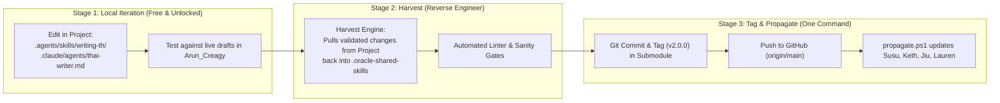

# Plan: "Harvest & Propagate" Shared Skills Architecture (Project-First / Outside-In)

**Author:** Antigravity & Boss  
**Date:** 2026-10-03  
**File:** `plans/2026-10-03_harvest-and-propagate-shared-skills-architecture.md`  
**Target:** `oracle-shared-skills` and Consumer Projects (`Arun_Creagy`, `Susu_Ocean`, `Keth-goverment-agent`, `Jiu-climate-risk-and-resilience`, `Lauren-data-architect`)  
**Status:** Proposal / Ready for Review  

---

## 1. Context & The Core Problem

### The Legacy "Inside-Out" (Submodule-First) Model
In the legacy architecture:
1. Skills were treated as strictly owned by the Submodule (`.oracle-shared-skills`).
2. Consuming projects copied skills into `.agents/skills/` and **marked every file `Read-Only`** (`$_.IsReadOnly = $true`) to prevent developers from making uncommitted local edits.
3. If an agent (such as **Google Antigravity** or **Codex**) wanted to iterate or improve a skill, it could not edit `.agents/skills/` (the folder it actually reads from!). It had to navigate around to `.oracle-shared-skills/skills/`, edit files there, and then run `sync-skills.ps1` to overwrite its own working files.
4. Developers and agents had to remember a confusing array of 6 scripts: `sync-skills.ps1`, `sync-agents.ps1`, `sync-global-agents.ps1`, `detect-drift.ps1`, `release.ps1`, and `propagate.ps1`.

### The Boss Directive: "Outside-In" (Project-First / Harvest Pattern)
> *"Can't we just edit in our project folder? When it works, we reverse engineer it back to oracle-shared-skills submodule and adjust propagate script to correctly install the new stuff?"*

Development naturally happens **where the work is**: in the active project (`Arun_Creagy`), against real data, real drafts, and real constraints. 

---

## 2. Architectural Blueprint: The Harvest & Propagate Model

Instead of forcing developers into the submodule, the workflow is inverted into a clean **3-Stage Lifecycle**:



---

## 3. Key Principles

### Principle 1: Eradicate `Read-Only` Locks
* Remove `$_.IsReadOnly = $true` from `sync-skills.ps1`.
* Files in `.agents/skills/` become normal, mutable project files.
* Antigravity and developers can immediately edit, fix bugs, and refine scripts without permission errors.

### Principle 2: The "Harvest" Action (Local $\rightarrow$ Submodule)
When a feature or fix works locally, a dedicated harvest routine copies the updated files from the host project back into `.oracle-shared-skills/`:
* Copies `.agents/skills/<name>/` $\rightarrow$ `.oracle-shared-skills/skills/<name>/`
* Copies updated agent personas $\rightarrow$ `.oracle-shared-skills/skills/writing-th/agents/`
* Filters out workspace junk (`.venv`, `__pycache__`, temporary draft files, `.DS_Store`).

### Principle 3: Single-Command Release Orchestration
Boss or the agent only ever needs to run **one command** to release to the entire Oracle fleet:

```powershell
pwsh -File .oracle-shared-skills\skills\shared-skill-release\scripts\propagate.ps1 `
    -HarvestFrom "C:\Users\sitth\OracleWorkspace\Arun_Creagy" `
    -Version "v2.0.0" `
    -Message "feat(writing-th): v2.0.0 unified multi-client thai-writer, node.js engine, and drafting-plan" `
    -Push
```

What `propagate.ps1` does under the hood:
1. **Harvests** all changed skill and agent files from `Arun_Creagy` into `.oracle-shared-skills/`.
2. **Runs test suite** (`run_tests.mjs`) to verify syntax and logic.
3. **Commits and Tags** the new version (`v2.0.0`) inside `.oracle-shared-skills` on branch `main`.
4. **Pushes** `main` and `--tags` to `origin` (GitHub).
5. **Commits Submodule Bump** in `Arun_Creagy` (`git add .oracle-shared-skills && git commit -m "bump oracle-shared-skills to v2.0.0"`).
6. **Iterates over all other consumers** in `consumers.json` (`Susu_Ocean`, `Keth`, `Jiu`, `Lauren`):
   - Runs `git fetch --tags && git checkout v2.0.0` in their `.oracle-shared-skills` submodule.
   - Commits the submodule bump in their parent repos.
   - Provisions their `.agents/skills/`, `.claude/agents/`, `.agents/agents/`, and `.codex/agents/`.
   - Purges any retired agent files (`th-argument-mapper`, `th-verbalizer`, `th-editorial-reviewer`).

---

## 4. Multi-Client Subagent Installation Mapping

When `propagate.ps1` installs or updates a consumer project, it places subagents into the exact documented discovery path for each AI client:

| Client Runtime | Subagent Location in Project | Format |
| :--- | :--- | :--- |
| **Claude Code** | `<project>/.claude/agents/thai-writer.md` | Markdown with YAML frontmatter |
| **Google Antigravity** | `<project>/.agents/agents/thai-writer.md` | Markdown with YAML frontmatter |
| **OpenAI Codex CLI** | `<project>/.codex/agents/thai-writer.toml` | TOML (`developer_instructions`, `model`, `sandbox_mode`) |

### Automated Housekeeping & Deletion of Retired Agents
The installer automatically scans the client agent directories and deletes legacy/retired profiles:
* `th-argument-mapper.md` $\rightarrow$ REMOVED
* `th-verbalizer.md` $\rightarrow$ REMOVED
* `th-editorial-reviewer.md` $\rightarrow$ REMOVED
* Legacy global agent scripts $\rightarrow$ REMOVED

---

## 5. Execution Steps for Current Session (`writing-th` v2)

Using this exact "Harvest & Propagate" model:

1. **Step 1 (Work in Project):**
   * Edit and build directly in `Arun_Creagy`:
     * Create zero-dependency Node.js scripts in `Arun_Creagy/.agents/skills/writing-th/scripts/` (`lint_thai_writing.mjs`, `check_draft_preconditions.mjs`, `post_draft_lint.mjs`).
     * Create `thai-writer.md` and `thai-writer.toml`.
     * Update `writing-th/SKILL.md` to the Dual-Lane & `drafting-plan.md` workflow.
   * Run the Node.js linter on `ψ/writing/2026-10-03_thai-writer-agent-profile-and-harness-analysis.md` to verify it passes 100%.

2. **Step 2 (Harvest & Upgrade Submodule):**
   * Copy the tested files from `Arun_Creagy` into `.oracle-shared-skills/`.
   * Update `propagate.ps1` to include the automated `-HarvestFrom` parameter and multi-client provisioning logic.
   * Remove legacy agent files from `.oracle-shared-skills/`.

3. **Step 3 (Release & Propagate to Fleet):**
   * Run `propagate.ps1 -HarvestFrom Arun_Creagy -Version v2.0.0 -Push`.
   * Verify all 5 consumer projects are synchronized and clean.
