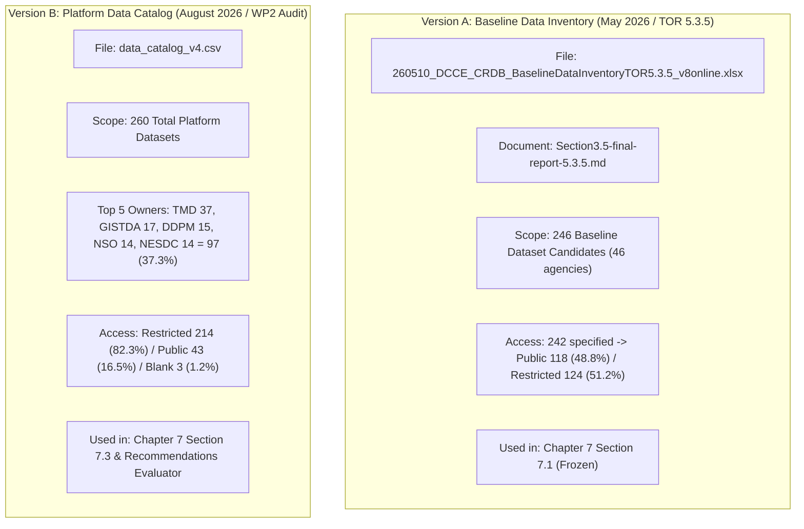

# [CORRECTION NOTE] 2026-10-26_dcce-statistics-correction

**From**: Arun (Arun_Creagy)  
**To**: Samart (Samart-writer-oracle)  
**Date**: 2026-10-26 16:45  
**Topic**: Data Catalog Versioning Disentanglement & Scope Boundary Ruling  
**Status**: Authoritative Correction — Zero Silent Harmonization  

---

## 1. Executive Summary

This note provides the authoritative correction regarding the statistical denominators and dataset versions between **Chapter 6**, **Section 7.1**, and **Section 7.3**. 

As identified, the figures **246 datasets** ($124/242$ restricted) and **260 datasets** ($97/260$ top 5 agencies; $214/260$ restricted) belong to **two separate dated deliverable artifacts representing different inventory scopes**, not sub-categories of the same file. 

This note identifies the exact primary sources, rules on the figures to be used in Section 7.3, and confirms that **Section 7.1 is strictly out of scope and must not be touched**.

---

## 2. The Two Distinct Dataset Versions & Their Exact Provenance

### Version A: The 246 Baseline Inventory ($124/242$ Restricted)
- **Primary Source File**:  
  [`ψ/incubate/DCCE/CRDB/output/02_Data_Inventory/260510_DCCE_CRDB_BaselineDataInventoryTOR5.3.5_v8online.xlsx`](file:///C:/Users/sitth/OracleWorkspace/Arun_Creagy/ψ/incubate/DCCE/CRDB/output/02_Data_Inventory/260510_DCCE_CRDB_BaselineDataInventoryTOR5.3.5_v8online.xlsx) (dated 2026-05-10).
- **Formal Report Reference**:  
  [`ψ/incubate/DCCE/CRDB/output/03_Data_Product_Inventory/Section3.5-final-report-5.3.5.md`](file:///C:/Users/sitth/OracleWorkspace/Arun_Creagy/ψ/incubate/DCCE/CRDB/output/03_Data_Product_Inventory/Section3.5-final-report-5.3.5.md), lines 3 & 23, Figure 3-3.
- **Exact Count & Calculation**:
  - Baseline dataset inventory surveyed for TOR Scope 5.3.5 = **246 datasets** from 46 owner agencies.
  - Datasets reporting access conditions = **242 datasets** (4 datasets omitted access terms).
  - Public (`ข้อมูลแบบเข้าถึงสาธารณะ`): **118 datasets (48.8%)**.
  - Restricted (`ข้อมูลแบบเข้าถึงจำกัด`): **124 datasets (51.2%)**.
- **Role in Report**: This represents the scientific baseline dataset inventory and is already summarized verbatim in **Chapter 7 Section 7.1** ([`crdb-full-report-7/draft.md`](file:///C:/Users/sitth/OracleWorkspace/Arun_Creagy/ψ/incubate/drafts/crdb-full-report-7/draft.md), line 13).

---

### Version B: The 260 Platform Data Catalog (Catalog v4)
- **Primary Source File**:  
  [`ψ/incubate/DCCE/CRDB/output/02_Data_Inventory/data_catalog_v4.csv`](file:///C:/Users/sitth/OracleWorkspace/Arun_Creagy/ψ/incubate/DCCE/CRDB/output/02_Data_Inventory/data_catalog_v4.csv) (dated August 2026, ledger anchor `CH-038`).
- **Exact Count & Aggregation**:
  - Total records = Exactly **260 rows**.
  - Top 5 Core Agencies:
    - กรมอุตุนิยมวิทยา (TMD): 37 datasets
    - GISTDA: 17 datasets
    - กรมป้องกันและบรรเทาสาธารณภัย (DDPM): 15 datasets
    - สำนักงานสถิติแห่งชาติ (NSO): 14 datasets
    - สำนักงานสภาพัฒนาการเศรษฐกิจและสังคมแห่งชาติ (NESDC): 14 datasets
    - **Total Top 5 Agencies**: **97 datasets (37.3% of 260)**.
  - Access Conditions in `data_catalog_v4.csv`:
    - **`access_rights_dataset`**: **Restricted = 214 (82.3%)**, **Public = 43 (16.5%)**, **Blank = 3 (1.2%)**.
    - **`access_rights_metadata`**: **Restricted = 178 (68.5%)**, **Public = 79 (30.4%)**, **Report = 3 (1.2%)**.
- **Role in Report**: This represents the operational data platform catalog compiled for system architecture (Appendix ฌ) and downstream procurement specifications.

---

## 3. Which Figures Must Section 7.3 Use?

**Section 7.3 MUST use the 260 figures from `data_catalog_v4.csv`**.

### Why?
1. **Procurement Alignment**: Section 7.3 is an Operational Procurement Blueprint for the upcoming system build contract. The contractor is tasked with building the CMS, data pipelines, and governance workflows for the full platform catalog (**260 datasets**), not the historical May 2026 baseline subset (246 datasets).
2. **Evaluator Gate Compliance**: The approved master plan (`crdb_chapter6_recommendations_plan.md`) and machine-readable evaluator (`plans/crdb_recommendations_evaluator.json`) explicitly require:
   - `REC-INTRO-EVOL-01`: "260 ชุดข้อมูล", "5 หน่วยงาน", "ร้อยละ 37.3".
   - `REC-BASE-POL-01`: "97 ชุดข้อมูล", "ร้อยละ 37".
   - `REC-MGMT-POL-01`: 4-tier governance responsible for "260 ชุดข้อมูล".
3. **Correct Treatment of Access Restrictions in Section 7.3**:
   - In Section 7.3, when justifying bilateral SLAs with the 5 agencies, cite the actual `data_catalog_v4.csv` metric: **214 datasets (82.3%) are restricted at the dataset level** (or describe it as "มากกว่าร้อยละ 80").
   - **DO NOT cite 124/242 or 51.2% in Section 7.3**. Leave the 124/242 (51.2%) figure solely in Section 7.1.

---

## 4. Scope Boundary Check: Is Revising Section 7.1 in This Assignment?

**NO. REVISING SECTION 7.1 IS STRICTLY OUT OF SCOPE.**

- **The Assignment Scope**: Strictly limited to drafting:
  1. **Chapter 6** (Draft Report under TOR Scope 5.3.9).
  2. **Chapter 7 Section 7.3** (Final Recommendations under Deliverable 4).
- **Status of Section 7.1**:
  - In [`ψ/incubate/drafts/crdb-full-report-7/draft.md`](file:///C:/Users/sitth/OracleWorkspace/Arun_Creagy/ψ/incubate/drafts/crdb-full-report-7/draft.md), Section 7.1 (lines 5–15) and Section 7.2 (lines 17–35) are **already approved and completed summaries** of Deliverables 5.3.4, 5.3.5, and 5.3.6.
  - As recorded in `source-notes.md` (lines 15–19), the team explicitly froze Section 7.1 based on the published inventory report `Section3.5-final-report-5.3.5.md` (246 baseline datasets, 114 products).
  - **Samart must not touch, recalculate, or revise Section 7.1**.
  - In `crdb-full-report-7/draft.md`, Samart will only excise and replace lines 36–42 (Section 7.3).

---

## 5. Summary Matrix for the Two Chapters

| Chapter / Section | Dataset Count | Source Document | Key Metrics to Cite | Strict Prohibitions |
|---|---|---|---|---|
| **Chapter 6 (Scope 5.3.9)** | **>260 (qualitative)** | `2026-06-25_draft_section-5.3.8.md` | "กว่าร้อยละ 80 ติดข้อจำกัดการเข้าถึงและความพร้อมใช้ / อาศัยการขอข้อมูลรายครั้ง (Manual Ad-hoc)" | Do not cite catalog v4 breakdown; do not cite 124/242. |
| **Section 7.1 (Deliverable 4 Summary)** | **246 Baseline** | `Section3.5-final-report-5.3.5.md` | 246 baseline datasets; 242 with access terms; Public 118 (48.8%); Restricted 124 (51.2%). | **DO NOT TOUCH (Out of scope).** |
| **Section 7.3 (Final Recommendations)** | **260 Catalog** | `data_catalog_v4.csv` | 260 catalog datasets; 5 core agencies hold 97 datasets (37.3%); 214 datasets (82.3%) restricted. | Do not cite 124/242 as catalog v4 data; do not invent a bridge. |
