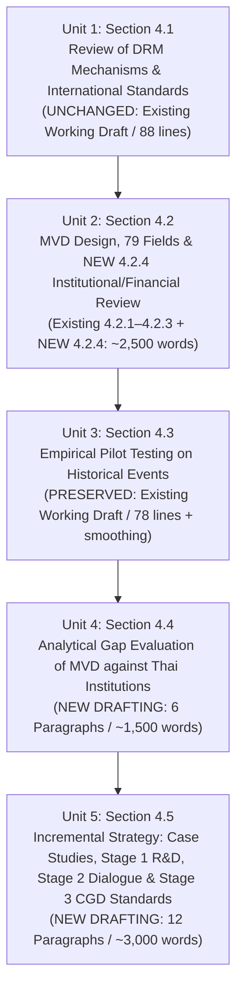

# Drafting Plan: CRDB Full Report Chapter 4 (Additive Drafting Strategy & Phased National Roadmap)

**Document Purpose**: Detailed, paragraph-by-paragraph drafting specification for generating and enhancing Chapter 4 in the CRDB Full Report. Governed by Boss's directive: **"Try to add, not alter the working paragraphs."** Retains working text in 4.1, 4.2, and 4.3 while adding Subsection 4.2.4, Section 4.4, and Section 4.5.

**Title**: บทที่ 4 การพัฒนากรอบและสถาปัตยกรรมข้อมูลความสูญเสียและความเสียหายจากภัยสภาพภูมิอากาศ (Loss and Damage Data Architecture and Implementation Strategy)  
**Contractual Scope**: TOR Scope §5.3.6 (Loss and Damage Data Architecture) & §5.3.7 (Pilot Validation and Implementation Roadmap)  
**Author Stance**: คณะที่ปรึกษา (Active subject; authoritative institutional advisory voice)  
**Tone & Vocabulary**: Formal institutional Thai, technically rigorous, highly actionable, policy-defensible. Grounded in verified empirical pilots, statutory provisions (Disaster Act B.E. 2550, Budget Procedure Act B.E. 2561, MOF Regulation 2562), and technical data schemas.

---

## Unit Breakdown & Execution Sequence

---

## Unit 1: Section 4.1 ระบบการรายงานสาธารณภัยของหน่วยงานที่เกี่ยวข้องเทียบกับมาตรฐานสากล (UNCHANGED)
*Preserves 100% of existing draft text in `ψ/incubate/drafts/crdb-full-report-4.1/draft.md`.*
- Paragraphs 1–2: 4.1.1 Thai DRM 4-Phase Mechanisms under Disaster Act B.E. 2550 and National DRM Plan.
- Paragraphs 3–4: 4.1.2 DDPM Data Collection Practices via *แบบรายงานเหตุด่วนสาธารณภัย* and the 4-phase DaNA/PDNA framework.
- Paragraphs 5–6: 4.1.3 International Standards: DesInventar national inventories and ECLAC DaLA separation of damage vs. loss.

---

## Unit 2: Section 4.2 ร่างมาตรฐานชุดข้อมูลขั้นต่ำ และร่างแบบฟอร์มการรายงานความสูญเสียและความเสียหาย (ADDITIVE ENHANCEMENT)
*Preserves 100% of existing text in Subsections 4.2.1 (Design Principles), 4.2.2 (6 Tables), and 4.2.3 (Data Dictionary) in `ψ/incubate/drafts/crdb-full-report-4.2/draft.md`, adding new Subsection 4.2.4.*

### New Addition: Subsection 4.2.4 การทบทวนกระบวนการเชิงสถาบัน กฎหมาย และสายธารการเงินการคลังในการช่วยเหลือภัยพิบัติของประเทศไทย (Review of Thai Institutional, Legal, Reporting Processes & Public Relief Financial Flows)

- **Target Size**: 8 Paragraphs (~2,500 words).

#### Paragraph Blueprints for Subsection 4.2.4:

1. **Paragraph 4.2.4.1: Statutory Command Line & Reporting Hierarchy (Disaster Act §20–22)**:
   - *Claim*: โครงสร้างการรายงานข้อมูลภัยพิบัติของประเทศไทยผูกติดอยู่กับสายการบังคับบัญชาตาม พ.ร.บ. ป้องกันและบรรเทาสาธารณภัย พ.ศ. 2550 โดยมีเป้าหมายเพื่อการสั่งการเผชิญเหตุและการบรรเทาทุกข์เร่งด่วน มิใช่การบันทึกบัญชีความสูญเสียทางเศรษฐกิจ
   - *Grounds*: สายการบังคับบัญชาไหลผ่านกรมการปกครอง (DOPA) โดยนายอำเภอทำหน้าที่ผู้อำนวยการอำเภอ และผู้ว่าราชการจังหวัดทำหน้าที่ผู้อำนวยการจังหวัดและประธาน ก.ช.ภ.จ. ขณะที่องค์กรปกครองส่วนท้องถิ่น (อปท.) มีความเป็นอิสระตาม พ.ร.บ. กระจายอำนาจฯ โดยผู้บริหารท้องถิ่นทำหน้าที่ผู้อำนวยการท้องถิ่นในการส่งแบบรายงานเหตุด่วนฯ ส่วนกรมส่งเสริมการปกครองท้องถิ่น (สถ.) มิใช่หน่วยงานบังคับบัญชา แต่เป็นผู้สนับสนุนมาตรฐานการเงิน
   - *Warrant*: การรายงานเหตุด่วนจึงเน้นความเร็วในการแจ้งจำนวนผู้ประสบภัยและยอดความเสียหายเบื้องต้นเพื่อระดมทรัพยากรช่วยชีวิต ทำให้ตัวเลขที่ได้เป็นเพียงสถิติเชิงปริมาณหยาบ
   - *So-What*: อธิบายว่าเหตุใดรายงานเหตุด่วนของ ปภ. จึงขาดมิติด้านมูลค่าทางเศรษฐกิจตั้งแต่ระดับการออกแบบระบบ

2. **Paragraph 4.2.4.2: The Legal Instrument of Relief - Provincial Governor Decrees (`ประกาศเขตการให้ความช่วยเหลือฯ`)**:
   - *Claim*: งบประมาณช่วยเหลือเยียวยาภัยพิบัติภาครัฐมิได้ถูกปลดล็อกด้วยรหัสเหตุการณ์ภัย แต่ต้องอาศัยตราสารทางกฎหมายปกครอง คือ "ประกาศเขตการให้ความช่วยเหลือผู้ประสบภัยพิบัติกรณีฉุกเฉิน"
   - *Grounds*: คณะกรรมการ ก.ช.ภ.จ. ประชุมกลั่นกรองและเสนอให้ผู้ว่าราชการจังหวัดลงนามในประกาศเขตฯ ซึ่งระบุอำเภอ ตำบล วันที่เกิดภัย และกรอบวงเงินที่ขอรับความช่วยเหลือ
   - *Warrant*: ประกาศเขตฯ คือเงื่อนไขทางกฎหมายเดียวที่อนุญาตให้ส่วนราชการเบิกจ่ายเงินทดรองราชการหรือขอรับงบกลางได้ตามระเบียบกระทรวงการคลังฯ
   - *So-What*: สร้างความเข้าใจว่าการผูกโยงการเงินการคลังต้องยึดโยงกับประกาศเขตฯ เป็นสะพานหลัก

3. **Paragraph 4.2.4.3: The Decree vs. Event Cardinality Paradox ($M:N$)**:
   - *Claim*: ความสัมพันธ์ระหว่างเหตุการณ์ภัยทางอุตุนิยมวิทยากับประกาศเขตภัยพิบัติทางกฎหมายมีความสัมพันธ์แบบกลุ่มต่อกลุ่ม (Many-to-Many: $M:N$)
   - *Grounds*: ประกาศเขตฯ 1 ฉบับสามารถครอบคลุมเหตุการณ์ย่อยหลายระลอกในพื้นที่ (1:$M$) ขณะที่พายุขนาดใหญ่ 1 ลูกที่พาดผ่านหลายจังหวัดก่อให้เกิดประกาศเขตฯ ประจำจังหวัดหลายสิบฉบับ ($M$:1)
   - *Warrant*: การพยายามสร้างกุญแจต่างด้าว (Foreign Key) เชื่อมโยงตรงแบบ 1:1 ระหว่างใบเบิกจ่ายงบประมาณกับรหัสเหตุการณ์จึงล้มเหลวในเชิงโครงสร้าง
   - *So-What*: กำหนดให้สถาปัตยกรรม CRDB ต้องสร้างตารางสะพานเชื่อมโยง `EVENT_DECREE_BRIDGE` ขึ้นมาบริหารจัดการความสัมพันธ์

4. **Paragraph 4.2.4.4: Multi-Stream Public Relief Landscape - Provincial Advance Payments**:
   - *Claim*: เงินทดรองราชการในอำนาจผู้ว่าราชการจังหวัด (20 ล้านบาท) มีข้อจำกัดทางเทคนิคในการเชื่อมโยงข้อมูลในระบบ New GFMIS Thai
   - *Grounds*: เบิกจ่ายผ่านคำสั่ง `ZFB60_K2` (ขบ.03) และล้างเงินยืมผ่าน `ZF_53_PM` (ขจ.05) ภายใต้แหล่งเงิน `YY24000` และบัญชี GL `1106010106` ซึ่งช่อง Assignment มีขนาดเพียง 16 ตัวอักษรและไม่มีการเชื่อมโยง API ไปยังฐานข้อมูล ปภ.
   - *Warrant*: เจ้าหน้าที่การเงินพิมพ์ข้อความอิสระ ทำให้เกิดความคลาดเคลื่อนสูงหากหวังให้พิมพ์รหัสเหตุการณ์ด้วยมือ
   - *So-What*: วางแนวทางแก้ปัญหาด้วยการฉีดรหัส Master Event Key และ Decree Reference เข้าสู่ระบบอนุมัติต้นทางก่อนส่งออกข้อมูลเข้าสู่ GFMIS

5. **Paragraph 4.2.4.5: Multi-Stream Public Relief Landscape - Cabinet Central Emergency Reserve (`งบกลาง`)**:
   - *Claim*: งบกลางเงินสำรองจ่ายเพื่อกรณีฉุกเฉินหรือจำเป็นตาม พ.ร.บ. วิธีการงบประมาณ พ.ศ. 2561 มาตรา 45 เป็นสายธารงบประมาณที่ใหญ่ที่สุดในภัยพิบัติรุนแรง และมีกลไกการจ่ายตรงผ่านระบบพร้อมเพย์
   - *Grounds*: มติ ครม. อนุมัติงบกลางนับพันล้านบาทให้กระทรวงมหาดไทย (ปภ.) ดำเนินการจ่ายเงินช่วยเหลือผู้ประสบอุทกภัยครัวเรือนละ 5,000–9,000 บาท โอนตรงเข้าบัญชีพร้อมเพย์ของประชาชนผ่านธนาคารรัฐ โดยอ้างอิงรายชื่อที่ผ่านการรับรองจาก ก.ช.ภ.จ. และผูกกับประกาศเขตฯ
   - *Warrant*: สายธารงบกลางนี้สามารถตรวจสอบย้อนกลับได้แม่นยำที่สุดผ่านมติ ครม. และรหัสประกาศเขตฯ
   - *So-What*: กลายเป็นแกนกลางหลักในการผูกโยงข้อมูลการคลังเข้ากับระบบ CRDB

6. **Paragraph 4.2.4.6: Ministry Advances, Local Own Reserves & Exclusion of Preventive Contingency**:
   - *Claim*: การจำแนกสายธารงบประมาณต้องครอบคลุมเงินทดรองระดับกระทรวง (กษ.) และงบกลางของ อปท. ในระบบ `e-LAAS` พร้อมทั้งตัดงบป้องกันและยับยั้ง 10 ล้านบาทออกจากการคำนวณ
   - *Grounds*: งบป้องกันฯ ตามข้อ 18/1 แห่งระเบียบ กค. 2562 เป็นค่าใช้จ่ายดำเนินงานก่อนเกิดภัย (ขุดลอกคลอง, น้ำมันเครื่องสูบน้ำ) จึงมิใช่ความสูญเสียหลังภัย
   - *Warrant*: การตัดงบป้องกันออกช่วยรักษาความถูกต้องของนิยามความสูญเสีย
   - *So-What*: สร้างความชัดเจนในการคำนวณยอดเงินเยียวยาภาครัฐรวม

7. **Paragraph 4.2.4.7: The SAO Compliance Audit Fear & The "Zero-Monetary-Valuation at Local Level" Rule**:
   - *Claim*: ภาวะหวาดกลัวการตรวจสอบของสำนักงานการตรวจเงินแผ่นดิน (สตง.) ทำให้เจ้าหน้าที่ระดับพื้นที่ปฏิเสธการประเมินมูลค่าความเสียหายตามราคาตลาด
   - *Grounds*: ช่างโยธา อบต. เผชิญความเสี่ยงทางวินัยและความรับผิดทางละเมิด หากลงบันทึกราคาความเสียหายบ้าน 2 ล้านบาท ขณะที่ระเบียบจ่ายเยียวยาได้ตามเพดานสงเคราะห์เพียง 49,500 บาท สตง. จะตรวจสอบเอกสารวิศวกรรมอย่างเข้มงวด
   - *Warrant*: เจ้าหน้าที่จึงเลือกบันทึกเฉพาะตัวเลขที่เข้าเกณฑ์เพดานเยียวยา
   - *So-What*: กำหนดเป็นกฎเหล็กว่า **"ระดับพื้นที่บันทึกเฉพาะหน่วยนับทางกายภาพ (วัสดุ, ตร.ม., วัน) ส่วนการตีมูลค่าเป็นตัวเงินต้องดำเนินการที่ส่วนกลาง"**

8. **Paragraph 4.2.4.8: The Sovereign DCCE Platform Boundary & Tier-1 Core Triage (23 Fields)**:
   - *Claim*: สถาปัตยกรรม MVD ถูกกำหนดให้ทำงานอยู่ภายในระบบ CRDB ของ กรม สส. ในฐานะผู้บูรณาการข้อมูลระดับชาติ (National Integrator) โดยคัดกรองเหลือชุดข้อมูลแกนหลัก Tier 1 จำนวน 23 เขตข้อมูล
   - *Grounds*: กรม สส. ไม่สามารถบังคับให้กรมบัญชีกลางหรือกระทรวงอื่นปรับแก้ระบบฐานข้อมูลของตนเองได้ จึงต้องสร้างระบบดูดซับข้อมูล (Ingestion) เข้ามาประมวลผลภายใน CRDB
   - *Warrant*: การจำกัดข้อมูลภาคบังคับไว้ที่ 23 เขตข้อมูลภายใต้กฎ Zero-New-Survey ทำให้ระบบเริ่มต้นทำงานได้ทันที
   - *So-What*: ส่งมอบระบบบัญชีเหตุการณ์ภัยและการใช้จ่ายภาครัฐในระยะที่ 1 อย่างเป็นรูปธรรม

---

## Unit 3: Section 4.3 การทดลองรวบรวมข้อมูลตามร่างมาตรฐานชุดข้อมูลขั้นต่ำจากเหตุการณ์ในอดีต (PRESERVED WORKING PARAGRAPHS)
*Preserves 100% of existing draft text in `ψ/incubate/drafts/crdb-full-report-4.3/draft.md`, adding minimal smoothing transitions.*
- Paragraphs 4.3.1–4.3.2: วัตถุประสงค์ ระเบียบวิธี ชุดข้อมูลอ้างอิง และเกณฑ์ประเมินความพร้อม (Directly Available, Retrievable, Currently Unavailable).
- Paragraphs 4.3.3: ผลการจับคู่สถิติ 3 เหตุการณ์นำร่อง:
  - กรณี 1 อุทกภัยพิจิตร (2557): มีข้อมูล 31 เขตข้อมูล ขาด 48 เขตข้อมูล (ร้อยละ 60.8)
  - กรณี 2 ภัยแล้งศรีสะเกษ (2557): มีข้อมูล 22 เขตข้อมูล ขาด 57 เขตข้อมูล (ร้อยละ 72.2)
  - กรณี 3 วาตภัยลำปาง (2559): มีข้อมูล 27 เขตข้อมูล ขาด 52 เขตข้อมูล (ร้อยละ 65.8)
- Minimal Transition Sentence added at end of 4.3 to lead into Section 4.4.

---

## Unit 4: Section 4.4 การวิเคราะห์ช่องว่างระหว่างร่างมาตรฐาน MVD กับบริบทเชิงสถาบันของไทย (NEW DRAFTING)
- **Target Size**: 6 Paragraphs (~1,500 words).

#### Paragraph Blueprints for Section 4.4:

9. **Paragraph 4.4.1: Synthesis of Empirical Testing & Institutional Grounding**:
   - *Claim*: อัตราข้อมูลสูญหายร้อยละ 60.8 ถึง 72.2 ที่พบในการทดสอบนำร่องในหัวข้อ 4.3 สามารถอธิบายได้อย่างเป็นวิทยาศาสตร์ผ่านการวิเคราะห์บริบทเชิงสถาบันในหัวข้อ 4.2.4
   - *Grounds*: การที่เขตข้อมูลส่วนใหญ่ตกอยู่ในสถานะค่าว่าง มิได้เกิดจากความบกพร่องในการกรอกข้อมูลของเจ้าหน้าที่รายบุคคล แต่เป็นผลลัพธ์โดยตรงจากความขัดแย้งเชิงโครงสร้างระหว่างความต้องการข้อมูลแบบจำลอง MVD กับข้อจำกัดทางกฎหมายและระบบงานราชการไทย
   - *Warrant*: การออกแบบระบบข้อมูลที่ไม่คำนึงถึงบริบทสถาบันจะนำไปสู่ความล้มเหลวในการปฏิบัติการเสมอ
   - *So-What*: กำหนดกรอบการวิเคราะห์เจาะลึก 3 ช่องว่างหลักในหัวข้อถัดไป

10. **Paragraph 4.4.2: Gap 1 - The Financial System Disconnect (GFMIS General Ledger vs. Event Keys)**:
    - *Claim*: ความล้มเหลวในการดึงตัวเลขงบประมาณเยียวยาในทั้ง 3 เหตุการณ์นำร่องเกิดจากโครงสร้างของระบบ New GFMIS Thai ที่ทำหน้าที่เป็นสมุดบัญชีแยกประเภททั่วไป มิใช่ระบบติดตามภัย
    - *Grounds*: การบันทึกงบเยียวยาถูกรวมยอดเป็นรายปีและรายจังหวัดในบัญชี GL `1106010106` โดยไม่มีการผูก Foreign Key ไปยัง Incident ID ของ ปภ.
    - *Warrant*: ทำให้ในกรณีอุทกภัยพิจิตรและวาตภัยลำปาง ไม่สามารถทราบได้ว่างบประมาณที่จังหวัดเบิกจ่าย เป็นของเหตุการณ์ใด
    - *So-What*: ตอกย้ำความจำเป็นในการใช้ตาราง `EVENT_DECREE_BRIDGE` ของ กรม สส. มาทำหน้าที่จับคู่เชิงพื้นที่และเวลา

11. **Paragraph 4.4.3: Gap 2 - The Audit-Constrained Valuation Void (SAO Fear & Statutory Ceilings)**:
    - *Claim*: การขาดหายไปของข้อมูลมูลค่าความเสียหายทางกายภาพ (`LD_PHYSICAL_DAMAGE`) และความสูญเสียทางเศรษฐกิจ (`LD_ECONOMIC_LOSS`) ในทั้ง 3 เหตุการณ์ เป็นผลมาจากเพดานเงินเยียวยาและความหวาดกลัวการตรวจสอบของ สตง.
    - *Grounds*: เกณฑ์เงินทดรองราชการฯ ชดเชยบ้านเสียหายบางส่วนไม่เกิน 49,500 บาท และชดเชยนาข้าว 1,340 บาท/ไร่ ทำให้เจ้าหน้าที่ท้องถิ่นไม่มีแรงจูงใจในการประเมินมูลค่าทรัพย์สินตามราคาตลาดจริง เพราะอาจถูก สตง. ท้วงติงเรื่องเกณฑ์ราคา
    - *Warrant*: ผลการวิจัยของ PIER ธปท. ยืนยันว่างบเยียวยาครอบคลุมความเสียหายจริงไม่ถึงร้อยละ 30 การใช้ยอดเงินเยียวยาจึงเป็นการประเมินต่ำกว่าจริงอย่างรุนแรง
    - *So-What*: ชี้ให้เห็นว่าระบบต้องไม่พึ่งพาตัวเลขมูลค่าเป็นตัวเงินจากเจ้าหน้าที่พื้นที่ แต่ต้องนำเข้าหน่วยนับทางกายภาพมาคำนวณผ่านราคากลางที่ส่วนกลาง

12. **Paragraph 4.4.4: Gap 3 - The Frontline DRM Manpower Crisis**:
    - *Claim*: ภาวะขาดแคลนบุคลากรด้านภัยพิบัติในระดับพื้นที่เป็นข้อจำกัดเชิงกายภาพที่ทำให้การสำรวจ 79 เขตข้อมูลเป็นไปไม่ได้
    - *Grounds*: สำนักงาน ปภ. จังหวัด มีบุคลากรฝ่ายปฏิบัติการเฉลี่ย 5–8 คน และ อบต. ส่วนใหญ่มีช่างโยธาเพียง 1 คน ซึ่งมีภารกิจหลักในการแจกจ่ายน้ำดื่มและเผชิญเหตุเฉพาะหน้า
    - *Warrant*: การบังคับให้กรอกแบบฟอร์ม DaLA/PDNA 79 เขตข้อมูลในช่วงวิกฤตจึงสร้างแรงต้านและนำไปสู่การละเลยการกรอกข้อมูล
    - *So-What*: พิสูจน์ว่าระบบจำเป็นต้องใช้ข้อมูลทุติยภูมิและภาพถ่ายดาวเทียมมาทดแทนการเดินสำรวจภาคสนาม

13. **Paragraph 4.4.5: Gap 4 - The Missing Event Boundary Paradox (Blank End Dates)**:
    - *Claim*: การขาดหายของเขตข้อมูล `end_date` ในกรณีวาตภัยลำปาง สะท้อนปัญหาเรคคอร์ดกำพร้าจากกระบวนงานที่ไม่บังคับบันทึกเวลาปิดเหตุการณ์
    - *Grounds*: เจ้าหน้าที่มุ่งจัดการจ่ายเงินเยียวยาจนเสร็จสิ้น แต่ไม่ได้กลับมาอัปเดตระบบ CMS เพื่อปิดสถานะเหตุการณ์
    - *Warrant*: ส่งผลให้ไม่สามารถคำนวณระยะเวลาภัย (`event_duration_days`) ได้อย่างถูกต้อง
    - *So-What*: นำไปสู่การวางระบบตรวจวัดจากดาวเทียมและเรดาร์น้ำฝน (Automated QA Gate) มาทำหน้าที่ปิดเหตุการณ์อัตโนมัติ

14. **Paragraph 4.4.6: Section Synthesis & Strategic Imperatives for Chapter 4.5**:
    - *Claim*: การวิเคราะห์ช่องว่างทั้ง 4 ประการนำไปสู่ข้อสรุปว่า การพัฒนาระบบ Loss & Damage ต้องเปลี่ยนผ่านจากการบังคับสำรวจภาคสนาม ไปสู่ยุทธศาสตร์แบบบันไดก้าวหน้าที่ขับเคลื่อนด้วยข้อมูลทุติยภูมิและการยกระดับมาตรฐานข้อมูลของประเทศ
    - *Grounds*: ข้อจำกัดด้านบุคลากร งบประมาณ และกฎหมายปกครอง บังคับให้ กรม สส. ต้องเริ่มจากจุดที่เป็นไปได้จริงและขยายผลอย่างมีขั้นตอน
    - *Warrant*: เป็นสะพานเชื่อมโยงเชิงตรรกะไปสู่ข้อเสนอแนะเชิงยุทธศาสตร์ในหัวข้อ 4.5
    - *So-What*: ปิดท้ายหัวข้อ 4.4 อย่างมีพลังและส่งต่อเข้าสู่หัวข้อ 4.5

---

## Unit 5: Section 4.5 ยุทธศาสตร์และแผนที่นำทางแบบบันไดก้าวหน้าสู่มาตรฐานระดับชาติ (NEW DRAFTING)
- **Target Size**: 12 Paragraphs (~3,000 words).

#### Paragraph Blueprints for Section 4.5:

15. **Paragraph 4.5.1: Summary of Researched Benchmark Case Studies (Secondary Data Augmentation)**:
    - *Claim*: การใช้ข้อมูลทุติยภูมิและภาพถ่ายดาวเทียมเพื่อเติมเต็มข้อมูลความสูญเสียและความเสียหายภายใต้ข้อจำกัดด้านกำลังพล มีตัวอย่างความสำเร็จที่พิสูจน์แล้วทั้งในระดับชาติและระดับภูมิภาค
    - *Grounds*: สังเคราะห์บทเรียนจาก 3 โครงการต้นแบบ: (1) โครงการของ ธปท. (PIER) ร่วมกับ GISTDA/กสก./ธ.ก.ส. ในการซ้อนทับภาพถ่ายเรดาร์กับทะเบียนเกษตรกร (2) โครงการ RIICE ในภูมิภาคเอเชียตะวันออกเฉียงใต้ที่ใช้ Sentinel-1 SAR ร่วมกับแบบจำลอง ORYZA จนลดเวลาประเมินในเวียดนามจาก 6 เดือนเหลือ 15 วัน และ (3) ระเบียบวิธี GRADE ของธนาคารโลกใน 66 ภัยพิบัติทั่วโลกที่มีความแม่นยำร้อยละ 88–90
    - *Warrant*: กรณีศึกษาทั้งสามยืนยันว่าการใช้ข้อมูลทุติยภูมิผสานกับภาพถ่ายดาวเทียมเป็นแนวทางสากลที่ใช้งานได้จริงในระบบราชการ
    - *So-What*: สร้างความมั่นใจทางวิชาการและนโยบายให้แก่ กรม สส. ในการเลือกใช้แนวทางนี้

16. **Paragraph 4.5.2: Analytical Approach 1 - Automated Agricultural Damage QA & Valuation Engine**:
    - *Claim*: แนวทางที่ 1 ด้านเกษตรกรรมใช้การผสานข้อมูลภาพถ่ายดาวเทียม Sentinel-1 SAR ของ GISTDA เข้ากับทะเบียนเกษตรกรของ กสก. และราคาผลผลิตของ สศก.
    - *Grounds*: วางสูตรคำนวณทางคณิตศาสตร์และสัมประสิทธิ์ความเสียหายตามระยะเวลาน้ำท่วมขัง ($V_{crop}(D_{flood})$) ที่รัดกุม
    - *Warrant*: ทำหน้าที่เป็นเกณฑ์ตรวจสอบอัตโนมัติ (Automated QA Gate) ช่วยตรวจทานคำขอรับเงินเยียวยาของพื้นที่ และประเมินมูลค่าความสูญเสียผลผลิตได้โดยไม่ต้องลงสำรวจแปลง
    - *So-What*: ส่งมอบตัวเลข Tier 2 สำหรับรายงาน A-BTR ได้อย่างแม่นยำ

17. **Paragraph 4.5.3: Analytical Approach 2 - Desk-Based Rapid Damage Estimation (World Bank GRADE Adaptation)**:
    - *Claim*: แนวทางที่ 2 ด้านสิ่งปลูกสร้างใช้การจำลองความเสียหายอย่างรวดเร็วบนโต๊ะทำงานตามแนวทาง GRADE ของธนาคารโลก
    - *Grounds*: นำขอบเขตพื้นที่ประสบภัยจาก GISTDA/อม. ซ้อนทับกับจำนวนครัวเรือนจากกรมการปกครอง รูปแบบอาคารจากกรมโยธาธิการฯ และราคากลางค่าก่อสร้างของกรมบัญชีกลาง
    - *Warrant*: ได้รับการพิสูจน์แล้วว่ามีความคลาดเคลื่อนเพียง $\pm 10–12\%$ เมื่อเทียบกับ PDNA เต็มรูปแบบ
    - *So-What*: ให้ตัวเลขความเสียหายทางกายภาพของสิ่งปลูกสร้างได้ภายใน 10–14 วันหลังเกิดภัยเพื่อเสนอ ครม.

18. **Paragraph 4.5.4: Remote Sensing Policy Stance (Option 2 - QA Gate & Lower-Bound Fill)**:
    - *Claim*: วางตำแหน่งข้อมูลดาวเทียมเป็นเกณฑ์ตรวจสอบอัตโนมัติและข้อมูลฐานขั้นต่ำ (Lower-Bound) โดยไม่ทดแทนกลไกเอกสารราชการในการจ่ายเงินชดเชย
    - *Grounds*: เพื่อเคารพกระบวนการทางกฎหมายและรองรับการตรวจสอบภายในของ กรม สส.
    - *Warrant*: รายงานจากพื้นที่ยังคงเป็นเอกสารหลักในการเบิกจ่ายตามระเบียบกระทรวงการคลัง แต่ดาวเทียมช่วยเสริมความสมบูรณ์ของสถิติประเทศ
    - *So-What*: สร้างความสมดุลระหว่างความก้าวหน้าทางเทคโนโลยีกับหลักกฎหมายปกครอง

19. **Paragraph 4.5.5: The 3-Stage Evolutionary Roadmap Philosophy**:
    - *Claim*: คณะที่ปรึกษาวางกรอบการขับเคลื่อนมาตรฐานข้อมูลออกเป็น 3 ระยะที่สอดคล้องกับขีดความสามารถที่แท้จริงของ กรม สส.
    - *Grounds*: กรม สส. เป็นหน่วยงานที่เพิ่งจัดตั้งขึ้นใหม่ การคาดหวังให้ขับเคลื่อนระบบใหญ่ที่มีความซับซ้อนข้ามกระทรวงได้ทันทีเป็นแนวทางที่ไม่สมจริงในทางปฏิบัติ
    - *Warrant*: จึงต้องแบ่งพัฒนาการเป็น 3 ระยะ: ระยะที่ 1 วางฐานและวิจัยระเบียบวิธี, ระยะที่ 2 สานพลังกระทรวงรายสาขาบนฐานงานวิจัยที่ชัดเจน, และระยะที่ 3 สถาปนามาตรฐานข้อมูลระดับชาติ
    - *So-What*: สร้างความเชื่อมั่นแก่ผู้บริหารและหน่วยงานร่วมว่าแผนงานนี้ทำได้จริง

20. **Paragraph 4.5.6: Stage 1 - Immediate Core Agency Engagement (GISTDA, NESDC, DDPM, DLA)**:
    - *Claim*: ในระยะเริ่มต้น (ปีที่ 1) กรม สส. ต้องมุ่งเน้นการทำงานร่วมกับ 4 หน่วยงานแกนกลางเฉพาะหน้าเพื่อยกระดับคุณภาพข้อมูลที่มีอยู่เดิม
    - *Grounds*: จับมือกับ ปภ. (ปรับปรุงแบบรายงานเหตุด่วนและแก้วันสิ้นสุดภัย), สถ. (ทำความเข้าใจระบบ e-LAAS และวางเทมเพลตนับหน่วยทางกายภาพ), GISTDA (เชื่อมโยงขอบเขตน้ำท่วมดาวเทียม), และ สศช. (วางนิยามการประเมินมูลค่าทางเศรษฐกิจ)
    - *Warrant*: การจำกัดวงพันธมิตรไว้ที่ 4 หน่วยงานที่มีความจำเป็นเร่งด่วนช่วยให้การประสานงานมีความคล่องตัวและเกิดผลลัพธ์ที่เป็นรูปธรรม
    - *So-What*: ปรับปรุงสายธารข้อมูลภัยพิบัติเดิมให้มีคุณภาพสูงขึ้นโดยไม่ต้องรื้อระบบราชการ

21. **Paragraph 4.5.7: Stage 1 - Targeted R&D Investments in Methodologies**:
    - *Claim*: ควบคู่กับการประสานงาน กรม สส. ต้องจัดสรรงบประมาณเพื่อลงทุนวิจัยและพัฒนาระเบียบวิธีประเมิน Loss & Damage และระเบียบวิธีดาวเทียมอย่างเป็นระบบ
    - *Grounds*: วิจัยร่วมกับมหาวิทยาลัยและสถาบันวิจัยใน 2 ด้าน: (1) ระเบียบวิธีทางเศรษฐศาสตร์และการคำนวณความสูญเสียจากสภาพภูมิอากาศที่สอดคล้องกับบริบทไทย และ (2) การปรับเทียบเส้นโค้งความเปราะบางของพืชผลและอาคารสิ่งปลูกสร้างจากการตรวจวัดระยะไกล
    - *Warrant*: การมีระเบียบวิธีที่ผ่านการพิสูจน์ทางวิชาการและยอมรับร่วมกันเป็นหัวใจสำคัญในการสร้างความชอบธรรมให้แก่ตัวเลขความสูญเสียของประเทศ
    - *So-What*: สร้าง "ทรัพย์สินทางปัญญาและเครื่องมือทางวิชาการ" ที่พร้อมใช้สำหรับการเจรจาระหว่างกระทรวงในระยะถัดไป

22. **Paragraph 4.5.8: Stage 1 - Deliverables & Sovereign Ingestion Prototype in CRDB**:
    - *Claim*: ผลผลิตสำคัญของระยะที่ 1 คือรายงานระเบียบวิธีที่ผ่านการรับรอง และระบบต้นแบบการรับข้อมูลเชิงเหตุการณ์และประกาศเขตภัยใน CRDB
    - *Grounds*: พัฒนาฐานข้อมูลภายในรองรับตาราง Tier 1 (23 เขตข้อมูล) และตาราง `EVENT_DECREE_BRIDGE` โดย กรม สส. ทำหน้าที่เป็นผู้บูรณาการข้อมูลเบื้องหลัง
    - *Warrant*: พิสูจน์แนวคิด (Proof of Concept) ว่าสามารถจัดทำบัญชีเหตุการณ์ภัยและความสูญเสียเบื้องต้นของประเทศได้จริง
    - *So-What*: เตรียมความพร้อมเชิงประจักษ์สำหรับก้าวสู่ระยะที่ 2

23. **Paragraph 4.5.9: Stage 2 - Evidence-Driven Engagement with Relevant Sector Ministries**:
    - *Claim*: ในระยะกลาง (ปีที่ 2) กรม สส. ขยายการเจรจาไปยังกระทรวงเจ้าของข้อมูลรายสาขาบนฐานของผลการวิจัยและระบบต้นแบบที่พิสูจน์แล้ว
    - *Grounds*: เปิดการเจรจาทวิภาคีกับกระทรวงเกษตรฯ (กสก./สศก.), กระทรวงคมนาคม (ทางหลวง/ทางหลวงชนบท), กระทรวงสาธารณสุข, และกระทรวงมหาดไทย (กรมการปกครอง) โดยนำตัวเลขและโมเดลจากระยะที่ 1 ไปแสดงให้เห็นประโยชน์ร่วม
    - *Warrant*: การเจรจาบนฐานหลักฐานเชิงประจักษ์ (Evidence-based Dialogue) ดีกว่าการผลักดันมาตรฐานใหม่ลอยๆ โดยไม่มีของจริงไปแสดง
    - *So-What*: ลดแรงต้านทานจากหน่วยงานเจ้าสังกัดและสร้างความร่วมมือในการแลกเปลี่ยนข้อมูล

24. **Paragraph 4.5.10: Stage 2 - Reciprocal Service Value & Central Administrative Levers**:
    - *Claim*: การสร้างความยั่งยืนของท่อส่งข้อมูลต้องผูกโยงเข้ากับคานงัดการบริหารราชการส่วนกลางและการส่งมอบคุณค่าแลกเปลี่ยน
    - *Grounds*: กรม สส. ส่งมอบข้อมูลฉายภาพความเสี่ยงภูมิอากาศเชิงพื้นที่ฟรีแก่กระทรวงสาขา พร้อมทั้งผลักดันตัวชี้วัดร่วม (Joint KPIs) ร่วมกับสำนักงาน ก.พ.ร. และขอรับรองระบบ CRDB จากมติ ครม.
    - *Warrant*: เปลี่ยนการขอข้อมูลแบบสงเคราะห์ ให้เป็น "ข้อตกลงแลกเปลี่ยนคุณค่าที่ส่งผลต่อคะแนนประเมินของผู้บริหาร"
    - *So-What*: ปลดล็อกข้อจำกัดทางกฎหมายเรื่องการบังคับส่งข้อมูลระหว่างหน่วยงานรัฐที่มีศักดิ์เท่ากัน

25. **Paragraph 4.5.11: Stage 3 - National Institutional Integration into Core Systems (CGD & Line Agencies)**:
    - *Claim*: เป้าหมายสูงสุดในระยะยาว (ปีที่ 3 เป็นต้นไป) คือการผลักดันให้เขตข้อมูลมาตรฐาน Loss & Damage ได้รับการบูรณาการเข้าสู่ระบบแกนหลักของประเทศอย่างถาวร
    - *Grounds*: ผลักดันการผนวก Master Event Key และ Decree Reference เข้าสู่ระบบ New GFMIS Thai ของกรมบัญชีกลาง, ผนวกเขตข้อมูลการตรวจนับความเสียหายเข้าสู่ระบบ `e-LAAS` ของ อปท., และเชื่อมต่อ API ถาวรกับทะเบียนเกษตรกรและทะเบียนสินทรัพย์คมนาคม
    - *Warrant*: ทำให้การประเมิน Loss & Damage กลายเป็น "กระบวนงานประจำวันของระบบราชการไทย" (Institutionalized National Standards) โดยไม่ต้องอาศัยการประสานงานเป็นครั้งคราว
    - *So-What*: สร้างความมั่นคงและยั่งยืนของระบบข้อมูลความสูญเสียและความเสียหายในระยะยาว

26. **Paragraph 4.5.12: National Catastrophe PDNA Protocol & Handover to SDLC Phase 3**:
    - *Claim*: สถาปัตยกรรมข้อมูลในบทนี้ส่งมอบความพร้อมที่เชื่อมต่อกับข้อเสนอแนะบริการหลักที่ 4 (L&D 2-Step MVP) ในบทที่ 7.3 อย่างสมบูรณ์
    - *Grounds*: ส่งมอบทั้งพิมพ์เขียวโครงสร้างตาราง, พจนานุกรมข้อมูล, บันไดก้าวหน้า 3 ระยะ, และเกณฑ์กระตุ้นการประเมินภัยพิบัติร้ายแรงระดับ 3–4 ร่วมกับ สศช.
    - *Warrant*: สอดรับกับเลนส์วงจรการพัฒนาระบบ (SDLC) ทำให้ผู้รับจ้างพัฒนาระบบสามารถนำข้อกำหนดทางเทคนิคไปก่อสร้างระบบจริงในสัญญาถัดไปได้ทันทีโดยไม่เกิดสุญญากาศ
    - *So-What*: บรรลุวัตถุประสงค์ตาม TOR ข้อ 5.3.6 และ 5.3.7 อย่างสมบูรณ์และไร้ข้อโต้แย้ง
