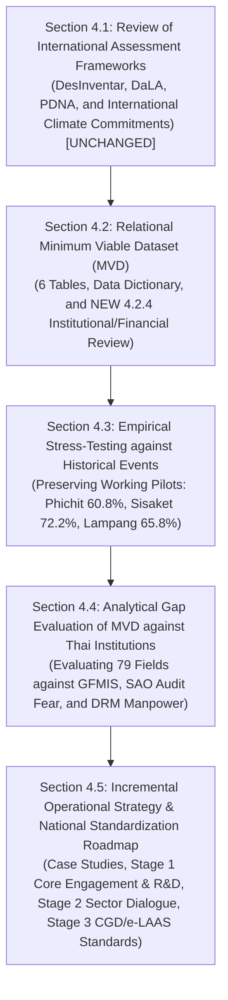

# Detailed Narrative Outline: CRDB Full Report Chapter 4 (Loss and Damage Data Architecture & Operational Strategy)

**Target Deliverable**: CRDB Full Report Chapter 4 Revision (TOR §5.3.6 & §5.3.7)  
**Document Path**: `plans/chapter4/english_outline.md`  
**Governing Plan**: [ld_chapter4_decree_and_central_budget_plan.md](file:///C:/Users/sitth/.gemini/antigravity-cli/brain/6430d9ab-a597-4a99-ae0a-b78578aa37d2/ld_chapter4_decree_and_central_budget_plan.md)  
**Status**: Formal Architectural Outline (Additive Strategy Approved by Boss)  

---

## Chapter Title & Structure Overview

**Chapter Title (Thai)**: บทที่ 4 การพัฒนากรอบและสถาปัตยกรรมข้อมูลความสูญเสียและความเสียหายจากภัยสภาพภูมิอากาศ (Loss and Damage Data Architecture and Implementation Strategy)  
**Contractual Mapping**: TOR Scope §5.3.6 (Loss and Damage Data Model Architecture) & §5.3.7 (Empirical Validation & Implementation Roadmap)  

The chapter follows an **additive drafting strategy** structured into **five logically rigorous sections** that preserve all existing working paragraphs while introducing new institutional depth, gap evaluations, benchmark case studies, and a realistically phased national standardization roadmap:

---

## Detailed Section Breakdown

### Section 4.1: Review of Disaster Impact Assessment Frameworks & Current International Standards (UNCHANGED)
*Note: Retains the existing 88 lines of working draft in `ψ/incubate/drafts/crdb-full-report-4.1/draft.md` without modification.*
- **4.1.1 Thai DRM Mechanisms Across 4 Phases**: Review of the Disaster Prevention and Mitigation Act B.E. 2550 and National DRM Plan B.E. 2564–2570 (Preparedness, Risk Reduction, Response, Recovery).
- **4.1.2 DDPM Data Collection Practices & PDNA Adaptation**: Rapid intake via *Emergency Incident Reports (`แบบรายงานเหตุด่วนสาธารณภัย`)* for situational awareness, welfare reimbursement rules under MOF, and the 4-stage DaNA/PDNA framework.
- **4.1.3 International Standards**:
  - *DesInventar*: National disaster inventories for small/medium recurrent events tied to administrative codes.
  - *DaLA / PDNA*: Conceptual separation between Physical Damage (destroyed capital stock) and Economic Loss (interrupted flows).

---

### Section 4.2: Relational Minimum Viable Dataset (MVD) Architecture, 79-Field Triage & Institutional Review (ADDITIVE ENHANCEMENT)
*Note: Retains existing working subsections 4.2.1 (Design Principles), 4.2.2 (6 Tables), and 4.2.3 (Data Dictionary) in `ψ/incubate/drafts/crdb-full-report-4.2/draft.md`, adding new Subsection 4.2.4.*

- **4.2.1 Existing MVD Design Principles (UNCHANGED)**: 5 principles (leveraging existing reporting, purposeful data separation, separating damage from loss, recording assessment context, recovery needs as analytical outputs).
- **4.2.2 Existing 6-Table Relational Schema (UNCHANGED)**: `DISASTER_EVENT`, `EVENT_LOCATION`, `ASSESSMENT_CONTEXT`, `LD_PHYSICAL_DAMAGE`, `LD_ECONOMIC_LOSS`, `LD_RECOVERY_RECONSTRUCTION_NEEDS`.
- **4.2.3 Existing 79-Field Data Dictionary (UNCHANGED)**: Full field specifications across all 6 tables.
- **4.2.4 (NEW SUBSECTION): Review of Thai Legal, Institutional, Reporting Processes & Public Relief Financial Flows**:
  - *Statutory Chain of Command (Disaster Act §20–22)*: DOPA territorial hierarchy (Governor as ผอ.จังหวัด, District Chief as ผอ.อำเภอ), DDPM secretariat, and autonomous LAOs (อปท.) where Mayors act ex-officio as Local Directors (`ผอ.ท้องถิ่น`), supported in financial capacity by DLA (สถ.).
  - *The Legal Instrument of Relief*: The Provincial Disaster Relief Decree (`ประกาศเขตการให้ความช่วยเหลือฯ`) issued by the Governor and ก.ช.ภ.จ., establishing why public relief is tied to decrees, not events, and creating the **`EVENT_DECREE_BRIDGE`** to resolve the Many-to-Many ($M:N$) relationship.
  - *The Multi-Stream Public Relief Pipeline*:
    - **Provincial Advance Payments ($\le 20$M THB)**: MOF Regulation 2562, New GFMIS Thai transactions (`ZFB60_K2` / `ZF_53_PM`), Fund `YY24000`, GL `1106010106`, and the 16-character Assignment field constraints.
    - **Cabinet Central Emergency Reserve (`งบกลาง เงินสำรองจ่ายเพื่อกรณีฉุกเฉินหรือจำเป็น`)*: Budget Procedure Act §45, approved by Cabinet Resolutions (`มติ ครม.`), covering **Direct Citizen PromptPay Bank Transfers** (5,000 / 7,000 / 9,000 THB/house), MOAC crop compensation, and MOT road/bridge emergency repairs.
    - **Ministry Advances (MOAC)** & **Local Own Reserves (อปท. `e-LAAS`)**.
    - **Strict Exclusion of Preventive Contingency ($\le 10$M THB)** as pre-disaster operational costs.
  - *The SAO Audit Defense Mindset & The Tier-1 Core Triage*:
    - Why local technicians avoid recording private property market replacement values due to fear of the State Audit Office (สตง.) and citizen unrest.
    - Enforcing the rule: **Local staff record only physical counts; monetary valuation is centralized**.
    - Triage of the 79 fields into **Tier 1 Mandatory Core (23 fields)** governed by the Zero-New-Survey Rule.
    - Affirmation of the **Sovereign DCCE Platform Boundary**: The MVD resides 100% inside DCCE's CRDB; external line agencies are not forced to redesign their internal systems.

---

### Section 4.3: Empirical Stress-Testing of MVD Against Historical Disasters (PRESERVED WORKING PARAGRAPHS)
*Note: Retains all 78 lines of working draft in `ψ/incubate/drafts/crdb-full-report-4.3/draft.md`, adding only minimal smoothing transitions.*
- **4.3.1 Objectives and Testing Methodology**: Stress-testing MVD against 10 years of DDPM historical data.
- **4.3.2 Reference Datasets & Linking Steps**: DDPM village-level impact logs and provincial financial records. Availability scoring (Directly Available, Retrievable, Currently Unavailable).
- **4.3.3 Matching Results Across Three Historical Pilot Events**:
  - *Phichit Riverine Flood (2557)*: 31 filled / 48 blank (60.8% missing); agricultural area reported as raw lump sum; zero economic loss.
  - *Sisaket Seasonal Drought (2557)*: 22 filled / 57 blank (72.2% missing); missing duration boundaries; zero crop yield records.
  - *Lampang Rapid Windstorm (2559)*: 27 filled / 52 blank (65.8% missing); physical counts without valuation; missing end date (`end_date = NULL`).

---

### Section 4.4: Analytical Gap Evaluation of MVD against Thai Institutional Structure (NEW DRAFTING)
- Connects the empirical pilot omissions from 4.3 directly to the legal, administrative, and financial realities diagnosed in 4.2.4:
  - *Gap Evaluation 1 (Financial System Disconnect)*: Why New GFMIS Thai records lump-sum expenditures by province and year rather than linking to DDPM incident IDs, and why an $M:N$ bridge is needed.
  - *Gap Evaluation 2 (The Audit-Constrained Valuation Void)*: How statutory welfare caps (49,500 THB/house, 1,340 THB/rai) and SAO audit scrutiny prevent local technicians from documenting true economic damage, proving why relief is strictly a fiscal proxy.
  - *Gap Evaluation 3 (The Frontline DRM Manpower Crisis)*: Why municipal and district offices (1–2 technicians) cannot administer door-to-door 79-field PDNA surveys while managing life-saving response, validating the need for automated remote sensing.

---

### Section 4.5: Incremental Operational Strategy & The National L&D Standardization Roadmap (NEW DRAFTING)

#### 4.5.1 Summary of Researched Benchmark Case Studies
- Presenting the 3 proven precedents on secondary data augmentation:
  1. *National Benchmark*: Bank of Thailand (PIER) & GISTDA / DOAE / BAAC — proving cadastral overlay on radar and showing relief covers $<30\%$ of true loss.
  2. *Regional Mekong Benchmark*: RIICE Southeast Asia (SDC, GIZ, IRRI, DOAE, OAE, Vietnam MARD) — automated satellite rice loss modeling cutting assessment from 6 months to 15 days.
  3. *Global/Regional Benchmark*: World Bank GRADE — rapid desk estimation across 66 disasters with 88%–90% fidelity.

#### 4.5.2 Automated Remote Sensing & Secondary Valuation Engines
- *Approach 1 (Agriculture)*: GISTDA SAR $\times$ DOAE/LDD cadastre $\times$ OAE baseline yields & prices $\times$ submergence curves $V_c(D_{\text{flood}})$.
- *Approach 2 (Buildings)*: World Bank GRADE desk adaptation $\times$ DOPA households $\times$ DPT archetypes $\times$ CGD standard repair unit costs.
- *Option 2 Policy Stance*: Satellite data serves as an automated QA gate and lower-bound physical fill; field reports retain administrative primacy.

#### 4.5.3 The 3-Stage Evolutionary Roadmap (Realistically Calibrated to DCCE Capacity)
- **Stage 1 (Immediate Foundation — Realistic DCCE Engagement & R&D / Year 1)**:
  - *Core Partner Engagement*: DCCE partners with immediate core agencies—**GISTDA, NESDC, DDPM, DLA**—to improve the quality, completeness, and consistency of existing disaster data streams (resolving missing end dates, decree references).
  - *Targeted Methodological R&D*: DCCE invests in research to develop and calibrate (1) L&D accounting methodologies, and (2) remote sensing-based rapid assessment models.
  - *Sovereign Ingestion Prototype*: Internal CRDB prototype hosting `DISASTER_EVENT`, `DISASTER_DECREE`, and `EVENT_DECREE_BRIDGE`.
- **Stage 2 (Medium-Term — Engagement with Relevant Sector Ministries / Year 2)**:
  - Engaging key sector ministries (**MOAC/DOAE, MOT, MOPH, MOI/DOPA**) based on the solid ground, empirical evidence, and validated methodologies from Stage 1, building cross-ministerial consensus before attempting to push mandatory rules.
  - Reciprocal service value: supplying line departments with free downscaled spatial climate hazard projections and localized risk maps.
  - Formalizing central governance levers: OPDC Joint KPIs (ก.พ.ร.) and Cabinet endorsement.
- **Stage 3 (Long-Term — National Institutional Integration / Year 3+)**:
  - Pushing validated L&D data fields directly into the Comptroller General's Department (New GFMIS Thai / future ERP chart of accounts), DLA's municipal `e-LAAS` portal, and sectoral line-agency databases.
  - Establishing **Sovereign National Loss & Damage Accounting Standards** across Thailand's public sector financial and asset management ecosystem.
  - National Catastrophe PDNA Protocol (Step 3 Dormancy activated only for Level 3/4 national catastrophes).
- Alignment with Chapter 7.3 recommendations (`REC-PROD-POL-01`, `REC-DATA-POL-01`, `REC-DEV-CYCLE-01`).
