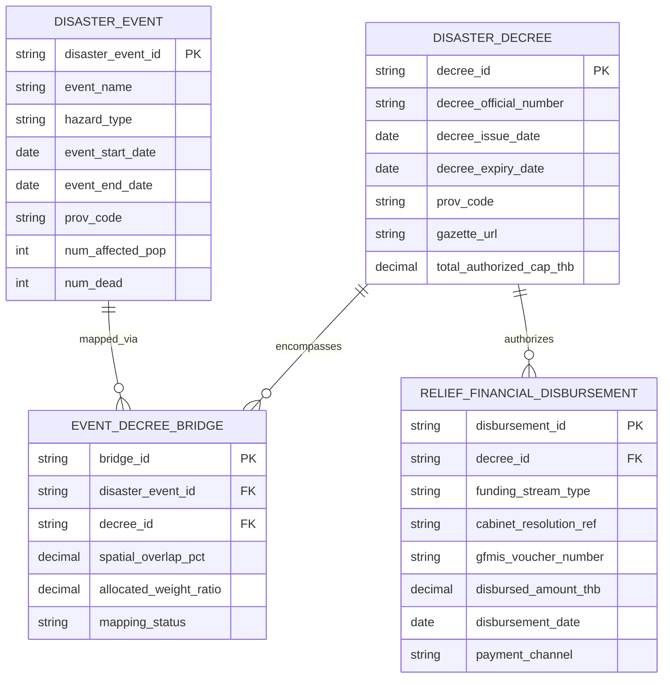

# Technical Specification: Event Unit Definition, Disaster Decree Cardinality & Public Relief Finance Linkage Architecture

**Target Deliverable**: CRDB Chapter 4 Revision (TOR §5.3.6 & §5.3.7)  
**Document Path**: `plans/chapter4/event_unit_and_relief_linkage.md`  
**Governing Plan**: [ld_chapter4_decree_and_central_budget_plan.md](file:///C:/Users/sitth/.gemini/antigravity-cli/brain/6430d9ab-a597-4a99-ae0a-b78578aa37d2/ld_chapter4_decree_and_central_budget_plan.md)  
**Status**: Formal Technical Specification (Approved by Boss)  

---

## 1. Executive Summary & The Sovereign DCCE Platform Boundary

A fundamental friction identified during the CRDB empirical pilot (Chapter 4.3) and stress-tested with Keth-oracle's bureaucratic analysis is the severe structural disconnect between **how disaster impacts occur on the ground** and **how disaster relief finances are legally authorized and accounted for in the Thai public sector**:

1. **Granular Meteorological Incidents**: Department of Disaster Prevention and Mitigation (DDPM / ปภ.) records physical impacts, evacuations, and casualties at the village and incident level via the *Emergency Incident Report* (`แบบรายงานเหตุด่วนสาธารณภัย`).
2. **The Legal Instrument of Relief**: Public disaster relief expenditures under Thai law are **not** unlocked by an abstract meteorological event ID; they are unlocked by a formal legal administrative instrument—the Provincial Governor's **Declaration of Emergency Disaster Relief Area (`ประกาศเขตการให้ความช่วยเหลือผู้ประสบภัยพิบัติกรณีฉุกเฉิน`)**.
3. **The Many-to-Many ($M:N$) Cardinality Reality**: A single sweeping provincial decree can encompass dozens of localized flash floods, storms, and landslides occurring across multiple districts over a multi-week monsoon period ($1:M$). Conversely, a single tropical cyclone or riverine flood basin crossing provincial borders triggers dozens of separate provincial decrees ($M:1$). Attempting to force a direct 1:1 foreign key between financial vouchers and disaster events causes immediate relational breakdown.
4. **The Sovereign DCCE Platform Boundary**: Expecting the Comptroller General's Department (CGD / New GFMIS Thai), Provincial Finance Offices, or sectoral line ministries to integrate the 6-table, 79-field MVD into their core transaction systems is an institutional impossibility. New GFMIS Thai is strictly an ERP general financial ledger. **The MVD tables reside 100% within DCCE's sovereign CRDB database**. DCCE serves as the **National Data Integrator and Synthesizer**, extracting external administrative feeds (decree gazettes, GFMIS voucher extracts, citizen bank rosters, satellite masks) and resolving the relational bridge centrally.

---

## 2. Event Unit of Analysis vs. Disaster Decrees

### 2.1 The Native Reporting Grain
Per Boss's ruling (Decision Q5), CRDB adopts **DDPM's native reporting unit (`Incident Name`)** as the primary anchor for physical impact tracking:
- `Incident Name`: Free-text incident descriptor (e.g., *อุทกภัยจากพายุโนรู*, *ภัยแล้งปี 2563*)
- `Disaster Type`: Source hazard classification (Flood, Drought, Windstorm, Landslide, etc.)
- `Disaster Date`: Initial date of onset or impact confirmation
- `End Disaster Date`: Date the emergency situation officially stabilized
- `Administrative Hierarchy`: Province Code, District Code, Subdistrict Code, Village Code (Moo)

### 2.2 Master Event Normalization Algorithm (`disaster_event_id`)
To maintain relational integrity in CRDB without overriding DDPM's native reporting grain, the data ingestion pipeline implements a **2-Tier Master Event Key**:

```
[Master Event ID Schema]
CRDB-EVT-{YYYY}-{HAZARD_CODE}-{PROV_CODE}-{INCIDENT_HASH}
Example: CRDB-EVT-2022-FLD-30-A8F29C
```

- **Grain Preservation Rule**: One record in `DISASTER_EVENT` corresponds directly to one unique DDPM `Incident Name` within a province.
- **Temporal Imputation Rule (End Date)**: When `End Disaster Date` is blank (as in rapid-onset storms like the Lampang pilot), DCCE's automated remote sensing gate scans GISTDA radar and TMD rainfall grids:
  $$\text{Effective End Date} = \min\left(\text{Field Closure Date}, \text{Satellite Receding Date} + 72\,\text{hrs}\right)$$
  Populated with provenance flag: `provenance = 'GISTDA_QA_DERIVED'`.

---

## 3. The Decree-Event Relational Bridge Architecture ($M:N$)

To resolve the cardinality mismatch between administrative decrees and physical events, CRDB implements a dedicated bridge entity:



### Mathematical Weighting Formula:
When a single decree $D$ covers multiple disaster events $e \in E_D$, the public relief outlay attributed to event $e$ is calculated proportionally:

$$\text{Relief Attributed to Event}_{e} = \text{Disbursement}_{D} \times \frac{\text{Affected Population}_{e} \times \text{Duration}_{e}}{\sum_{i \in E_D} \left(\text{Affected Population}_{i} \times \text{Duration}_{i}\right)}$$

This guarantees that:
1. No public expenditure is double-counted.
2. The sum of event-allocated relief outlays strictly equals total audited disbursements.

---

## 4. Comprehensive Public Relief Finance Streams

The report establishes a rigorous boundary distinguishing public relief funding streams based on their legal authority, controlling body, disbursement caps, and event-linkage feasibility:

```
┌──────────────────────────────────────────────────────────────────────────────────────────────────┐
│                                COMPREHENSIVE PUBLIC RELIEF FINANCE PIPELINE                      │
├─────────────────────────┬──────────────────────────────┬──────────────────┬──────────────────────┤
│ Funding Stream          │ Controlling Authority        │ Legal Prerequisite│ Primary Accounting   │
│                         │ & Source                     │ for Release      │ & Payment System     │
├─────────────────────────┼──────────────────────────────┼──────────────────┼──────────────────────┤
│ 1. Central Reserve      │ Prime Minister & Cabinet     │ Governor's       │ Direct Citizen Bank  │
│    (งบกลาง เงินสำรองจ่ายฯ)│ Budget Procedure Act §45     │ Disaster Decree  │ Rosters (PromptPay) /│
│    [Primary Stream]     │ (Approved by มติ ครม.)       │ (ประกาศเขตฯ)     │ New GFMIS Thai batch │
├─────────────────────────┼──────────────────────────────┼──────────────────┼──────────────────────┤
│ 2. Provincial Advance   │ Provincial Governor & ก.ช.ภ.จ.│ Governor's       │ New GFMIS Thai       │
│    (เงินทดรองราชการ - ผวจ.)│ MOF Regulation 2562 (≤20M THB)│ Disaster Decree  │ Trans: ZFB60_K2      │
│    [Initial Response]   │                              │ (ประกาศเขตฯ)     │ Fund: YY24000        │
├─────────────────────────┼──────────────────────────────┼──────────────────┼──────────────────────┤
│ 3. Ministry Advances    │ Permanent Secretary of MOAC  │ Governor's       │ New GFMIS Thai       │
│    (เงินทดรองระดับกระทรวง)│ MOF Regulation 2562 ข้อ 19   │ Disaster Decree  │ Ministerial Account  │
│    [Sector Specific]    │ (กษ. ชดเชยพืชผลทางการเกษตร)  │ (ประกาศเขตฯ)     │ (DOAE farmer roster) │
├─────────────────────────┼──────────────────────────────┼──────────────────┼──────────────────────┤
│ 4. Local Own Reserves   │ Autonomous Local Councils    │ Incident Notice /│ e-LAAS               │
│    (งบกลาง อปท. สำรองจ่าย)│ MOI Regulations 2566         │ Local Disaster   │ Municipal Electronic │
│    [Frontline Local]    │ (เทศบาล / อบต. เงินสำรองจ่าย)│ Committee Action │ Accounting System    │
├─────────────────────────┼──────────────────────────────┼──────────────────┼──────────────────────┤
│ 5. Preventive Fund      │ Provincial Governor          │ Pre-Disaster     │ EXCLUDED FROM EVENT  │
│    (เงินทดรองฯ ป้องกันฯ)  │ MOF Regulation 2562 ข้อ 18/1 │ Forecast         │ (Pre-disaster        │
│    [Strictly Excluded]  │ (≤10M THB)                   │ (No decree req.) │ operating cost)      │
└─────────────────────────┴──────────────────────────────┴──────────────────┴──────────────────────┘
```

### 4.1 Stream 1: Cabinet Central Emergency Reserve (`งบกลาง เงินสำรองจ่ายเพื่อกรณีฉุกเฉินหรือจำเป็น`)
- **Statutory Authority**: Section 45 of the Budget Procedure Act B.E. 2561 (พ.ร.บ. วิธีการงบประมาณ พ.ศ. 2561).
- **Scale**: Multi-billion-baht allocations authorized by specific Cabinet Resolutions (`มติ ครม.`) when provincial advance limits are exhausted during severe national disasters.
- **The 3 Disbursement Channels**:
  1. *Channel A: Direct Citizen Household Cash Transfers*: Fixed cash subsidies (5,000 / 7,000 / 9,000 THB per household based on submergence duration). Disbursed directly into citizens' **PromptPay** accounts via government banks (Krungthai/BAAC) against rosters certified by Local Committees and District Chiefs citing the **Provincial Disaster Decree**.
  2. *Channel B: Agricultural Compensation via MOAC*: Crop, livestock, and fishery compensation per rai disbursed to registered farmers.
  3. *Channel C: Public Infrastructure Emergency Restoration via MOT & DLA*: Direct budget allocations to repair washed-out highways, bridges, and municipal dikes.

### 4.2 Stream 2: Provincial Governor Advance Fund (`เงินทดรองราชการ - ผวจ.`)
- **Statutory Authority**: Ministry of Finance Regulations B.E. 2562 (ข้อ 18).
- **Cap**: 20,000,000 THB per province per disaster declaration.
- **Accounting Architecture (New GFMIS Thai)**:
  - Transaction `ZFB60_K2` (Disbursement Voucher ขบ.03 / ขบ.01) and `ZF_53_PM` (Clearing Voucher ขจ.05).
  - Fund Source Code: `YY24000` (Emergency Disaster Relief Fund).
  - General Ledger (GL) Account: `1106010106` (Advance payments for disaster assistance).
  - Interface Constraint: Assignment field has only 16 characters; manual data entry leads to clerical errors. Master Event Key must be injected upstream before GFMIS batch export.

### 4.3 Stream 4: Local Government Budget Reserves (`งบกลาง อปท. - เงินสำรองจ่าย`)
- **Statutory Authority**: MOI Regulations on Expenses for Assisting People According to Duties of LAOs B.E. 2566.
- **System**: Tracked in the municipal `e-LAAS` accounting portal. Must be accounted for when calculating total public relief outlay.

---

## 5. Implementation Directives for Chapter 4 Revision

1. **Strict Semantic Boundary**: Public relief outlays (`government_relief_allocated_thb`) represent a **fiscal-response proxy, not true economic loss**.
2. **Database Schema Integrity**: DCCE's CRDB hosts the `DISASTER_DECREE` and `EVENT_DECREE_BRIDGE` tables in Layer A, shielding line agencies from schema changes.
3. **Upstream Key Injection**: DCCE collaborates with DDPM and MOI to inject standardized decree and event codes into front-end intake systems, avoiding costly core GFMIS re-engineering.
