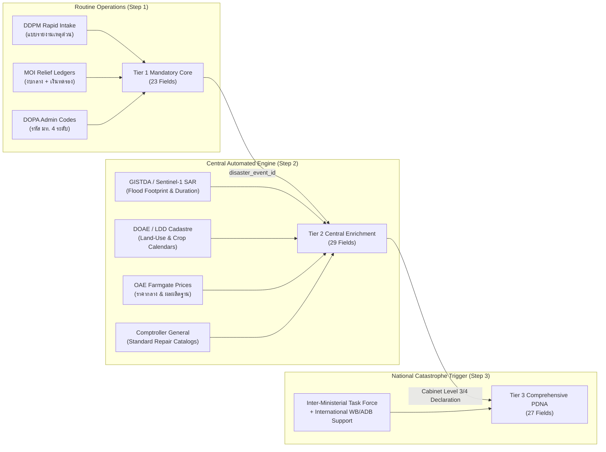

# Technical Specification: 79-Field MVD Triage Matrix & Acquisition Pathways

**Target Deliverable**: CRDB Chapter 4 Revision (TOR §5.3.6 & §5.3.7)  
**Document Path**: `plans/chapter4/field_triage_matrix.md`  
**Governing Plan**: [ld_chapter4_incremental_plan.md](file:///C:/Users/sitth/.gemini/antigravity-cli/brain/6430d9ab-a597-4a99-ae0a-b78578aa37d2/ld_chapter4_incremental_plan.md)  
**Status**: Formal Technical Specification (Approved by Boss)  

---

## 1. Executive Summary & Triage Philosophy

The CRDB Minimum Viable Dataset (MVD) specification in [`Pillar_06_LDM_LossDamage_DataModel_Technical_Specification.md`](file:///C:/Users/sitth/OracleWorkspace/Arun_Creagy/ψ/incubate/DCCE/CRDB/output/09_LDM_LossDamage_DataModel/Pillar_06_LDM_LossDamage_DataModel_Technical_Specification.md) defines **79 relational data fields across 6 tables**. 

During empirical pilot testing against 3 historical disaster events in Chapter 4.3, local officials were able to fill only a fraction of this specification:
- **Phichit Flood (2557)**: 31 fields filled (48 blank / 60.8% missing)
- **Sisaket Drought (2557)**: 22 fields filled (57 blank / 72.2% missing)
- **Lampang Storm (2559)**: 27 fields filled (52 blank / 65.8% missing)

This triage matrix eliminates DCCE's operational paralysis by categorizing all 79 fields into **three functional tiers** governed by the **"Zero-New-Survey Rule" for Step 1**:

1. **Tier 1: Mandatory Core (23 Fields)**: Non-negotiable for Step 1 event accounting. Must directly support event identity, human casualty aggregation, or public relief budget linkage. **Every Tier 1 field must be obtainable from existing DDPM rapid intake (`แบบรายงานเหตุด่วน`), MOI administrative ledgers, or standard administrative geometry without dispatching new survey teams.**
2. **Tier 2: Central Enrichment & Remote Sensing QA (29 Fields)**: Operational in Step 2. These fields provide physical damage extents and estimated economic losses, but are populated **centrally by DCCE/สศช./สศก. algorithms** using satellite remote sensing (GISTDA/Sentinel), agricultural land-use layers (LDD/DOAE), and central price catalogs—requiring zero field data collection.
3. **Tier 3: Targeted Comprehensive PDNA/DaLA (27 Fields)**: Detailed post-disaster recovery, reconstruction, and commercial disruption fields. **Strictly dormant during routine disaster operations.** Activated only when the Cabinet declares a Level 3 or Level 4 National Catastrophe and mobilizes dedicated inter-ministerial assessment task forces.

---

## 2. Summary Scorecard of the 79 Fields

```
┌───────────────────────────────────────┬────────────┬────────────┬────────────┬─────────────┐
│ Relational Table Name                 │ Total Spec │   Tier 1   │   Tier 2   │   Tier 3    │
│ (Pillar 06 Technical Specification)   │   Fields   │ (Mandatory)│(Enrich/RS) │ (Full PDNA) │
├───────────────────────────────────────┼────────────┼────────────┼────────────┼─────────────┤
│ 1. DISASTER_EVENT                     │     18     │     12     │      4     │      2      │
│ 2. EVENT_LOCATION                     │      7     │      6     │      1     │      0      │
│ 3. ASSESSMENT_CONTEXT                 │     12     │      5     │      4     │      3      │
│ 4. LD_PHYSICAL_DAMAGE                 │     16     │      0     │     10     │      6      │
│ 5. LD_ECONOMIC_LOSS                   │     15     │      0     │     10     │      5      │
│ 6. LD_RECOVERY_RECONSTRUCTION_NEEDS   │     11     │      0     │      0     │     11      │
├───────────────────────────────────────┼────────────┼────────────┼────────────┼─────────────┤
│ TOTAL FIELDS                          │     79     │     23     │     29     │     27      │
│ Percentage of MVD Specification       │   100.0%   │    29.1%   │    36.7%   │    34.2%    │
└───────────────────────────────────────┴────────────┴────────────┴────────────┴─────────────┘
```

*Note on Agriculture in Tier 1*: Total damaged agricultural area (`affected_area_rai`) is tracked under `DISASTER_EVENT` / `EVENT_LOCATION` aggregates as Tier 1 Mandatory. Primary crop category is optional/recommended if recorded locally; otherwise deferred to Tier 2 spatial cadastre overlay.

---

## 3. Comprehensive 79-Field Triage Matrix

### Table 1: `DISASTER_EVENT` (18 Fields — Event Master Anchor)

| # | Field Name | Data Type | Tier | Primary Acquisition Pathway | Pilot Status | Custodian & DCCE Obligation |
|:---:|:---|:---|:---:|:---|:---:|:---|
| 1 | `disaster_event_id` | VARCHAR(50) | **T1** | Pipeline Generated (Master Key algorithm) | Filled (Pilot Key) | DCCE: System generated |
| 2 | `source_assessment_ref` | VARCHAR(100) | **T1** | DDPM Incident Name / Report Ref No. | Filled (Phichit, Sisaket, Lampang) | DDPM: Ingest via daily feed |
| 3 | `hazard_type` | ENUM | **T1** | DDPM Disaster Type (Standardized ENUM) | Filled (Phichit, Sisaket, Lampang) | DDPM: Harmonize to NESDC taxonomy |
| 4 | `event_name` | VARCHAR(255) | **T1** | DDPM Incident Title (`Incident Name`) | Filled (Phichit, Sisaket, Lampang) | DDPM: Raw ingest |
| 5 | `event_start_date` | DATE | **T1** | DDPM `Disaster Date` | Filled (Phichit, Sisaket, Lampang) | DDPM: Administrative date |
| 6 | `event_end_date` | DATE | **T2** | Remote Sensing QA (Sentinel-1 / GISTDA) | Blank in Lampang | GISTDA/TMD: QA gate on field blank |
| 7 | `event_duration_days` | INT | **T2** | Calculated: `event_end_date - event_start_date` | Blank in Lampang | DCCE: Backend calculated |
| 8 | `event_status` | ENUM | **T1** | DDPM Incident Status (`Closed`/`Under_Assessment`) | Filled (Phichit, Sisaket, Lampang) | DDPM: Administrative status |
| 9 | `reporting_level` | ENUM | **T1** | Inferred from Source Admin Grain (Village/District) | Filled (Village Level) | DCCE: Pipeline classified |
| 10 | `num_affected_pop` | INT | **T1** | DDPM `Affected People` count | Blank in Phichit, Sisaket | DDPM: Core casualty metric |
| 11 | `num_evacuated` | INT | **T1** | DDPM `Evacuated People` count | Blank in Phichit, Sisaket | DDPM: Core casualty metric |
| 12 | `num_dead` | INT | **T1** | DDPM `Deaths` count (Official verified) | Blank in Phichit, Sisaket | DDPM / MOPH: Non-negotiable casualty |
| 13 | `num_missing` | INT | **T1** | DDPM `Missing` count (Official verified) | Blank in Phichit, Sisaket | DDPM / Royal Thai Police |
| 14 | `num_injured` | INT | **T1** | DDPM `Injured` count (Official verified) | Blank in Phichit, Sisaket | DDPM / MOPH: Non-negotiable casualty |
| 15 | `response_phase_note` | TEXT | **T2** | Text summary from DDPM situation briefings | Filled in Pilot narrative | DDPM: Curated qualitative context |
| 16 | `created_by_agency` | VARCHAR(255) | **T1** | Submitting Unit (e.g. สำนักงาน ปภ. จังหวัด) | Filled (Phichit, Sisaket, Lampang) | DDPM: Data provenance |
| 17 | `record_created_at` | DATETIME | **T3** | Audit Trail Timestamp | Blank in Historical DB | DCCE: Modern CMS metadata |
| 18 | `record_updated_at` | DATETIME | **T3** | Audit Trail Timestamp | Blank in Historical DB | DCCE: Modern CMS metadata |

---

### Table 2: `EVENT_LOCATION` (7 Fields — Geographic Footprint)

| # | Field Name | Data Type | Tier | Primary Acquisition Pathway | Pilot Status | Custodian & DCCE Obligation |
|:---:|:---|:---|:---:|:---|:---:|:---|
| 19 | `event_location_id` | VARCHAR(50) | **T1** | Pipeline Generated Location UUID | Filled (Pilot Key) | DCCE: System generated |
| 20 | `disaster_event_id` | VARCHAR(50) | **T1** | Foreign Key to `DISASTER_EVENT` | Filled | DCCE: Relational integrity link |
| 21 | `admin_level` | ENUM | **T1** | DOPA Standard (Province, District, Tambon, Moo) | Filled (Moo level in DDPM) | DOPA / DDPM: Administrative grain |
| 22 | `location_code` | VARCHAR(20) | **T1** | DOPA Official Administrative Code (รหัส มท.) | Filled (All 3 pilots) | DOPA: Spatial join backbone |
| 23 | `location_name` | VARCHAR(255) | **T1** | DOPA Official Geographic Name | Filled (All 3 pilots) | DOPA: Human-readable location |
| 24 | `is_primary_impact_area` | BOOLEAN | **T1** | Spatial Overlay: Centroid in flood/drought core | Filled in Pilot | DCCE/GISTDA: Automated spatial flag |
| 25 | `spatial_reference_note` | TEXT | **T2** | GISTDA SAR polygon boundary / geometry note | Blank in historical | GISTDA: GIS metadata reference |

---

### Table 3: `ASSESSMENT_CONTEXT` (12 Fields — Methodology & Audit Trail)

| # | Field Name | Data Type | Tier | Primary Acquisition Pathway | Pilot Status | Custodian & DCCE Obligation |
|:---:|:---|:---|:---:|:---|:---:|:---|
| 26 | `assessment_context_id` | VARCHAR(50) | **T1** | Pipeline Generated Assessment UUID | Filled (Pilot Key) | DCCE: System generated |
| 27 | `disaster_event_id` | VARCHAR(50) | **T1** | Foreign Key to `DISASTER_EVENT` | Filled | DCCE: Relational integrity link |
| 28 | `assessment_phase` | ENUM | **T1** | `Phase_1_Initial`, `Phase_2_Rapid`, `DaLA_Analytical` | Filled in Pilot | DDPM: Phase classification |
| 29 | `method_family` | ENUM | **T1** | `DDPM_Event`, `GISTDA_RS_QA`, `NESDC_Model` | Filled in Pilot | DCCE: Methodology tracking |
| 30 | `lead_agency` | VARCHAR(255) | **T1** | Agency compiling report (ปภ. จังหวัด / อปท.) | Filled (ศปภ. เขต) | MOI / DDPM: Lead responsibility |
| 31 | `supporting_agency` | VARCHAR(255) | **T2** | Secondary Agencies (GISTDA, กสก., สศก.) | Blank in historical | DCCE: Partner attribution |
| 32 | `assessor_name_or_team` | VARCHAR(255) | **T2** | Provincial Disaster Relief Committee (ก.ช.ภ.จ.) | Blank in historical | DOPA/DDPM: Committee ref |
| 33 | `assessment_date` | DATE | **T2** | Date of compilation / G.C.P.J. resolution | Filled in Pilot | Provincial Gazette / DDPM |
| 34 | `review_status` | ENUM | **T2** | `Draft`, `Under_Review`, `Validated`, `Final` | Filled in Pilot | DCCE: Data governance lifecycle |
| 35 | `validation_event_ref` | VARCHAR(100) | **T3** | Official Committee Meeting Minute No. | Blank in historical | Provincial Admin / DOPA |
| 36 | `revision_trace_note` | TEXT | **T3** | Audit log of corrections / errata | Blank in historical | DCCE: Data Steward audit log |
| 37 | `source_document_ref` | TEXT | **T3** | Official Letter No. (หนังสือราชการ ปภ./มท.) | Blank in historical | MOI Document Management |

---

### Table 4: `LD_PHYSICAL_DAMAGE` (16 Fields — Asset & Physical Damage Valuation)

| # | Field Name | Data Type | Tier | Primary Acquisition Pathway | Pilot Status | Custodian & DCCE Obligation |
|:---:|:---|:---|:---:|:---|:---:|:---|
| 38 | `damage_record_id` | VARCHAR(50) | **T2** | Pipeline Generated Damage UUID | Filled (Pilot Key) | DCCE: System generated |
| 39 | `assessment_context_id` | VARCHAR(50) | **T2** | Foreign Key to `ASSESSMENT_CONTEXT` | Filled | DCCE: Relational bridge link |
| 40 | `disaster_event_id` | VARCHAR(50) | **T2** | Redundant Foreign Key to `DISASTER_EVENT` | Filled | DCCE: Relational integrity link |
| 41 | `sector_id` | ENUM | **T2** | NESDC 5-Sector (`Agriculture`, `Housing`, etc.) | Filled in Pilot | NESDC / DCCE: Sector allocation |
| 42 | `subsector_id` | VARCHAR(100) | **T2** | `Crops`, `Livestock`, `Roads`, `Bridges` | Filled (คมนาคม, บ้าน) | DOAE / DPT / Rural Roads |
| 43 | `asset_type` | VARCHAR(255) | **T2** | Specific Asset (บ้านเรือน, ทางหลวงชนบท, บ่อปลา) | Filled in Pilot | Local Governments / Line Agencies |
| 44 | `owner_or_responsible_entity` | VARCHAR(255) | **T3** | Public vs. Private vs. Municipal Asset | Blank in historical | Line Ministries / Land Registry |
| 45 | `severity_state` | ENUM | **T2** | `Destroyed` vs. `Damaged` (เสียหายทั้งหลัง/บางส่วน) | Filled in Lampang | DDPM / LAOs: Standard categories |
| 46 | `qty_destroyed` | DECIMAL(18,2) | **T2** | DDPM Physical Count (Units totally destroyed) | Filled in Lampang | DDPM / Local Governments (อปท.) |
| 47 | `qty_damaged` | DECIMAL(18,2) | **T2** | DDPM Physical Count (Units partially damaged) | Filled in Lampang | DDPM / Local Governments (อปท.) |
| 48 | `unit_measure` | VARCHAR(50) | **T2** | Standard Unit (`หลัง`, `ไร่`, `กิโลเมตร`, `แห่ง`) | Filled in Pilot | DCCE: Standardized lookup |
| 49 | `unit_replacement_cost_thb`| DECIMAL(18,2) | **T2** | Central Unit Cost Catalog (สถ. / กรมบัญชีกลาง) | Blank in historical | Comptroller General / DPT Catalog |
| 50 | `unit_repair_cost_thb` | DECIMAL(18,2) | **T3** | Detailed engineering repair estimate | Blank in historical | Line Agency Engineers (PDNA only) |
| 51 | `valuation_basis_note` | TEXT | **T3** | Price catalog version or methodology footnote | Blank in historical | DCCE: Metadata audit note |
| 52 | `monetary_damage_thb` | DECIMAL(18,2) | **T2** | Calculated: `(qty_dest × rep_cost) + (qty_dam × rep_cost)` | Blank in historical | DCCE Backend: Automated calculation |
| 53 | `validation_status` | ENUM | **T3** | Formal sign-off by Provincial Engineering Unit | Blank in historical | DPT / Provincial Administration |

---

### Table 5: `LD_ECONOMIC_LOSS` (15 Fields — Economic Flow Disruption)

| # | Field Name | Data Type | Tier | Primary Acquisition Pathway | Pilot Status | Custodian & DCCE Obligation |
|:---:|:---|:---|:---:|:---|:---:|:---|
| 54 | `loss_record_id` | VARCHAR(50) | **T2** | Pipeline Generated Loss UUID | Blank in all 3 | DCCE: System generated |
| 55 | `assessment_context_id` | VARCHAR(50) | **T2** | Foreign Key to `ASSESSMENT_CONTEXT` | Blank in all 3 | DCCE: Relational bridge link |
| 56 | `disaster_event_id` | VARCHAR(50) | **T2** | Redundant Foreign Key to `DISASTER_EVENT` | Blank in all 3 | DCCE: Relational integrity link |
| 57 | `sector_id` | ENUM | **T2** | NESDC 5-Sector (`Agriculture`, `Housing`, etc.) | Blank in all 3 | NESDC / DCCE: Sector allocation |
| 58 | `subsector_id` | VARCHAR(100) | **T2** | `Paddy_Rice`, `Cassava`, `Retail`, `Tourism` | Blank in all 3 | DOAE / NESDC: Baseline mapping |
| 59 | `loss_category` | ENUM | **T2** | `Yield_Reduction`, `Service_Disruption`, `Rent` | Blank in all 3 | DaLA Taxonomy standard |
| 60 | `analysis_horizon_start` | DATE | **T2** | Impact onset date (aligned to `event_start_date`) | Blank in all 3 | DCCE Pipeline: Inherited date |
| 61 | `analysis_horizon_end` | DATE | **T2** | Normalization Date / Next Harvest Season | Blank in all 3 | DOAE Crop Calendar / OAE |
| 62 | `baseline_quantity_or_value`| DECIMAL(18,2)| **T2** | OAE 5-Year Provincial Baseline Yield (กก./ไร่) | Blank in all 3 | OAE (สศก.): Central baseline feed |
| 63 | `actual_post_disaster_qty` | DECIMAL(18,2) | **T3** | Post-harvest field survey check | Blank in all 3 | OAE / DOAE: Post-season statistics |
| 64 | `price_or_valuation_basis` | TEXT | **T2** | OAE Weekly Farmgate Price Index Reference | Blank in all 3 | OAE (สศก.): Price lookup table |
| 65 | `increased_costs_thb` | DECIMAL(18,2) | **T3** | Additional operating costs (water pumping, feed) | Blank in all 3 | Field Interviews (PDNA only) |
| 66 | `monetary_loss_thb` | DECIMAL(18,2) | **T2** | Calculated: `Flooded_Rai × Baseline_Yield × Price` | Blank in all 3 | DCCE Backend: Automated calculation |
| 67 | `loss_formula_note` | TEXT | **T2** | Mathematical formula documentation footnote | Blank in all 3 | DCCE: Algorithmic documentation |
| 68 | `validation_status` | ENUM | **T3** | Joint approval by NESDC / Sector Ministry | Blank in all 3 | NESDC / Macroeconomic panel |

---

### Table 6: `LD_RECOVERY_RECONSTRUCTION_NEEDS` (11 Fields — Build Back Better Needs)

| # | Field Name | Data Type | Tier | Primary Acquisition Pathway | Pilot Status | Custodian & DCCE Obligation |
|:---:|:---|:---|:---:|:---|:---:|:---|
| 69 | `needs_record_id` | VARCHAR(50) | **T3** | Pipeline Generated Needs UUID | Blank in all 3 | DCCE: Activated in Level 3/4 only |
| 70 | `assessment_context_id` | VARCHAR(50) | **T3** | Foreign Key to `ASSESSMENT_CONTEXT` | Blank in all 3 | DCCE: Relational bridge link |
| 71 | `disaster_event_id` | VARCHAR(50) | **T3** | Foreign Key to `DISASTER_EVENT` | Blank in all 3 | DCCE: Relational integrity link |
| 72 | `sector_id` | ENUM | **T3** | NESDC 5-Sector Taxonomy | Blank in all 3 | NESDC / Budget Bureau |
| 73 | `needs_type` | ENUM | **T3** | `Recovery`, `Reconstruction`, `Risk_Reduction` | Blank in all 3 | PDNA Working Group |
| 74 | `time_horizon` | ENUM | **T3** | `Short_Term` (0-1 yr), `Medium_Term` (1-3 yr) | Blank in all 3 | National Economic Recovery Plan |
| 75 | `derived_from_damage` | BOOLEAN | **T3** | Cross-check: Linked to `LD_PHYSICAL_DAMAGE` | Blank in all 3 | DCCE Audit Gate G5 check |
| 76 | `derived_from_loss` | BOOLEAN | **T3** | Cross-check: Linked to `LD_ECONOMIC_LOSS` | Blank in all 3 | DCCE Audit Gate G5 check |
| 77 | `estimated_needs_thb` | DECIMAL(18,2) | **T3** | Build Back Better Budget Request Package | Blank in all 3 | Budget Bureau / Line Ministries |
| 78 | `needs_basis_note` | TEXT | **T3** | Engineering resilience standard upgrade notes | Blank in all 3 | DPT / Ministry Engineers |
| 79 | `validation_status` | ENUM | **T3** | Cabinet Formal Approved Recovery Package | Blank in all 3 | Cabinet Resolution (มติ ครม.) |

---

## 4. Operationalization Pathways for Step 1 & Step 2



### 4.1 Step 1 Routine Operation (The Lean Core)
*   **Data Entry Burden**: Zero new forms for local officers. DDPM continues submitting the standard *Emergency Incident Report* into its Disaster Center CMS.
*   **DCCE Data Team Action**: Runs the automated ingestion script that pulls Tier 1 fields, assigns the `disaster_event_id`, maps administrative codes, and connects the MOI public finance relief records using the declaration-date cascade join.
*   **Immediate Output**: An annual national ledger of climate-related disaster events, verified casualties (deaths, missing, injured, affected households), and linked government emergency relief outlays.

### 4.2 Step 2 Central Enrichment (The Automated Multiplier)
*   **Data Entry Burden**: Still zero field data collection.
*   **DCCE Data Team Action**: 
    1. Ingests GISTDA/Sentinel-1 flood polygons for the event dates. If field reports are blank, uses satellite surface area to set `affected_area_rai` and duration.
    2. Runs spatial overlay with LDD/DOAE cadastral layers to identify submerged crop types.
    3. Executes automated pricing scripts multiplying inundated crop areas by OAE seasonal baseline yields and farmgate prices $\rightarrow$ populates `LD_ECONOMIC_LOSS` (`monetary_loss_thb`).
    4. Multiplies damaged homes/infrastructure counts by Comptroller General standard repair unit costs $\rightarrow$ populates `LD_PHYSICAL_DAMAGE` (`monetary_damage_thb`).
*   **Immediate Output**: Objective, empirical monetary damage and loss ranges ready for the National Adaptation Plan (NAP) and UNFCCC Article 13 Biennial Transparency Reports (A-BTR).

---

## 5. Strategic Benefits for DCCE

1. **Immediate Defensibility**: Protects DCCE from audit criticism. Instead of presenting a 79-field blank database, DCCE delivers an 100% complete Tier 1 national event ledger.
2. **Pragmatic Institutional Positioning**: Respects line agency boundaries. DCCE does not pretend to be a frontline disaster responder (DDPM's domain) or a macroeconomic statistician (NESDC's domain). DCCE acts as the **National Climate Integration & Analytics Hub**.
3. **Seamless Transition to Chapter 7.3**: Matches the **L&D 2-Step MVP** in Section 7.3.0 and `REC-PROD-POL-01`, creating complete contractual consistency across the Final Report deliverables.
