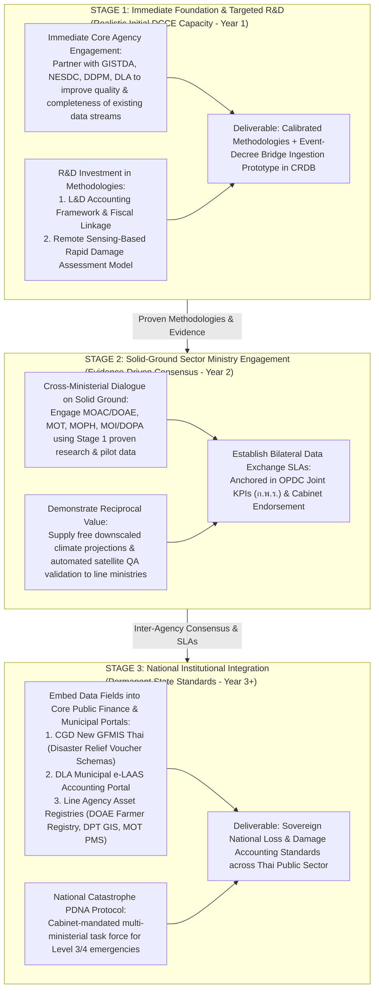

# Technical Specification: The 3-Step Incremental Operational Staircase & National Standardization Roadmap for Loss & Damage

**Target Deliverable**: CRDB Chapter 4 Revision (TOR §5.3.6 & §5.3.7)  
**Document Path**: `plans/chapter4/incremental_strategy_staircase.md`  
**Governing Plan**: [ld_chapter4_decree_and_central_budget_plan.md](file:///C:/Users/sitth/.gemini/antigravity-cli/brain/6430d9ab-a597-4a99-ae0a-b78578aa37d2/ld_chapter4_decree_and_central_budget_plan.md)  
**Status**: Formal Technical Specification (Approved by Boss)  

---

## 1. Executive Summary & Realistic Strategic Calibration

A major lesson from the CRDB empirical pilot across Phichit, Sisaket, and Lampang is that attempting to implement a comprehensive Post-Disaster Needs Assessment (PDNA / DaLA) data collection framework on day one leads to **total operational paralysis**:
- The theoretical 79-field Minimum Viable Dataset (MVD) overwhelmed frontline officers.
- In practice, between **60.8% and 72.2% of fields remained completely blank**.
- Frontline DRM officers in DDPM provincial offices and local administrative organizations (LAOs / อปท.) are severely understaffed and cannot conduct door-to-door physical asset surveys or commercial business downtime interviews while managing emergency relief.

To transition DCCE from theoretical paralysis to immediate, functional operational capability without overestimating the agency's initial internal capacity, this specification establishes a **realistically calibrated, 3-stage evolutionary roadmap**:

---

## 2. Detailed Stage-by-Stage Architecture

### 2.1 Stage 1: Immediate Foundation & Targeted R&D (Realistic Initial DCCE Capacity)
*Target Timeline: Year 1 of CRDB Operation*  
*Field Universe: Tier 1 Mandatory Core (23 Fields)*

#### Primary Objective:
Establish a clean, event-based relational foundation that links physical disaster occurrences, legal decrees, and government relief outlays without imposing a single new survey burden on frontline personnel, while building methodological readiness through targeted research.

#### Operational Mechanism:
1. **Engaging Immediate Core Partner Agencies**:
   - Rather than attempting to integrate with the entire government at once, DCCE focuses its initial bilateral engagement strictly on **four immediate core agencies**:
     1. **DDPM (ปภ.)**: Jointly review and clean existing *Emergency Incident Reports (`แบบรายงานเหตุด่วนสาธารณภัย`)*, addressing missing end dates and standardizing incident descriptions.
     2. **DLA (สถ.)**: Review municipal disaster reporting practices in `e-LAAS` and establish basic damage count templates.
     3. **GISTDA (สทอภ.)**: Ingest radar satellite water extent polygons to serve as the objective spatial QA gate.
     4. **NESDC (สศช.)**: Align macroeconomic valuation definitions with national accounting standards.
2. **DCCE Methodological Research Investments**:
   - DCCE commissions or conducts focused applied research in two vital domains:
     - *Research Stream A (L&D Accounting & Fiscal Linkage)*: Formalizing the $M:N$ mapping rules between Provincial Governor Decrees (`ประกาศเขตฯ`) and DDPM incident records, and establishing the exact formula for attributing Cabinet Emergency Reserve (`งบกลาง`) cash transfers.
     - *Research Stream B (Remote Sensing Rapid Assessment)*: Calibrating the Sentinel-1 SAR flood mortality curves ($V_c(D_{\text{flood}})$) against Thai crop varieties (jasmine rice, cassava, sugarcane) and adapting the World Bank GRADE building vulnerability matrix to Thai housing archetypes.
3. **Sovereign Ingestion Prototype in CRDB**:
   - DCCE builds the internal database prototype in CRDB hosting `DISASTER_EVENT`, `DISASTER_DECREE`, and `EVENT_DECREE_BRIDGE`, shielding external agencies from schema changes.

#### Institutional Output:
- **Calibrated Thai L&D Accounting & Remote Sensing Assessment Methodologies** (Peer-reviewed technical research reports).
- **Annual National Disaster Event & Relief Ledger (Pilot Prototype)**: Documenting event-level casualties and public relief outlays (strictly classified as a fiscal proxy).

---

### 2.2 Stage 2: Solid-Ground Sector Ministry Engagement
*Target Timeline: Year 2 of CRDB Operation*  
*Field Universe: Tier 1 (23 Fields) + Tier 2 (29 Fields) = 52 Fields*

#### Primary Objective:
Engage with relevant sector ministries based on solid empirical research and validated pilot results, establishing bilateral data-sharing consensus before attempting to push formal regulatory mandates.

#### Operational Mechanism:
1. **Engagement on Solid Ground (Evidence-Driven Dialogue)**:
   - Armed with the validated methodologies and pilot evidence from Stage 1, DCCE conducts structured bilateral consultations with key sector ministries:
     - **Ministry of Agriculture and Cooperatives (MOAC / DOAE & OAE)**: Sharing the automated agricultural loss model results and demonstrating how satellite SAR radar can help DOAE audit per-rai compensation claims and eliminate multi-month verification backlogs.
     - **Ministry of Transport (MOT / DOH & DRR)**: Reviewing highway and rural road asset damage logs and establishing standard repair cost integration.
     - **Ministry of Public Health (MOPH)**: Mapping post-disaster disease outbreaks and emergency medical expenditures.
     - **Ministry of Interior (MOI / DOPA)**: Aligning provincial disaster decree gazette feeds with territorial administration codes.
2. **Reciprocal Service Value**:
   - DCCE does not simply "demand" data from sector ministries. DCCE supplies reciprocal value: providing line departments with free downscaled spatial climate hazard projections, drought risk maps, and automated satellite inundation verifications.
3. **Formalizing Central Governance Anchors**:
   - Partner with the **Office of the Public Sector Development Commission (OPDC / ก.พ.ร.)** to embed data pipeline delivery into official Horizontal Joint KPIs for Climate Change Adaptation.
   - Secure a formal **Cabinet Resolution (มติ ครม.)** endorsing the CRDB data catalog under the 20-Year National Strategy.

#### Institutional Output:
- **Formalized Bilateral SLAs with Line Ministries**: Covering automated feeds for DOAE farmer registrations, LDD soil/zoning layers, and OAE baseline prices.
- **Empirical Loss & Damage Estimates for NAP and UNFCCC A-BTR**: Disaggregated by sector (Agriculture, Housing, Transport).

---

### 2.3 Stage 3: National Institutional Integration of L&D Accounting Standards
*Target Timeline: Year 3+ (Long-Term / Catastrophic)*  
*Field Universe: All 79 Fields (Tier 1 + Tier 2 + Tier 3)*

#### Primary Objective:
Embed standardized Loss & Damage accounting data fields directly into the core financial, municipal, and asset management systems of the Thai public sector, establishing permanent national standards.

#### Operational Mechanism:
1. **Integration into the Comptroller General's Department (CGD / New GFMIS Thai)**:
   - Work with CGD to embed the Master Event Key and Decree Reference into the next-generation public financial ERP chart of accounts and disaster relief voucher templates (`ZFB60_K2` / `ZF_53_PM`), making event-level relief tracking an automated standard across all 878 district finance offices.
2. **Integration into DLA's Municipal Portal (`e-LAAS`)**:
   - Institutionalize standard physical damage count fields (structural material, flooded area $m^2$, duration days) into the municipal accounting software used by all 7,850 Local Administrative Organizations (อปท.).
3. **National Catastrophe PDNA Protocol (Step 3 Dormancy)**:
   - For routine events, data collection remains automated via Stage 1/2 algorithms.
   - For rare, Cabinet-declared **Level 3 (National) or Level 4 (Catastrophic)** emergencies under Disaster Act §21, an ad-hoc National Post-Disaster Assessment Task Force (NESDC + DCCE + MOF) is mobilized to populate Tier-3 recovery project cards (`LD_RECOVERY_RECONSTRUCTION_NEEDS`) for Build Back Better capital appropriations.

#### Institutional Output:
- **Sovereign National Loss & Damage Accounting Standards**: Formally gazetted across the Thai public sector.
- **Integrated National Catastrophe Recovery Investment Pipeline**: Directly authorized by Cabinet resolutions for international climate finance and multi-billion-baht reconstruction loans.

---

## 3. Comparison of the Three Evolutionary Stages

| Dimension | Stage 1: Immediate Foundation (Year 1) | Stage 2: Sector Dialogue (Year 2) | Stage 3: National Standards (Year 3+) |
|---|---|---|---|
| **DCCE Role** | Research Investor & Core Integrator | Cross-Ministerial Consensus Builder | National Standard Custodian |
| **Partner Scope** | Core 4: GISTDA, NESDC, DDPM, DLA | Sector Line Ministries: MOAC, MOT, MOPH, MOI | Whole-of-Government: CGD, DLA e-LAAS, Line Agencies |
| **Primary Mechanism** | Methodology R&D + Existing Data Cleaning | Reciprocal Value + OPDC Joint KPIs + SLAs | Core ERP/e-LAAS Schema Integration + Cabinet Protocol |
| **Data Fields Handled** | 23 Fields (Tier 1 Mandatory Core) | 52 Fields (Tier 1 + Tier 2 Modeled) | All 79 Fields (Full MVD + Table 6 BBB Needs) |
| **Field Survey Burden** | **Zero** | **Zero** | **Zero for routine; High for Level 3/4 Catastrophes** |
| **Target Deliverable** | Calibrated R&D Methodologies + Event Ledger | NAP & UNFCCC A-BTR Empirical Tables | Gazetted National L&D Accounting Standards |

---

## 4. Seamless Harmonization with Chapter 7.3

This evolutionary specification directly underpins the strategic recommendations in CRDB Chapter 7.3:
- **`REC-PROD-POL-01`**: Implements Core Service 4 (Loss & Damage 2-Step MVP).
- **`REC-DATA-POL-01`**: Structures the phased SLA negotiation sequence, starting with core agencies in Stage 1 before expanding to sector ministries in Stage 2.
- **`REC-DEV-CYCLE-01`**: Aligns Stage 1 research with Cycle 1 software sprints, and Stage 2 sector integrations with Cycle 2 beta milestones.
