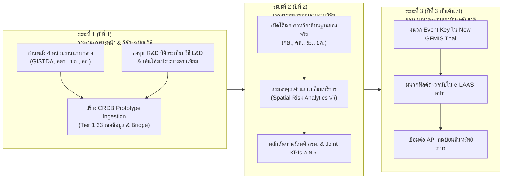

# Package of Reference Draft Prose for Chapter 4 (Loss & Damage Architecture)

**Document Path**: `plans/chapter4/reference_draft_prose.md`  
**Purpose**: Complete, verified Thai institutional reference text, mathematical formulas, and tables prepared for the writing agent. This file packages the verbalized content for Subsection 4.2.4, the Section 4.3 transition, Section 4.4, and Section 4.5 so that the writing agent can reference, adapt, or directly incorporate them into the final drafts without loss of institutional precision.

---

## Part 1: Subsection 4.2.4 การทบทวนกระบวนการเชิงสถาบัน กฎหมาย และสายธารการเงินการคลังในการช่วยเหลือภัยพิบัติของประเทศไทย

```markdown
### 4.2.4 การทบทวนกระบวนการเชิงสถาบัน กฎหมาย และสายธารการเงินการคลังในการช่วยเหลือภัยพิบัติของประเทศไทย

เพื่อแปลงกรอบแนวคิดชุดข้อมูลขั้นต่ำ (MVD) ให้สามารถนำไปปฏิบัติได้จริงในบริบทระบบราชการไทย คณะที่ปรึกษาได้ดำเนินการทบทวนโครงสร้างเชิงสถาบัน กฎหมายปกครอง ระเบียบการเงินการคลัง และกระบวนการรายงานข้อมูลภัยพิบัติที่บังคับใช้อยู่ในปัจจุบัน ซึ่งเป็นปัจจัยเชิงโครงสร้างที่กำหนดพฤติกรรมการจัดเก็บข้อมูลและสายธารงบประมาณช่วยเหลือเยียวยาทั้งหมดของประเทศ

#### 4.2.4.1 สายการบังคับบัญชาตามกฎหมายและลำดับชั้นการรายงานเหตุด่วนสาธารณภัย

โครงสร้างการรายงานข้อมูลสาธารณภัยของประเทศไทยผูกติดอยู่กับสายการบังคับบัญชาตามพระราชบัญญัติป้องกันและบรรเทาสาธารณภัย พ.ศ. 2550 อย่างแนบแน่น โดยมีวัตถุประสงค์หลักเพื่อ "การสั่งการเผชิญเหตุ การควบคุมสถานการณ์ฉุกเฉิน และการระดมทรัพยากรเพื่อบรรเทาทุกข์เร่งด่วน" มิได้ถูกออกแบบมาเพื่อเป็นระบบบัญชีเศรษฐกิจสำหรับประเมินความสูญเสียและความเสียหายในระยะยาว สายการบังคับบัญชาในภาวะฉุกเฉินดำเนินผ่านกลไกกระทรวงมหาดไทย โดยนายอำเภอทำหน้าที่เป็น "ผู้อำนวยการอำเภอ" (มาตรา 20) และผู้ว่าราชการจังหวัดทำหน้าที่เป็น "ผู้อำนวยการจังหวัด" (มาตรา 21) รวมถึงเป็นประธานคณะกรรมการให้ความช่วยเหลือผู้ประสบภัยพิบัติกรณีฉุกเฉินระดับจังหวัด (ก.ช.ภ.จ.) ขณะที่ในระดับพื้นที่ องค์กรปกครองส่วนท้องถิ่น (อปท.) มีความเป็นอิสระในการบริหารงานตาม พ.ร.บ. กำหนดแผนและขั้นตอนการกระจายอำนาจให้แก่องค์กรปกครองส่วนท้องถิ่น พ.ศ. 2542 โดยนายกเทศมนตรีหรือนายก อบต. ทำหน้าที่เป็น "ผู้อำนวยการท้องถิ่น" มีหน้าที่รายงานเหตุด่วนสาธารณภัยไปยังนายอำเภอและผู้ว่าราชการจังหวัดผ่านสำนักงานป้องกันและบรรเทาสาธารณภัยจังหวัด (สนง. ปภ.จ.) ซึ่งทำหน้าที่เป็นฝ่ายเลขานุการ 

ทั้งนี้ พึงตระหนักว่า กรมส่งเสริมการปกครองท้องถิ่น (สถ.) มิได้มีอำนาจบังคับบัญชาสายตรงเหนือนายกเทศมนตรีหรือนายก อบต. แต่ทำหน้าที่เป็นหน่วยงานส่งเสริม สนับสนุนการพัฒนาศักยภาพ และวางระบบมาตรฐานการบริหารงานคลังของท้องถิ่น (ระบบ e-LAAS) ด้วยเหตุนี้ การรายงานข้อมูลผ่าน "แบบรายงานเหตุด่วนสาธารณภัย" ของ กรม ปภ. จึงถูกขับเคลื่อนด้วยความเร็วเพื่อระดมกำลังช่วยชีวิต การอพยพ และการจ่ายถุงยังชีพ สถิติที่บันทึกในระยะแรกจึงเป็นเพียงตัวเลขคาดการณ์หยาบ เช่น จำนวนครัวเรือนที่คาดว่าจะได้รับผลกระทบ เพื่อประกอบการขอเปิดใช้กลไกช่วยเหลือทางกฎหมาย มิใช่สถิติที่ผ่านการประเมินมูลค่าตามหลักวิชาการด้านเศรษฐศาสตร์

#### 4.2.4.2 ตราสารทางกฎหมายปกครองในการปลดล็อกงบประมาณ: "ประกาศเขตการให้ความช่วยเหลือผู้ประสบภัยพิบัติกรณีฉุกเฉิน"

ข้อค้นพบสำคัญยิ่งในเชิงสถาบัน คือ **"งบประมาณช่วยเหลือเยียวยาภัยพิบัติของภาครัฐไทยมิได้ถูกปลดล็อกด้วยรหัสเหตุการณ์ภัยทางกายภาพ (Meteorological Event ID) แต่ต้องอาศัยตราสารทางกฎหมายปกครอง คือ 'ประกาศเขตการให้ความช่วยเหลือผู้ประสบภัยพิบัติกรณีฉุกเฉิน' เป็นเครื่องมือทางกฎหมายเพียงหนึ่งเดียว"** ภายใต้ระเบียบกระทรวงการคลังว่าด้วยเงินทดรองราชการเพื่อช่วยเหลือผู้ประสบภัยพิบัติกรณีฉุกเฉิน พ.ศ. 2562 เมื่อเกิดภัยพิบัติขึ้น นายอำเภอและส่วนราชการที่เกี่ยวข้องจะรวบรวมข้อมูลเสนอต่อคณะกรรมการ ก.ช.ภ.จ. เพื่อประชุมพิจารณากลั่นกรองข้อเท็จจริง หากเข้าข่ายเป็นภัยพิบัติกรณีฉุกเฉินตามระเบียบ ผู้ว่าราชการจังหวัดจะลงนามใน "ประกาศเขตการให้ความช่วยเหลือผู้ประสบภัยพิบัติกรณีฉุกเฉิน" ซึ่งเป็นคำสั่งทางปกครองที่ระบุพื้นที่ประสบภัย (อำเภอ ตำบล หรือหมู่บ้าน) วันที่เริ่มเกิดภัย และประเภทของภัยอย่างเป็นทางการ

ประกาศเขตฯ ดังกล่าวทำหน้าที่เป็นเงื่อนไขทางกฎหมาย (Legal Prerequisite) ที่อนุญาตให้ส่วนราชการสามารถเบิกจ่ายเงินงบประมาณ ไม่ว่าจะเป็นเงินทดรองราชการในอำนาจผู้ว่าราชการจังหวัด วงเงินทดรองราชการระดับกระทรวง หรือการเสนอขอรับจัดสรรงบกลางจากคณะรัฐมนตรี หากปราศจากประกาศเขตฯ ฉบับนี้ ส่วนราชการและ อปท. จะไม่สามารถเบิกจ่ายงบประมาณช่วยเหลือเยียวยาแก่ราษฎรได้เลย เนื่องจากจะถือเป็นการกระทำที่ผิดระเบียบการเงินการคลังของรัฐและมีความรับผิดทางละเมิด

#### 4.2.4.3 ภาวะขัดแย้งของมิติความสัมพันธ์ระหว่างเหตุการณ์ภัยกับประกาศเขตฯ (The Decree vs. Event Cardinality Paradox: M:N)

ในเชิงสถาปัตยกรรมข้อมูล ความสัมพันธ์ระหว่างเหตุการณ์ภัยทางกายภาพกับประกาศเขตภัยพิบัติทางกฎหมายมิได้มีความสัมพันธ์แบบหนึ่งต่อหนึ่ง (1:1) หากแต่มีความสัมพันธ์ที่ซับซ้อนในลักษณะ **กลุ่มต่อกลุ่ม (Many-to-Many: M:N)** ซึ่งเป็นสาเหตุหลักที่ทำให้การเชื่อมโยงข้อมูลการคลังเข้ากับข้อมูลภัยพิบัติในอดีตล้มเหลว:
1. **มิติ 1 ประกาศเขตฯ ครอบคลุมหลายเหตุการณ์ย่อย (1:M)**: ในช่วงฤดูมรสุมหรืออุทกภัยระลอกยาว ผู้ว่าราชการจังหวัดมักออกประกาศเขตฯ ฉบับเดียวที่ครอบคลุมพื้นที่ทั้งจังหวัดหรือหลายอำเภอ โดยประกาศฉบับดังกล่าวทำหน้าที่รองรับเหตุการณ์ย่อยจำนวนมากที่เกิดขึ้นต่อเนื่อง เช่น น้ำป่าไหลหลากระลอกแรก ดินโคลนถล่มในพื้นที่ภูเขา และน้ำล้นตลิ่งในพื้นที่ลุ่มต่ำ ซึ่งเกิดขึ้นต่างวันเวลาและมีลักษณะทางกายภาพแตกต่างกัน
2. **มิติหลายประกาศเขตฯ รองรับเหตุการณ์ภัยขนาดใหญ่เดียว (M:1)**: ในกรณีที่เกิดพายุหมุนเขตร้อนหรือร่องมรสุมขนาดใหญ่พาดผ่าน เช่น พายุโนรู หรือพายุโพดุล พายุลูกเดียวก่อให้เกิดความเสียหายกินพื้นที่ 15–20 จังหวัด ทำให้ผู้ว่าราชการจังหวัดแต่ละจังหวัดต้องออกประกาศเขตฯ ประจำจังหวัดของตนแยกกันถึง 15–20 ฉบับ

หากระบบ CRDB พยายามสร้างกุญแจต่างด้าว (Foreign Key) เชื่อมโยงตรงระหว่างใบสำคัญเบิกจ่ายเงินงบประมาณกับรหัสเหตุการณ์ภัยพิบัติ จะเกิดความล้มเหลวเชิงโครงสร้างทันที คณะที่ปรึกษาจึงได้ออกแบบตารางสะพานเชื่อมโยง `EVENT_DECREE_BRIDGE` ขึ้นในสถาปัตยกรรม CRDB โดยทำหน้าที่จับคู่ระหว่าง `disaster_event_id` และ `decree_id` พร้อมทั้งกำหนดสูตรคณิตศาสตร์ในการปันส่วนงบประมาณช่วยเหลือ (Allocated Weight Ratio) ตามสัดส่วนจำนวนประชากรที่ได้รับผลกระทบและระยะเวลาของภัย:

$$\text{Relief Attributed to Event}_{e} = \text{Disbursement}_{D} \times \frac{\text{Affected Population}_{e} \times \text{Duration}_{e}}{\sum_{i \in E_D} \left(\text{Affected Population}_{i} \times \text{Duration}_{i}\right)}$$

กลไกนี้รับประกันว่า งบประมาณเยียวยาทั้งหมดจะถูกกระจายลงสู่เหตุการณ์ย่อยได้อย่างสมเหตุสมผลโดยไม่เกิดการนับซ้ำ (Double Counting) และยอดรวมงบประมาณรายเหตุการณ์จะเท่ากับยอดการใช้จ่ายจริงตามที่สำนักงานการตรวจเงินแผ่นดิน (สตง.) รับรองเสมอ

#### 4.2.4.4 ภูมิทัศน์สายธารการเงินการคลังภาครัฐ: เงินทดรองราชการในอำนาจผู้ว่าราชการจังหวัด

จากการวิเคราะห์ระบบการเงินการคลังภาครัฐ คณะที่ปรึกษาจำแนกสายธารงบประมาณช่วยเหลือเยียวยาออกเป็นหลายระดับ โดยสายธารระดับแรกที่ถูกเปิดใช้ทันทีหลังมีประกาศเขตฯ คือ **"เงินทดรองราชการเพื่อช่วยเหลือผู้ประสบภัยพิบัติกรณีฉุกเฉินในอำนาจผู้ว่าราชการจังหวัด"** ตามข้อ 18 แห่งระเบียบกระทรวงการคลังฯ พ.ศ. 2562 ในวงเงินไม่เกิน 20,000,000 บาทต่อเขตภัยพิบัติ โดยมี ก.ช.ภ.จ. ทำหน้าที่อนุมัติการใช้จ่ายเงินตามหลักเกณฑ์การใช้จ่ายเงินทดรองราชการฯ ที่กรมบัญชีกลางกำหนด ทั้งนี้ คณะที่ปรึกษาขอเน้นย้ำเส้นแบ่งทางแนวคิดที่สำคัญยิ่งว่า ยอดเงินทดรองราชการและงบประมาณช่วยเหลือเยียวยาของภาครัฐ (`government_relief_allocated_thb`) ในมิตินี้ ถือเป็นเพียง **"ตัวแทนทางการคลัง (Fiscal-Response Proxy)"** ของการบรรเทาทุกข์ตามระเบียบกฎหมาย มิใช่มูลค่าความสูญเสียทางเศรษฐกิจที่แท้จริง (True Economic Loss) ของระบบเศรษฐกิจและสังคม การนำยอดเงินช่วยเหลือเยียวยามาใช้เป็นตัวแทนของความเสียหายทั้งหมดจึงเป็นการประเมินที่ต่ำกว่าความเป็นจริงอย่างมีนัยสำคัญ

ในทางเทคนิค ข้อมูลการเบิกจ่ายเงินทดรองราชการนี้ถูกบันทึกและประมวลผลอยู่ในระบบการบริหารการเงินการคลังภาครัฐแบบอิเล็กทรอนิกส์ใหม่ (New GFMIS Thai) ของกรมบัญชีกลาง โดยบันทึกผ่านคำสั่งเบิกจ่ายเงินยืมทดรอง `ZFB60_K2` (ประเภทเอกสาร ขบ.03 หรือ ขบ.01) และบันทึกล้างเงินยืมทดรองผ่านคำสั่ง `ZF_53_PM` (ประเภทเอกสาร ขจ.05) ภายใต้รหัสแหล่งของเงิน `YY24000` (เงินทดรองราชการเพื่อช่วยเหลือผู้ประสบภัยพิบัติกรณีฉุกเฉิน) และผูกกับบัญชีแยกประเภททั่วไป (General Ledger: GL) รหัส `1106010106` (เงินทดรองราชการ-ผู้ประสบภัยพิบัติ)

อย่างไรก็ดี ข้อจำกัดเชิงระบบที่สำคัญยิ่งใน New GFMIS Thai คือ **"ระบบบัญชีของกรมบัญชีกลางถูกออกแบบมาเพื่อเป็นระบบควบคุมการเบิกจ่ายตามงบประมาณและบัญชีแยกประเภท มิใช่ระบบติดตามสถานการณ์ภัยพิบัติ"** ช่องบันทึกข้อความอ้างอิง (Assignment Field) ในระบบมีขนาดจำกัดเพียง 16 ตัวอักษร และเจ้าหน้าที่การเงินของ สนง. ปภ.จ. หรือที่ทำการปกครองจังหวัด มักกรอกข้อความแบบอิสระ (Free-Text) เช่น "ทดรองน้ำท่วม" หรือเลขที่หนังสืออนุมัติ โดยไม่มีการเชื่อมโยงระบบ (API) ไปยังฐานข้อมูลเหตุด่วนของ ปภ. การพึ่งพาให้เจ้าหน้าที่การเงินพิมพ์รหัสเหตุการณ์ลงใน GFMIS จึงมีความคลาดเคลื่อนสูงและไม่อาจเป็นช่องทางหลักในการเชื่อมโยงข้อมูลได้

#### 4.2.4.5 ภูมิทัศน์สายธารการเงินการคลังภาครัฐ: งบกลางเงินสำรองจ่ายเพื่อกรณีฉุกเฉินหรือจำเป็นตามกฎหมายวิธีการงบประมาณ

ในภัยพิบัติขนาดใหญ่ที่มีความรุนแรง วงเงินทดรองราชการ 20 ล้านบาทในอำนาจผู้ว่าราชการจังหวัดจะหมดลงอย่างรวดเร็ว สายธารงบประมาณที่แท้จริงซึ่งมีขนาดใหญ่ที่สุดและมีบทบาทหลักในการบรรเทาผลกระทบของประเทศ คือ **"งบกลาง รายการเงินสำรองจ่ายเพื่อกรณีฉุกเฉินหรือจำเป็น"** ตามพระราชบัญญัติวิธีการงบประมาณ พ.ศ. 2561 มาตรา 45 ซึ่งต้องได้รับอนุมัติจากคณะรัฐมนตรี (มติ ครม.) เป็นรายกรณี โดยมีวงเงินในแต่ละเหตุการณ์ตั้งแต่ระดับหลายพันล้านบาทจนถึงหลายหมื่นล้านบาท

การเบิกจ่ายงบกลางตามมติ ครม. ดำเนินการผ่าน 3 ช่องทางหลัก:
1. **การจ่ายเงินช่วยเหลือเยียวยาผู้ประสบอุทกภัยตรงเข้าบัญชีครัวเรือนผ่านระบบพร้อมเพย์ (PromptPay)**: คณะรัฐมนตรีจะมอบหมายให้กระทรวงมหาดไทย (กรม ปภ.) ดำเนินโครงการเงินช่วยเหลือเยียวยาผู้ประสบภัยเป็นกรณีพิเศษ โดยกำหนดอัตราช่วยเหลือคงที่แบบขั้นบันไดตามระยะเวลาน้ำท่วมขัง (เช่น 5,000 บาทต่อครัวเรือนสำหรับน้ำท่วมขังไม่เกิน 30 วัน, 7,000 บาทสำหรับ 31–60 วัน, และ 9,000 บาทสำหรับน้ำท่วมขังเกิน 60 วัน) การจ่ายเงินดำเนินการผ่านธนาคารของรัฐ (เช่น ธนาคารออมสิน หรือ ธ.ก.ส.) โอนตรงเข้าบัญชีพร้อมเพย์ที่ผูกกับเลขประจำตัวประชาชนของหัวหน้าครัวเรือน โดยอ้างอิงบัญชีรายชื่อที่ผ่านการประชาคมหมู่บ้าน การตรวจสอบของคณะกรรมการ ก.ช.ภ.อ. และการรับรองจาก ก.ช.ภ.จ. ภายใต้กรอบของประกาศเขตฯ ประจำจังหวัด
2. **เงินช่วยเหลือเกษตรกรผู้ประสบภัยพิบัติผ่านกระทรวงเกษตรและสหกรณ์**: จ่ายเงินชดเชยความเสียหายของพืชผล ปศุสัตว์ และประมง ตามระเบียบกระทรวงการคลังฯ ผ่านบัญชี ธ.ก.ส. ของเกษตรกรที่ขึ้นทะเบียนไว้กับกรมส่งเสริมการเกษตร (กสก.)
3. **งบประมาณฟื้นฟูโครงสร้างพื้นฐานคมนาคมเร่งด่วน**: จัดสรรตรงให้แก่หน่วยงานเจ้าของสินทรัพย์ เช่น กรมทางหลวง กรมทางหลวงชนบท และ อปท. เพื่อซ่อมแซมสะพาน ถนน คันกั้นน้ำ ที่ชำรุดเสียหาย

สายธารงบกลางนี้นับเป็นสายธารที่มีความสมบูรณ์และสามารถตรวจสอบย้อนกลับได้แม่นยำที่สุด เนื่องจากมีมติ ครม. กำกับวงเงินชัดเจน มีบัญชีรายชื่อผู้รับเงินรายบุคคลในระบบธนาคาร และมีประกาศเขตฯ รองรับอย่างเป็นทางการ จึงเป็นแกนหลักที่ระบบ CRDB จะนำมาผูกโยงเข้าสู่ตาราง `EVENT_DECREE_BRIDGE`

#### 4.2.4.6 สายธารเงินทดรองระดับกระทรวง งบประมาณท้องถิ่น และการตัดงบป้องกันและยับยั้งภัยพิบัติ

นอกจากงบกลางและเงินทดรองผู้ว่าราชการจังหวัดแล้ว สายธารการเงินภาครัฐยังประกอบด้วย:
- **เงินทดรองราชการระดับกระทรวง**: เช่น เงินทดรองในอำนาจปลัดกระทรวงเกษตรและสหกรณ์ ตามระเบียบกระทรวงการคลังฯ ข้อ 19 ซึ่งใช้จ่ายเพื่อช่วยเหลือเกษตรกรเพิ่มเติมเมื่อวงเงินของจังหวัดไม่เพียงพอ
- **งบประมาณรายจ่ายขององค์กรปกครองส่วนท้องถิ่น (อปท.)**: เทศบาลและ อบต. สามารถใช้จ่ายงบกลาง ประเภทเงินสำรองจ่าย หรือเงินสะสมของท้องถิ่น เพื่อช่วยเหลือผู้ประสบภัยตามระเบียบกระทรวงมหาดไทยว่าด้วยค่าใช้จ่ายเพื่อช่วยเหลือประชาชนตามอำนาจหน้าที่ขององค์กรปกครองส่วนท้องถิ่น พ.ศ. 2566 โดยบันทึกการใช้จ่ายผ่านระบบบัญชีคอมพิวเตอร์ขององค์กรปกครองส่วนท้องถิ่น (`e-LAAS`) ภายใต้หมวดรายจ่ายเงินอุดหนุนหรือค่าใช้จ่ายเพื่อการบรรเทาทุกข์

**หลักการตัดงบป้องกันและยับยั้งภัยพิบัติออกจากการคำนวณความสูญเสีย (Exclusion of Preventive Contingency)**:  
คณะที่ปรึกษาขอเน้นย้ำประเด็นข้อกฎหมายที่สำคัญ คือ ในระเบียบกระทรวงการคลังฯ พ.ศ. 2562 ข้อ 18/1 กำหนดให้ผู้ว่าราชการจังหวัดมีอำนาจใช้จ่ายเงินทดรองราชการในเชิงป้องกันหรือยับยั้งภัยพิบัติได้ไม่เกิน 10,000,000 บาท ซึ่งเป็นการใช้จ่าย "ก่อนเกิดภัยพิบัติ" (Pre-Disaster Phase) เช่น ค่าจ้างขุดลอกคูคลอง ค่าน้ำมันเชื้อเพลิงสำหรับเครื่องสูบน้ำ หรือค่าจัดซื้อแนวกระสอบทราย **ค่าใช้จ่ายในหมวดป้องกันและยับยั้งนี้ถือเป็นต้นทุนการดำเนินงานเชิงป้องกันของรัฐ มิใช่ความสูญเสียและความเสียหายที่เกิดจากภัยพิบัติ (Loss & Damage)** ดังนั้น ในการคำนวณงบประมาณช่วยเหลือเยียวยาเพื่อบันทึกในระบบ CRDB ระบบจะต้องคัดกรองและตัดยอดเงินทดรองฯ ป้องกัน 10 ล้านบาทนี้ออกจากการประเมิน เพื่อรักษาความถูกต้องตามหลักการทางเศรษฐศาสตร์สากล

#### 4.2.4.7 ข้อจำกัดเชิงพฤติกรรมจากความหวาดกลัวการตรวจสอบของ สตง. และกฎเหล็ก "Zero-Monetary-Valuation at Local Level"

จากการลงพื้นที่และสัมภาษณ์เชิงลึกกับเจ้าหน้าที่ระดับปฏิบัติการ พบอุปสรรคเชิงพฤติกรรมที่สำคัญที่สุดประการหนึ่งในการจัดเก็บข้อมูล คือ **"ภาวะความหวาดกลัวการตรวจสอบของสำนักงานการตรวจเงินแผ่นดิน (สตง.)"** ซึ่งทำให้เจ้าหน้าที่ระดับพื้นที่ปฏิเสธการประเมินมูลค่าความเสียหายตามราคาตลาดจริงโดยสิ้นเชิง

ในทางปฏิบัติ เมื่อบ้านเรือนของประชาชนพังเสียหาย นายช่างโยธาของ อบต. หรือเทศบาล ซึ่งส่วนใหญ่มีเพียง 1 คนต่อแห่ง มีหน้าที่หลักในการออกไปสำรวจความเสียหายเพื่อกรอกแบบฟอร์มขอรับเงินช่วยเหลือเยียวยาตามระเบียบกระทรวงการคลังฯ หากนายช่างโยธาประเมินมูลค่าความเสียหายของบ้านตามราคาประเมินวิศวกรรมจริง เช่น ประเมินว่าบ้านพังเสียหายมูลค่า 2,000,000 บาท แต่วงเงินที่ระเบียบของรัฐสามารถจ่ายเยียวยาได้ตามเกณฑ์สงเคราะห์มีเพดานสูงสุดเพียง 49,500 บาทต่อหลังคาเรือน นายช่างโยธาจะตกเป็นเป้าหมายการตรวจสอบของ สตง. ทันที โดย สตง. จะเรียกตรวจเอกสารประมาณราคา แบบแปลน และใบเสร็จอย่างเข้มงวด หากพบข้อผิดพลาดทางเทคนิค ช่างโยธาอาจถูกตั้งกรรมการสอบสวนทางวินัยและต้องชดใช้เงินตามความรับผิดทางละเมิด 

เพื่อลดความเสี่ยงจากการถูกตรวจสอบ เจ้าหน้าที่ระดับพื้นที่จึงเลือกบันทึกเฉพาะตัวเลขมูลค่าความเสียหายที่ไม่เกินเพดานเงินเยียวยาตามระเบียบ (เช่น ลงตัวเลขเพียง 49,500 บาท หรือลงเฉพาะราคาวัสดุซ่อมแซมจริงที่เบิกจ่ายได้) ส่งผลให้ตัวเลขความเสียหายในรายงานทางการของรัฐ **ต่ำกว่ามูลค่าความเสียหายทางเศรษฐกิจที่แท้จริงอย่างมหาศาล** ซึ่งสอดคล้องกับผลการศึกษาวิจัยเชิงประจักษ์ของสถาบันวิจัยเศรษฐกิจป๋วย อึ๊งภากรณ์ (PIER) ธนาคารแห่งประเทศไทย ที่พบว่างบประมาณช่วยเหลือเยียวยาของภาครัฐครอบคลุมมูลค่าความเสียหายที่แท้จริงของเกษตรกรไม่ถึงร้อยละ 30

จากข้อเท็จจริงดังกล่าว คณะที่ปรึกษาจึงได้กำหนด **"กฎเหล็กการตรวจนับเฉพาะหน่วยทางกายภาพในระดับพื้นที่ (The Zero-Monetary-Valuation at Local Level Rule)"** ในการออกแบบระบบรายงาน กล่าวคือ:
> **"ห้ามบังคับหรือมอบหมายให้เจ้าหน้าที่ระดับท้องถิ่น (อปท. / ปภ. อำเภอ) ทำการประเมินมูลค่าความเสียหายเป็นตัวเงิน (Monetary Valuation) โดยเด็ดขาด ให้เจ้าหน้าที่ระดับพื้นที่ทำหน้าที่บันทึกเฉพาะ 'หน่วยนับทางกายภาพที่สังเกตได้จริงในเชิงประจักษ์' (Physical Observable Counts) เช่น จำนวนหลังคาเรือนที่เสียหาย ระดับความเสียหาย (พังทั้งหลัง/พังบางส่วน) ชนิดวัสดุ พื้นที่เกษตรกรรมที่น้ำท่วมขัง (ไร่) และจำนวนวันน้ำท่วม ส่วนการแปลงหน่วยนับทางกายภาพไปสู่มูลค่าความเสียหายทางเศรษฐกิจเป็นตัวเงิน จะต้องถูกยกไปดำเนินการที่ระบบประมวลผลส่วนกลาง (DCCE/NESDC) ผ่านราคากลางมาตรฐานและแบบจำลองทางเศรษฐศาสตร์เท่านั้น"**

กฎเหล็กนี้จะช่วยปลดล็อกความหวาดกลัวการตรวจสอบของเจ้าหน้าที่ระดับพื้นที่ ทำให้รายงานสถิติทางกายภาพมีความถูกต้องตรงตามความเป็นจริง และลดภาระงานของช่างโยธาในภาวะวิกฤต

#### 4.2.4.8 ขอบเขตแพลตฟอร์ม CRDB ของ กรม สส. และการคัดกรองชุดข้อมูลแกนหลัก Tier 1 (23 เขตข้อมูล)

ข้อสรุปเชิงยุทธศาสตร์ที่ได้จากการทบทวนบริบทเชิงสถาบัน คือ **"กรมการเปลี่ยนแปลงสภาพภูมิอากาศและสิ่งแวดล้อม (กรม สส.) ไม่สามารถคาดหวังให้กรมบัญชีกลาง ปภ. หรือกระทรวงอื่น ๆ ดำเนินการปรับรื้อโครงสร้างระบบสารสนเทศของตนเองเพื่อรองรับตาราง MVD 6 ตาราง 79 เขตข้อมูลได้"** ระบบ New GFMIS Thai และระบบรายงานเหตุด่วนของ ปภ. มีกฎหมายและวัตถุประสงค์เฉพาะของตนเองที่ไม่อาจเปลี่ยนแปลงได้โดยง่าย

ดังนั้น โครงสร้าง MVD ทั้งหมดจึงถูกกำหนดให้ **"ทำงานอยู่ภายใต้ขอบเขตแพลตฟอร์มสารสนเทศอธิปไตยของ กรม สส. (Sovereign DCCE Platform Boundary)"** โดย กรม สส. ทำหน้าที่เป็น **"หน่วยบูรณาการและสังเคราะห์ข้อมูลระดับชาติ (National Data Integrator and Synthesizer)"** ที่ทำหน้าที่ดูดซับข้อมูลทุติยภูมิจากหน่วยงานต่าง ๆ เข้ามาประมวลผลภายในระบบ CRDB

เพื่อความพร้อมในการปฏิบัติการ คณะที่ปรึกษาได้ดำเนินการคัดกรองเขตข้อมูล 79 รายการใน MVD ออกเป็น 3 ระดับความพร้อม (Field Triage Matrix):
- **Tier 1: ชุดข้อมูลแกนหลักภาคบังคับ (Mandatory Core: 23 เขตข้อมูล)**: ยึดหลักการ **"กฎการไม่สร้างภาระสำรวจใหม่ (Zero-New-Survey Rule)"** โดยเป็นเขตข้อมูลที่สามารถนำเข้าได้ทันทีจากฐานข้อมูลรายงานเหตุด่วนของ ปภ., ประกาศเขตฯ ของผู้ว่าราชการจังหวัด, ข้อมูลการจ่ายเงินเยียวยาของ ครม. และรหัสการปกครองของกระทรวงมหาดไทย ช่วยให้ กรม สส. มีฐานข้อมูลบัญชีเหตุการณ์ภัยและงบประมาณเยียวยาที่สมบูรณ์ทันทีโดยไม่ต้องรองบประมาณหรือกำลังพลสำรวจใหม่
- **Tier 2: ชุดข้อมูลส่วนขยายที่เติมเต็มจากส่วนกลางและดาวเทียม (Central Enrichment & Remote Sensing: 29 เขตข้อมูล)**: เป็นเขตข้อมูลที่ กรม สส. ใช้ระบบประมวลผลส่วนกลาง อัลกอริทึมเศรษฐศาสตร์ และภาพถ่ายดาวเทียมของ GISTDA ในการคำนวณมูลค่าความเสียหายทางกายภาพและความสูญเสียทางเศรษฐกิจ โดยที่ระดับพื้นที่ไม่ต้องกรอกข้อมูลแม้แต่เขตข้อมูลเดียว
- **Tier 3: ชุดข้อมูลสำหรับการประเมินภัยพิบัติร้ายแรง (Dormant Post-Catastrophe PDNA: 27 เขตข้อมูล)**: เป็นเขตข้อมูลการประเมินความต้องการฟื้นฟูตามกรอบ DaLA/PDNA สากล ซึ่งจะเปิดใช้งานเฉพาะเมื่อเกิดมหาพิบัติภัยระดับชาติ (ระดับ 3–4) ที่นายกรัฐมนตรีหรือ ครม. มีคำสั่งให้ระดมผู้เชี่ยวชาญลงสำรวจภาคสนามร่วมกับ สศช. เท่านั้น

การกำหนดขอบเขตและจัดกลุ่มข้อมูลเช่นนี้ ทำให้ร่างมาตรฐาน MVD เปลี่ยนสภาพจากข้อเสนอทางทฤษฎีที่สร้างภาระงาน ไปสู่ **"เครื่องมือเชิงนโยบายที่พร้อมปฏิบัติงานได้จริงและสอดรับกับกฎหมายไทยทุกประการ"** ซึ่งคณะที่ปรึกษาจะได้นำโครงสร้างนี้ไปทดสอบกับสถิติเหตุการณ์จริงในอดีตในหัวข้อ 4.3 ถัดไป
```

---

## Part 2: ประโยคเชื่อมโยงท้ายหัวข้อ 4.3 (Section 4.3 Transition Sentence)

```markdown
อย่างไรก็ดี การที่ผลการทดสอบเชิงประจักษ์สะท้อนอัตราการขาดหายของข้อมูลสูงถึงร้อยละ 60.8 ถึง 72.2 ดังกล่าว มิได้เป็นเพียงปัญหาทางเทคนิคของการกรอกแบบฟอร์มรายบุคคล แต่มีรากฐานมาจากความขัดแย้งเชิงโครงสร้างระหว่างการออกแบบแบบจำลอง MVD กับบริบทเชิงสถาบัน กฎหมายปกครอง และระเบียบการเงินการคลังของภาครัฐไทยที่ได้ทบทวนไว้ในหัวข้อ 4.2.4 ซึ่งคณะที่ปรึกษาจะได้ดำเนินการสังเคราะห์และวิเคราะห์เจาะลึกช่องว่างเชิงระบบในหัวข้อ 4.4 ถัดไป
```

---

## Part 3: Section 4.4 การวิเคราะห์ช่องว่างระหว่างร่างมาตรฐาน MVD กับบริบทเชิงสถาบันของไทย

```markdown
# 4.4 การวิเคราะห์ช่องว่างระหว่างร่างมาตรฐาน MVD กับบริบทเชิงสถาบันของไทย

จากผลการทดลองนำร่องเชิงประจักษ์ในหัวข้อ 4.3 ซึ่งพบอัตราการขาดหายของข้อมูล (Missing Data Rate) สูงถึงร้อยละ 60.8 ในกรณีอุทกภัยจังหวัดพิจิตร ร้อยละ 72.2 ในกรณีภัยแล้งจังหวัดศรีสะเกษ และร้อยละ 65.8 ในกรณีวาตภัยจังหวัดลำปาง คณะที่ปรึกษาได้ดำเนินการวิเคราะห์เจาะลึกเพื่อหาสาเหตุเชิงรากเหง้า (Root Cause Analysis) โดยสังเคราะห์ผลการทดลองร่วมกับข้อเท็จจริงเชิงสถาบัน กฎหมาย และสายธารการเงินการคลังที่ได้ทบทวนไว้ในหัวข้อ 4.2.4 การวิเคราะห์พบว่าความว่างเปล่าของข้อมูลมิได้เกิดขึ้นจากความประมาทเลินเล่อหรือการขาดความรับผิดชอบของเจ้าหน้าที่ผู้ปฏิบัติงานรายบุคคล หากแต่เป็นผลลัพธ์โดยตรงจากความขัดแย้งเชิงโครงสร้าง (Structural Conflict) ระหว่างสมมติฐานทางทฤษฎีของแบบจำลองสากล กับความจริงเชิงสถาบัน กฎหมายปกครอง และขีดความสามารถของระบบราชการไทย ซึ่งสามารถจำแนกออกเป็น 4 ช่องว่างเชิงระบบที่สำคัญ ดังนี้

### 4.4.1 ช่องว่างที่ 1: การตัดขาดระหว่างระบบบัญชีการเงินการคลังกับรหัสเหตุการณ์ภัย (Financial System Disconnect: GFMIS vs. Event Keys)

ช่องว่างเชิงโครงสร้างประการแรกซึ่งเป็นอุปสรรคสำคัญที่สุดในการประเมินมูลค่าความเสียหายจากฐานข้อมูลการคลัง คือ **"การตัดขาดอย่างสิ้นเชิงระหว่างระบบบัญชีแยกประเภททั่วไปของภาครัฐ กับระบบติดตามสถานการณ์ภัยพิบัติทางกายภาพ"** ในการทดลองนำร่องทั้ง 3 เหตุการณ์ คณะที่ปรึกษาไม่สามารถดึงข้อมูลวงเงินช่วยเหลือเยียวยาที่รัฐจ่ายจริงเพื่อนำมาผูกกับรหัสเหตุการณ์ `disaster_event_id` ได้โดยตรง เนื่องจากระบบการบริหารการเงินการคลังภาครัฐแบบอิเล็กทรอนิกส์ใหม่ (New GFMIS Thai) ของกรมบัญชีกลาง ทำหน้าที่เป็นสมุดบัญชีแยกประเภททั่วไป (General Ledger: GL) ที่มีวัตถุประสงค์เพื่อการควบคุมวินัยการเบิกจ่ายงบประมาณตามหน่วยเบิกจ่ายและหมวดรายจ่าย มิได้ถูกออกแบบมาเพื่อติดตามวัตถุประสงค์เฉพาะกิจเชิงพื้นที่

ในการเบิกจ่ายเงินทดรองราชการเพื่อช่วยเหลือผู้ประสบภัยพิบัติกรณีฉุกเฉิน (แหล่งเงิน `YY24000` บัญชี GL `1106010106`) เอกสารการเบิกเงินยืมทดรอง (`ZFB60_K2` / ขบ.03) และเอกสารล้างเงินยืมทดรอง (`ZF_53_PM` / ขจ.05) จะถูกบันทึกรวมยอดเป็นรายจังหวัดและรายปีบัญชี โดยไม่มีการกำหนดให้ระบุรหัสเหตุการณ์ภัยพิบัติ (Disaster Event ID) หรือประเภทของภัยลงในฟิลด์ข้อมูลที่มีโครงสร้าง ช่องบันทึกข้อความอ้างอิง (Assignment Field) ในระบบมีขนาดจำกัดเพียง 16 ตัวอักษร และขึ้นอยู่กับการพิมพ์ข้อความอิสระ (Free-Text) ของเจ้าหน้าที่การเงิน เช่น ระบุเพียง "ยืมทดรองน้ำท่วม" หรือเลขที่หนังสืออนุมัติของจังหวัด 

ความไร้โครงสร้างนี้ ส่งผลให้ในกรณีอุทกภัยพิจิตรซึ่งกินเวลายาวนานข้ามปี หรือกรณีวาตภัยลำปางที่เกิดขึ้นหลายระลอก ระบบบัญชีภาครัฐไม่สามารถแยกแยะได้ว่างบประมาณที่เบิกจ่ายไปนั้นเป็นของเหตุการณ์ภัยลูกใด การพยายามบังคับให้ระบบ CRDB เชื่อมโยงกับ GFMIS แบบ 1:1 จึงเป็นไปไม่ได้ในทางเทคนิค และยืนยันถึงความจำเป็นที่ กรม สส. จะต้องใช้ตารางสะพาน `EVENT_DECREE_BRIDGE` เข้ามาทำหน้าที่เกลี่ยยอดงบประมาณตามมิติเวลาและพื้นที่ปกครองของประกาศเขตฯ

### 4.4.2 ช่องว่างที่ 2: สุญญากาศการประเมินมูลค่าจากเพดานสงเคราะห์และความหวาดกลัวการตรวจสอบของ สตง. (The Audit-Constrained Valuation Void)

ผลการทดลองนำร่องชี้ให้เห็นอย่างชัดเจนว่า เขตข้อมูลในตารางความเสียหายทางกายภาพ (`LD_PHYSICAL_DAMAGE`) และความสูญเสียทางเศรษฐกิจ (`LD_ECONOMIC_LOSS`) ที่เกี่ยวกับมูลค่าเป็นตัวเงิน (เช่น `unit_replacement_cost_thb`, `monetary_damage_thb`, `monetary_loss_thb`) ตกอยู่ในสถานะค่าว่างทั้งหมดในทั้ง 3 เหตุการณ์ สาเหตุเชิงรากเหง้าของปัญหานี้เกิดจาก **"การทำงานภายใต้กรอบเพดานเงินช่วยเหลือสงเคราะห์ และภาวะความหวาดกลัวการตรวจสอบของสำนักงานการตรวจเงินแผ่นดิน (สตง.)"**

ภายใต้ระเบียบกระทรวงการคลังว่าด้วยเงินทดรองราชการฯ พ.ศ. 2562 และหลักเกณฑ์วิธีปฏิบัติที่เกี่ยวข้อง การให้ความช่วยเหลือผู้ประสบภัยของภาครัฐไทยมีเจตนารมณ์เพื่อ "การสงเคราะห์บรรเทาความเดือดร้อนเฉพาะหน้า" มิใช่ "การชดใช้ค่าสินไหมทดแทนตามมูลค่าความเสียหายที่แท้จริง" อัตราเงินช่วยเหลือจึงถูกกำหนดเพดานไว้อย่างเข้มงวด เช่น ค่าวัสดุซ่อมแซมบ้านเรือนหลังที่เสียหายบางส่วนจ่ายตามจริงไม่เกิน 49,500 บาทต่อหลังคาเรือน และเงินช่วยเหลือเกษตรกรกรณีข้าวเสียหายสิ้นเชิงจ่ายในอัตราคงที่ 1,340 บาทต่อไร่ (ไม่เกินครัวเรือนละ 30 ไร่) 

ในบริบทเช่นนี้ เจ้าหน้าที่ระดับปฏิบัติการในพื้นที่ โดยเฉพาะนายช่างโยธาขององค์กรปกครองส่วนท้องถิ่น ย่อมไม่มีแรงจูงใจในการประเมินมูลค่าความเสียหายของทรัพย์สินตามราคาตลาด (Market Replacement Cost) เนื่องจากหากนายช่างโยธาประเมินมูลค่าบ้านที่พังทลายตามหลักวิศวกรรมจริงว่ามีมูลค่าความเสียหาย 1,500,000 บาท แต่วงเงินที่ระเบียบอนุญาตให้ช่วยเหลือได้จริงมีเพียง 49,500 บาท ตัวเลข 1,500,000 บาทดังกล่าวจะไม่ถูกนำไปใช้ในกระบวนการเบิกจ่ายใด ๆ ทั้งสิ้น ในทางกลับกัน การบันทึกตัวเลขมูลค่าสูงในเอกสารราชการจะทำให้เจ้าหน้าที่ตกเป็นเป้าหมายในการไต่สวนของ สตง. ซึ่งมักตรวจสอบความสมเหตุสมผลของประมาณราคาและตั้งข้อสงสัยว่ามีการเอื้อประโยชน์ให้แก่ผู้ประสบภัยหรือไม่ เจ้าหน้าที่ระดับพื้นที่จึงเลือกตัดปัญหาด้วยการบันทึกเฉพาะตัวเลขที่เข้าเกณฑ์เพดานสงเคราะห์ (49,500 บาท) หรือละเว้นการกรอกมูลค่าความเสียหายเป็นตัวเงินโดยสิ้นเชิง 

ปรากฏการณ์นี้นำไปสู่ภาวะ **"สุญญากาศของข้อมูลมูลค่าความเสียหายทางเศรษฐกิจ"** ในระบบราชการไทย โดยตัวเลขงบประมาณช่วยเหลือเยียวยาของภาครัฐ (`government_relief_allocated_thb`) ที่เบิกจ่ายจากเงินทดรองราชการหรือมติ ครม. ทำหน้าที่ได้เพียง **"ตัวแทนทางการคลัง (Fiscal Proxy)"** ของมาตรการสงเคราะห์ มิใช่มูลค่าความสูญเสียทางเศรษฐกิจที่แท้จริง (Economic Loss) ของเหตุการณ์ภัยพิบัติ ซึ่งสอดคล้องกับข้อค้นพบของสถาบันวิจัยเศรษฐกิจป๋วย อึ๊งภากรณ์ (PIER) ธนาคารแห่งประเทศไทย ที่ระบุว่างบประมาณเยียวยาของรัฐครอบคลุมความเสียหายจริงไม่ถึงร้อยละ 30 การนำตัวแทนทางการคลังมาแทนที่ความสูญเสียทางเศรษฐกิจที่แท้จริงจึงเป็นการประเมินต่ำกว่าจริงอย่างรุนแรง ดังนั้น การที่แบบจำลอง MVD คาดหวังให้เจ้าหน้าที่ท้องถิ่นกรอกตัวเลขมูลค่าความเสียหายทางเศรษฐกิจจึงเป็นสมมติฐานที่ขัดแย้งกับความเป็นจริงของระบบราชการอย่างสิ้นเชิง

### 4.4.3 ช่องว่างที่ 3: วิกฤตการณ์ขาดแคลนบุคลากรด้านสาธารณภัยในระดับแนวหน้า (Frontline DRM Manpower Crisis)

ช่องว่างประการที่ 3 คือ **"ข้อจำกัดทางกายภาพด้านกำลังคนของหน่วยงานบรรเทาสาธารณภัยในระดับพื้นที่"** ร่างมาตรฐานชุดข้อมูลขั้นต่ำ (MVD) ที่ประกอบด้วย 6 ตาราง 79 เขตข้อมูล ตั้งอยู่บนสมมติฐานโดยปริยายว่า ประเทศไทยมีทีมงานสำรวจประเมินผลกระทบหลังภัยพิบัติ (Post-Disaster Needs Assessment: PDNA) ที่มีความเชี่ยวชาญเฉพาะด้านลงพื้นที่สำรวจอย่างเป็นระบบหลังเกิดภัย แต่ในความเป็นจริงของระบบราชการไทย ภารกิจด้านสาธารณภัยระดับพื้นที่ต้องเผชิญกับภาวะขาดแคลนบุคลากรอย่างรุนแรง

จากการสำรวจข้อมูลเชิงโครงสร้าง สำนักงานป้องกันและบรรเทาสาธารณภัยจังหวัด (สนง. ปภ.จ.) แต่ละแห่งมีข้าราชการและเจ้าหน้าที่ฝ่ายปฏิบัติการเฉลี่ยเพียง 5–8 คน ซึ่งต้องรับผิดชอบพื้นที่ครอบคลุมทั้งจังหวัด (เฉลี่ย 10–20 อำเภอ และมากกว่า 100 ตำบล) ขณะที่ในระดับองค์กรปกครองส่วนท้องถิ่น เทศบาลตำบลและ อบต. ขนาดกลางและขนาดเล็กส่วนใหญ่ มีนายช่างโยธาหรือเจ้าหน้าที่ป้องกันและบรรเทาสาธารณภัยเพียง 1 คนเท่านั้น ในช่วงเวลาที่เกิดภัยพิบัติ เจ้าหน้าที่เหล่านี้ต้องทำหน้าที่เผชิญเหตุเฉพาะหน้าอย่างเต็มกำลัง ตั้งแต่การขับรถบรรทุกน้ำ การจัดส่งถุงยังชีพ การอพยพผู้ป่วยติดเตียง ไปจนถึงการติดตั้งเครื่องสูบน้ำ 

การคาดหวังให้เจ้าหน้าที่ซึ่งกำลังเผชิญวิกฤติต้องกรอกแบบฟอร์มสำรวจที่มีความละเอียดสูงถึง 79 เขตข้อมูล โดยเฉพาะการจำแนกประเภททรัพย์สินตามมาตรฐาน สศช. 5 ภาคส่วน และการคำนวณการหยุดชะงักของกระแสรายได้ จึงเป็นภาระงานที่เกินกำลังทางกายภาพ (Operational Overload) และสร้างแรงต้านทานเชิงลบต่อระบบรายงาน ส่งผลให้เจ้าหน้าที่เลือกกรอกเฉพาะข้อมูลที่จำเป็นต่อการบรรเทาทุกข์เร่งด่วนเท่านั้น วิกฤตด้านกำลังคนนี้เป็นหลักฐานเชิงประจักษ์ที่ชี้ว่า **ระบบ CRDB ไม่สามารถพึ่งพาการเดินสำรวจภาคสนามเป็นช่องทางหลักในการจัดเก็บข้อมูลได้ แต่ต้องปฏิวัติกระบวนการด้วยการนำเทคโนโลยีการตรวจวัดระยะไกล (Remote Sensing) และข้อมูลทุติยภูมิมาช่วยเติมเต็มข้อมูลโดยอัตโนมัติ**

### 4.4.4 ช่องว่างที่ 4: ภาวะขัดแย้งของวันสิ้นสุดเหตุการณ์และเรคคอร์ดกำพร้า (Missing Event Boundary Paradox & Blank End Dates)

ข้อค้นพบที่น่าสนใจจากการทดสอบนำร่องในกรณีวาตภัยจังหวัดลำปาง คือ เขตข้อมูล `event_end_date` (วันที่สิ้นสุดเหตุการณ์) ตกอยู่ในสถานะค่าว่าง ส่งผลให้ระบบไม่สามารถคำนวณระยะเวลาของเหตุการณ์ (`event_duration_days`) ได้ เมื่อสืบค้นลึกลงไปในฐานข้อมูลสถิติสาธารณภัยย้อนหลัง 10 ปีของ กรม ปภ. พบว่ามีระเบียนข้อมูลภัยพิบัติฉับพลัน (Rapid-Onset Disasters) เช่น วาตภัย ดินโคลนถล่ม และน้ำป่าไหลหลาก จำนวนหลายพันรายการที่ไม่มีการบันทึกวันสิ้นสุดเหตุการณ์

สาเหตุของปัญหานี้เกิดจาก **"การขาดขั้นตอนบังคับในการปิดสถานการณ์ในกระบวนงานของระบบสารสนเทศ (Absence of Mandatory Situational Closure Workflow)"** เมื่อเกิดพายุลมกระโชกแรง พายุจะพัดผ่านและสร้างความเสียหายภายในเวลาไม่กี่ชั่วโมง เจ้าหน้าที่ท้องถิ่นจะรายงานเหตุฉุกเฉินเข้ามาในระบบเพื่อขอรับความช่วยเหลือ หลังจากพายุสงบลง ความสนใจของเจ้าหน้าที่จะมุ่งไปที่การตัดกิ่งไม้ การซ่อมแซมสายไฟ และการแจกจ่ายกระเบื้องมุงหลังคา เมื่อกระบวนการช่วยเหลือสิ้นสุดลง เจ้าหน้าที่มักไม่ได้ย้อนกลับเข้าสู่ระบบสารสนเทศเพื่อกดปิดสถานการณ์หรือบันทึกเวลาที่เหตุการณ์ยุติ 

การละเลยนี้ทำให้เกิด "เรคคอร์ดกำพร้า" (Orphan Records) ในฐานข้อมูล ซึ่งในทางเทคนิคทำให้เหตุการณ์นั้นมีสถานะเปิดค้างอยู่ตลอดไป ส่งผลให้การวิเคราะห์ทางสถิติและการประเมินความสูญเสียทางเศรษฐกิจที่ต้องอาศัยตัวแปรระยะเวลาของภัยไม่สามารถประมวลผลได้ ปัญหานี้สะท้อนให้เห็นว่า ระบบรายงานของภาครัฐขาดกลไกการตรวจสอบความสมบูรณ์ของข้อมูลแบบอัตโนมัติ (Automated Data Validation Gate) ที่จะช่วยตรวจจับและปิดสถานการณ์ภัยที่ยุติลงแล้วในทางกายภาพ

### 4.4.5 บทสังเคราะห์ช่องว่างเชิงระบบและข้อสรุปสำหรับการกำหนดยุทธศาสตร์

ตารางที่ 4-8 สรุปการสังเคราะห์ช่องว่างเชิงโครงสร้างระหว่างร่างมาตรฐาน MVD กับบริบทเชิงสถาบันของไทย พร้อมทั้งระบุผลกระทบและแนวทางแก้ไขเชิงสถาปัตยกรรม:

**ตารางที่ 4-8: บทสังเคราะห์ช่องว่างเชิงโครงสร้างระหว่างร่าง MVD กับระบบราชการไทย**

| ช่องว่างเชิงโครงสร้าง | สาเหตุรากเหง้าเชิงสถาบัน | ผลกระทบต่อข้อมูล MVD | แนวทางแก้ไขเชิงสถาปัตยกรรมใน CRDB |
| :--- | :--- | :--- | :--- |
| **1. Financial Disconnect** | New GFMIS Thai บันทึกแบบ GL รวมยอดรายปี ไม่มี Foreign Key เชื่อมกับ ปภ. | งบเยียวยาใน MVD ว่างเปล่า ไม่ทราบยอดเงินรายเหตุการณ์ | ใช้ตารางสะพาน `EVENT_DECREE_BRIDGE` เชื่อมโยงผ่านประกาศเขตฯ และปันส่วนด้วยสูตรคณิตศาสตร์ |
| **2. Audit Valuation Void** | เพดานเงินสงเคราะห์จำกัด และเจ้าหน้าที่กลัวการตรวจสอบจาก สตง. | มูลค่าความเสียหายเป็นตัวเงินว่างเปล่า ตัวเลขราชการต่ำกว่าจริง | ใช้กฎ Zero-Monetary-Valuation บันทึกเฉพาะหน่วยกายภาพ แล้วคำนวณมูลค่าที่ส่วนกลาง |
| **3. Manpower Crisis** | ปภ. จังหวัดมีกำลังพล 5–8 คน อปท. มีช่างโยธา 1 คน ภาระงานเผชิญเหตุล้นมือ | แบบสำรวจ 79 เขตข้อมูลถูกละเลย ข้อมูลขาดความสมบูรณ์ | ใช้ Zero-New-Survey Rule (Tier 1 23 เขตข้อมูล) ผสานภาพถ่ายดาวเทียมและข้อมูลทุติยภูมิ |
| **4. Missing End Dates** | กระบวนงานขาดขั้นตอนบังคับปิดสถานการณ์ในระบบ CMS หลังภัยยุติ | `event_end_date` เป็นค่าว่าง ไม่สามารถคำนวณระยะเวลาภัยได้ | ใช้อัลกอริทึม Remote Sensing QA Gate จากดาวเทียมและเรดาร์น้ำฝนมาช่วยกำหนดวันปิดอัตโนมัติ |

บทเรียนเชิงประจักษ์จากการวิเคราะห์ช่องว่างทั้ง 4 ประการ นำไปสู่ข้อสรุปเชิงนโยบายที่สำคัญยิ่ง คือ **"การพัฒนาระบบข้อมูลความสูญเสียและความเสียหายจากสภาพภูมิอากาศของประเทศไทย จะไม่สามารถประสบความสำเร็จได้หากดำเนินตามแนวทางเดิมที่มุ่งเน้นการผลักดันแบบฟอร์มสำรวจภาคสนามขนาดใหญ่ให้แก่หน่วยงานระดับพื้นที่"** ความพยายามบังคับใช้มาตรฐาน 79 เขตข้อมูลในทันทีโดยปราศจากการปรับกระบวนงาน จะสร้างภาระงานมหาศาลและได้รับข้อมูลที่ขาดความสมบูรณ์เช่นเดิม

ดังนั้น ยุทธศาสตร์การขับเคลื่อนของ กรมการเปลี่ยนแปลงสภาพภูมิอากาศและสิ่งแวดล้อม (กรม สส.) จึงต้องปรับเปลี่ยนกระบวนทัศน์อย่างสิ้นเชิง โดยย้ายจากการบังคับสำรวจภาคสนาม ไปสู่ **"ยุทธศาสตร์แบบบันไดก้าวหน้า (Incremental Strategy Staircase) ที่ขับเคลื่อนด้วยการเสริมพลังข้อมูลทุติยภูมิและภาพถ่ายดาวเทียม ควบคู่กับการลงทุนวิจัยพัฒนาระเบียบวิธีประเมิน และการสานพลังความร่วมมือระหว่างกระทรวงอย่างเป็นขั้นตอน"** ซึ่งคณะที่ปรึกษาจะได้นำเสนอรายละเอียดในหัวข้อ 4.5 ต่อไป
```

---

## Part 4: Section 4.5 ยุทธศาสตร์และแผนที่นำทางแบบบันไดก้าวหน้าสู่มาตรฐานระดับชาติ

```markdown
# 4.5 ยุทธศาสตร์และแผนที่นำทางแบบบันไดก้าวหน้าสู่มาตรฐานระดับชาติ (Incremental Strategy Staircase and National Roadmap)

จากผลการวิเคราะห์ช่องว่างเชิงโครงสร้างในหัวข้อ 4.4 ซึ่งยืนยันว่าปัญหาข้อมูลความสูญเสียและความเสียหายที่ขาดหายไปมิได้เกิดจากความบกพร่องของบุคคล แต่เกิดจากข้อจำกัดเชิงสถาบัน กฎหมายปกครอง และวิกฤตกำลังพลในระดับพื้นที่ คณะที่ปรึกษาจึงได้พัฒนากรอบยุทธศาสตร์และแผนที่นำทางแบบบันไดก้าวหน้า (Incremental Strategy Staircase) เพื่อให้ กรมการเปลี่ยนแปลงสภาพภูมิอากาศและสิ่งแวดล้อม (กรม สส.) มีแนวทางการดำเนินงานที่สอดคล้องกับขีดความสามารถที่แท้จริง และสามารถยกระดับมาตรฐานข้อมูลของประเทศได้อย่างเป็นขั้นเป็นตอน

### 4.5.1 บทสังเคราะห์กรณีศึกษาต้นแบบการประยุกต์ใช้ข้อมูลทุติยภูมิและดาวเทียม (Secondary Data Augmentation Benchmarks)

เพื่อสร้างความชอบธรรมทางวิชาการและนโยบาย คณะที่ปรึกษาได้ทำการศึกษาและสังเคราะห์บทเรียนความสำเร็จจาก 3 โครงการต้นแบบระดับชาติและนานาชาติ ที่ใช้ข้อมูลทุติยภูมิและเทคโนโลยีการตรวจวัดระยะไกลในการประเมินความเสียหายภายใต้ข้อจำกัดด้านกำลังพลภาคสนาม:

1. **โครงการบูรณาการข้อมูลดาวเทียมและทะเบียนเกษตรกร (ธนาคารแห่งประเทศไทย และ GISTDA, ประเทศไทย)**:  
   สถาบันวิจัยเศรษฐกิจป๋วย อึ๊งภากรณ์ (PIER) ธนาคารแห่งประเทศไทย ร่วมกับ สำนักงานพัฒนาเทคโนโลยีอวกาศและภูมิสารสนเทศ (GISTDA) กรมส่งเสริมการเกษตร (กสก.) และธนาคารเพื่อการเกษตรและสหกรณ์การเกษตร (ธ.ก.ส.) ได้พัฒนาระบบประเมินความเสียหายของแปลงเกษตรกรรมจากอุทกภัยและภัยแล้ง โดยนำภาพถ่ายดาวเทียมเรดาร์ Sentinel-1 SAR และ COSMO-SkyMed มาซ้อนทับกับพิกัดแปลงที่ดินในทะเบียนเกษตรกร (ทบก.) และข้อมูลประวัติสินเชื่อ ผลการศึกษาพิสูจน์ให้เห็นว่า การใช้ภาพถ่ายดาวเทียมวิเคราะห์ระยะเวลาน้ำท่วมขังร่วมกับแบบจำลองความเปราะบางของพืชผล สามารถระบุความเสียหายในระดับแปลงได้อย่างแม่นยำ และชี้ให้เห็นว่าเงินช่วยเหลือเยียวยาของภาครัฐครอบคลุมความเสียหายจริงไม่ถึงร้อยละ 30 ของมูลค่าความสูญเสียทางเศรษฐกิจที่แท้จริง
2. **โครงการ RIICE (Remote Sensing-based Information and Insurance for Crops in Emerging Economies, เอเชียตะวันออกเฉียงใต้)**:  
   ความร่วมมือระหว่างองค์กรความร่วมมือระหว่างประเทศของเยอรมนี (GIZ), สถาบันวิจัยข้าวนานาชาติ (IRRI), และบริษัท Swiss Re ในกลุ่มประเทศเอเชียตะวันออกเฉียงใต้ (รวมถึงเวียดนาม ฟิลิปปินส์ และไทย) โดยใช้ภาพถ่ายดาวเทียม Sentinel-1 SAR ผสานกับแบบจำลองการเจริญเติบโตของข้าว (ORYZA Crop Growth Model) เพื่อติดตามพื้นที่ปลูกข้าวและประเมินผลผลิตที่สูญเสียจากอุทกภัยและภัยแล้ง ผลสัมฤทธิ์ในประเทศเวียดนามแสดงให้เห็นว่า ระบบสามารถลดระยะเวลาในการประเมินความเสียหายเพื่อจ่ายเงินชดเชยจากเดิมที่ต้องใช้เวลาสำรวจภาคสนามนานกว่า 6 เดือน ให้เหลือเพียง 15 วันหลังเกิดภัย โดยมีความถูกต้องแม่นยำสูงกว่าร้อยละ 85
3. **ระเบียบวิธี GRADE ของธนาคารโลก (World Bank Global Rapid post-disaster Damage Estimation)**:  
   ธนาคารโลกและ GFDRR ได้พัฒนาระเบียบวิธี GRADE ซึ่งเป็นกระบวนการจำลองความเสียหายทางเศรษฐกิจอย่างรวดเร็วบนโต๊ะทำงาน (Desk-Based Rapid Estimation) ภายใน 10–14 วันหลังเกิดภัยพิบัติ โดยนำร่องรอยพื้นที่น้ำท่วมจากดาวเทียม ข้อมูลความเร็วลมจากแบบจำลองอุตุนิยมวิทยา ไปซ้อนทับกับฐานข้อมูลสถิติประชากร ข้อมูลสินทรัพย์ทางกายภาพ (Exposure Database) และต้นทุนราคาค่าก่อสร้าง จากการประยุกต์ใช้ในภัยพิบัติมากกว่า 66 เหตุการณ์ทั่วโลก พบว่าผลการประเมินเบื้องต้นมีความแม่นยำสูงถึงร้อยละ 88–90 (มีความคลาดเคลื่อนเพียง $\pm 10–12\%$ เมื่อเทียบกับการลงสำรวจพื้นที่จริงอย่างละเอียดตามกรอบ PDNA เต็มรูปแบบ)

บทเรียนจากกรณีศึกษาทั้ง 3 โครงการ ยืนยันว่าการใช้ข้อมูลทุติยภูมิผสานกับภาพถ่ายดาวเทียมมิใช่แนวคิดเชิงทดลอง แต่เป็นระเบียบวิธีมาตรฐานสากลที่สามารถนำมาประยุกต์ใช้ทดแทนการสำรวจภาคสนามในระบบราชการไทยได้อย่างมีประสิทธิภาพ

### 4.5.2 ระเบียบวิธีวิเคราะห์แนวทางที่ 1: ระบบตรวจสอบและประเมินความเสียหายภาคเกษตรกรรมอัตโนมัติ (Agricultural Damage QA & Valuation Engine)

สำหรับภาคเกษตรกรรม คณะที่ปรึกษาเสนอให้ กรม สส. นำระเบียบวิธีของ PIER และ RIICE มาปรับใช้เป็นระบบประมวลผลส่วนกลางใน CRDB โดยผสาน 4 แหล่งข้อมูลทุติยภูมิของหน่วยงานรัฐ: (1) ข้อมูลรอยน้ำท่วมขังและความถี่จากภาพถ่ายดาวเทียม Sentinel-1 SAR ของ GISTDA (2) ข้อมูลพิกัดแปลง ชนิดพืช และวันที่เพาะปลูก จากระบบทะเบียนเกษตรกร (ทบก.) ของ กรมส่งเสริมการเกษตร (3) ข้อมูลแผนที่การจำแนกการใช้ประโยชน์ที่ดินและความเหมาะสมของชุดดินจาก กรมพัฒนาที่ดิน และ (4) ข้อมูลผลผลิตเฉลี่ยต่อไร่และราคา ณ ไร่นา จาก สำนักงานเศรษฐกิจการเกษตร (สศก.)

การคำนวณมูลค่าความสูญเสียทางเศรษฐกิจของพืชผล (`LD_ECONOMIC_LOSS`) ดำเนินการผ่านสูตรทางคณิตศาสตร์:

$$\text{Economic Loss}_{\text{crop}} = \sum_{p \in \text{Parcels}} \text{Area}_{p} \times \text{Normal Yield}_{c(p)} \times \text{Farmgate Price}_{c(p)} \times V_{\text{flood}}(D_{p})$$

โดยที่:
- $\text{Area}_{p}$ คือ พื้นที่เพาะปลูกของแปลง $p$ (ไร่) ที่ดึงจากฐานข้อมูล ทบก.
- $\text{Normal Yield}_{c(p)}$ คือ ผลผลิตเฉลี่ยปกติของพืชชนิด $c$ ในพื้นที่นั้น (กก./ไร่) จาก สศก.
- $\text{Farmgate Price}_{c(p)}$ คือ ราคาที่เกษตรกรขายได้ ณ ไร่นา (บาท/กก.) จาก สศก.
- $V_{\text{flood}}(D_{p})$ คือ ฟังก์ชันความเปราะบางของพืชผล (Crop Vulnerability Function) ตามระยะเวลาน้ำท่วมขัง $D_{p}$ (วัน) ที่สกัดจากดาวเทียม Sentinel-1 เช่น ข้าวที่จมน้ำมิดรวงนานเกิน 7 วัน จะมีสัมประสิทธิ์ความเสียหาย $V_{\text{flood}} = 1.0$ (เสียหายสิ้นเชิง) ขณะที่น้ำท่วมขัง 3–5 วัน จะมีสัมประสิทธิ์ความเสียหาย $V_{\text{flood}} = 0.4–0.6$

ระบบคำนวณนี้จะทำหน้าที่เป็น "เกณฑ์ตรวจสอบอัตโนมัติ (Automated QA Gate)" ในการตรวจทานความสมเหตุสมผลของคำขอรับเงินเยียวยาจากระดับพื้นที่ พร้อมทั้งเติมเต็มเขตข้อมูลมูลค่าความสูญเสียทางเศรษฐกิจในตาราง Tier 2 ได้อย่างสมบูรณ์โดยที่เจ้าหน้าที่เกษตรอำเภอไม่ต้องกรอกแบบฟอร์มเพิ่มเติม

### 4.5.3 ระเบียบวิธีวิเคราะห์แนวทางที่ 2: การประเมินความเสียหายสิ่งปลูกสร้างอย่างรวดเร็วบนโต๊ะทำงาน (Desk-Based Rapid Damage Estimation via GRADE Adaptation)

สำหรับภาคที่อยู่อาศัยและโครงสร้างพื้นฐาน คณะที่ปรึกษาเสนอให้นำระเบียบวิธี GRADE ของธนาคารโลกมาปรับใช้สำหรับการประเมินความเสียหายทางกายภาพ (`LD_PHYSICAL_DAMAGE`) โดยใช้การประมวลผลบนโต๊ะทำงานที่ส่วนกลาง ผ่านการซ้อนทับชั้นข้อมูลภูมิสารสนเทศ 4 ชั้น:
1. **Hazard Footprint**: ขอบเขตรอยน้ำท่วม ความลึกของน้ำ หรือความเร็วลมพายุ จาก GISTDA และกรมอุตุนิยมวิทยา
2. **Exposure Data**: จำนวนอาคารและครัวเรือนในพื้นที่ประสบภัย จากฐานข้อมูลสำมะโนประชากรและที่อยู่อาศัยของกรมการปกครอง
3. **Asset Typology**: การจำแนกประเภทและลักษณะโครงสร้างอาคาร (เช่น บ้านเดี่ยวไม้, บ้านเดี่ยวครึ่งตึกครึ่งไม้, อาคารคอนกรีตเสริมเหล็ก) ตามสถิติมาตรฐานของกรมโยธาธิการและผังเมือง
4. **Replacement Unit Cost**: บัญชีราคากลางค่าก่อสร้างและซ่อมแซมอาคารต่อตารางเมตร จากกรมบัญชีกลางและสมาคมผู้ประเมินค่าทรัพย์สิน

การคำนวณมูลค่าความเสียหายทางกายภาพของสิ่งปลูกสร้าง ($Damage_{\text{housing}}$) คำนวณจาก:

$$\text{Damage}_{\text{housing}} = \sum_{k} N_{k} \times \overline{\text{Area}}_{k} \times \text{Cost}_{k} \times \text{Damage Ratio}(H)$$

โดย $N_{k}$ คือจำนวนบ้านประเภท $k$ ที่อยู่ในเขตภัย, $\overline{\text{Area}}_{k}$ คือขนาดพื้นที่ใช้สอยเฉลี่ย, $\text{Cost}_{k}$ คือราคาค่าก่อสร้างใหม่ต่อตารางเมตร, และ $\text{Damage Ratio}(H)$ คือสัดส่วนความเสียหายตามระดับความรุนแรงของภัย $H$ (เช่น ความลึกของน้ำท่วม) วิธีการนี้ช่วยให้ กรม สส. และรัฐบาลสามารถรายงานตัวเลขมูลค่าความเสียหายของสิ่งปลูกสร้างในภาพรวมของประเทศได้ภายใน 10–14 วันหลังเกิดภัย เพื่อใช้ประกอบการตัดสินใจของคณะรัฐมนตรีได้อย่างทันท่วงที

### 4.5.4 จุดยืนเชิงนโยบายต่อข้อมูลภาพถ่ายดาวเทียม (Remote Sensing Policy Stance: Option 2)

คณะที่ปรึกษาขอยืนยันจุดยืนเชิงนโยบายที่สำคัญยิ่งว่า **"การประยุกต์ใช้เทคโนโลยีภาพถ่ายดาวเทียมในระบบ CRDB ถูกวางตำแหน่งเป็นเครื่องมือตรวจสอบความถูกต้องอัตโนมัติ (Automated QA Gate) และเป็นแหล่งข้อมูลเติมเต็มฐานล่างขั้นต่ำ (Lower-Bound Baseline) เท่านั้น โดยจะไม่ถูกนำไปใช้ทดแทนกระบวนการรับรองสิทธิและการจ่ายเงินเยียวยาของภาครัฐในระดับพื้นที่ (Option 2)"**

เหตุผลเบื้องหลังจุดยืนนี้ คือ การเคารพต่อกระบวนการทางกฎหมายปกครองและสิทธิของประชาชน การจ่ายเงินเยียวยาตามระเบียบกระทรวงการคลังฯ ต้องอาศัยการประชาคมหมู่บ้านและการรับรองจาก ก.ช.ภ.จ. เนื่องจากข้อจำกัดทางเทคนิคของภาพถ่ายดาวเทียม (เช่น การบดบังของเมฆ หรือความละเอียดของพิกเซล) อาจไม่สามารถตรวจจับน้ำท่วมใต้เรือนยอดไม้หรือน้ำท่วมในพื้นที่แคบได้ หากใช้ดาวเทียมเป็นเกณฑ์ตัดสินการจ่ายเงิน อาจทำให้ประชาชนที่ได้รับผลกระทบจริงตกหล่นจากสิทธิการเยียวยา ดังนั้น ข้อมูลจากพื้นที่ยังคงเป็นเอกสารหลักในการจ่ายเงิน ส่วนข้อมูลดาวเทียมจะทำหน้าที่เติมเต็มความสมบูรณ์ของบัญชีสถิติความสูญเสียทางเศรษฐกิจของประเทศในระบบ CRDB

### 4.5.5 ปรัชญาและโครงสร้างยุทธศาสตร์แบบบันไดก้าวหน้า 3 ระยะ (The 3-Stage Evolutionary Roadmap Philosophy)

ในการนำสถาปัตยกรรมข้อมูลไปสู่การปฏิบัติ คณะที่ปรึกษายึดหลักปรัชญาที่ว่า **"ยุทธศาสตร์ต้องสอดคล้องกับขีดความสามารถที่แท้จริงขององค์กร (Capacity-Realistic Strategy)"** กรมการเปลี่ยนแปลงสภาพภูมิอากาศและสิ่งแวดล้อม (กรม สส.) เป็นหน่วยงานที่เพิ่งได้รับการจัดตั้งขึ้นใหม่ การคาดหวังให้ กรม สส. ใช้อำนาจสั่งการข้ามกระทรวงเพื่อบังคับใช้มาตรฐานข้อมูล 79 เขตข้อมูลในทันที ย่อมเป็นแนวทางที่ไม่สามารถบรรลุผลได้ในทางปฏิบัติ

ดังนั้น แผนที่นำทางจึงถูกจัดวางเป็น **"ยุทธศาสตร์บันได 3 ขั้น (3-Step Incremental Staircase Roadmap)"** ที่เริ่มต้นจากจุดที่ กรม สส. มีอำนาจควบคุมและมีความพร้อมสูงสุด แล้วจึงขยายผลไปสู่การบูรณาการระดับชาติ:
- **ขั้นที่ 1 (ทันที / บัญชีเหตุการณ์และงบเยียวยาแกนหลัก 23 เขตข้อมูล)**: ดำเนินการโดย กรม สส. ร่วมกับ 4 หน่วยงานแกนกลางเฉพาะหน้า ควบคู่กับการลงทุนวิจัยระเบียบวิธีประเมิน
- **ขั้นที่ 2 (ระยะกลาง / การประเมินมูลค่าอัตโนมัติ 52 เขตข้อมูล)**: ขยายผลสู่การเจรจากับกระทรวงรายสาขาบนฐานหลักฐานเชิงประจักษ์และการประมวลผลดาวเทียม (รวม Tier 1 23 เขตข้อมูล + Tier 2 29 เขตข้อมูล เป็น 52 เขตข้อมูล)
- **ขั้นที่ 3 (ระยะยาว / การประเมินมหาพิบัติภัยเต็มรูปแบบ 79 เขตข้อมูล และบูรณาการมาตรฐานสู่ระบบสถาบันระดับชาติ)**: ฝังรหัสเหตุการณ์เข้าสู่ระบบ New GFMIS Thai, e-LAAS และเปิดใช้ชุดข้อมูล PDNA (Tier 3 27 เขตข้อมูล รวมเป็น 79 เขตข้อมูล) เฉพาะกรณีเกิดภัยพิบัติร้ายแรง

ความเชื่อมโยงของบันไดทั้ง 3 ขั้นแสดงดังภาพที่ 4-1:



---

### 4.5.6 บันไดขั้นที่ 1 (ปีที่ 1): การสานพลัง 4 หน่วยงานแกนกลางเฉพาะหน้า (Immediate Core Agency Engagement)

ในระยะเริ่มต้น (ปีงบประมาณที่ 1) กรม สส. จะต้องไม่กระจายกำลังไปเจรจากับทุกกระทรวง แต่ต้องจำกัดขอบเขตการทำงานร่วมกับ **4 หน่วยงานแกนกลางที่มีบทบาทจำเป็นเร่งด่วน** เพื่อยกระดับคุณภาพของสายธารข้อมูลที่มีอยู่เดิม:

1. **กรมป้องกันและบรรเทาสาธารณภัย (ปภ.)**: ร่วมมือในการปรับปรุงกระบวนงานระบบรายงานเหตุด่วนสาธารณภัยเดิม โดยเพิ่มการบันทึกรหัสประกาศเขตฯ และแก้ไขปัญหาวันสิ้นสุดเหตุการณ์ที่เป็นค่าว่าง ด้วยการกำหนดขั้นตอนบังคับปิดสถานการณ์ในระบบสารสนเทศ
2. **กรมส่งเสริมการปกครองท้องถิ่น (สถ.)**: ทำงานร่วมกันเพื่อทำความเข้าใจระบบบัญชีคอมพิวเตอร์ของ อปท. (`e-LAAS`) และจัดทำคู่มือแนะนำแนวปฏิบัติสำหรับนายช่างโยธา อบต./เทศบาล ในการตรวจนับเฉพาะหน่วยทางกายภาพ (วัสดุ, ตร.ม., วัน) โดยไม่ต้องประเมินมูลค่าเป็นตัวเงิน เพื่อปลดล็อกความกลัวการตรวจสอบของ สตง.
3. **สำนักงานพัฒนาเทคโนโลยีอวกาศและภูมิสารสนเทศ (GISTDA)**: จัดทำบันทึกข้อตกลงเพื่อเชื่อมโยงท่อส่งข้อมูล (Data Pipeline) รอยน้ำท่วมจากดาวเทียม Sentinel-1 SAR และดาวเทียม THEOS เข้าสู่ระบบ CRDB แบบกึ่งอัตโนมัติ
4. **สำนักงานสภาพัฒนาการเศรษฐกิจและสังคมแห่งชาติ (สศช.)**: ร่วมกันกำหนดนิยามและกรอบการจำแนกความสูญเสียทางเศรษฐกิจ 5 ภาคส่วน ให้มีความสอดคล้องระหว่างการจัดทำบัญชีประชาชาติ (National Accounts) กับระบบ CRDB

การโฟกัสที่ 4 หน่วยงานแกนกลางนี้ ช่วยให้การประสานงานมีความคล่องตัวสูงและสามารถสร้างผลลัพธ์ที่เป็นรูปธรรมได้ภายในระยะเวลา 6–12 เดือนแรก

### 4.5.7 บันไดขั้นที่ 1 (ปีที่ 1): การจัดสรรงบประมาณเพื่อลงทุนวิจัยและพัฒนาระเบียบวิธีประเมิน (Targeted R&D Investments in Methodologies)

ควบคู่กับการประสานงานระหว่างหน่วยงาน กรม สส. จะต้องจัดสรรงบประมาณเพื่อ **"ลงทุนในงานวิจัยและพัฒนาระเบียบวิธีประเมิน L&D และระเบียบวิธีดาวเทียมอย่างจริงจัง"** ร่วมกับสถาบันการศึกษาและสถาบันวิจัยชั้นนำของประเทศ ใน 2 ประเด็นหลัก:
1. **การพัฒนาระเบียบวิธีบัญชีความสูญเสียและความเสียหายจากสภาพภูมิอากาศของไทย (Thailand L&D Accounting Methodology)**: วิจัยสูตรการคำนวณความสูญเสียทางเศรษฐกิจทั้งที่จับต้องได้ (Economic Loss) และที่ไม่สามารถประเมินมูลค่าเป็นตัวเงินได้ (Non-Economic Loss: NELD) เช่น ผลกระทบต่อความหลากหลายทางชีวภาพ สุขภาพจิต และมรดกทางวัฒนธรรม ให้สอดคล้องกับระเบียบวิธีของอนุสัญญา UNFCCC
2. **การปรับเทียบเส้นโค้งความเปราะบางของพืชผลและอาคารในบริบทไทย (Calibration of Vulnerability Functions)**: ทำการศึกษาภาคสนามและวิจัยเชิงลึกเพื่อสร้างค่าสัมประสิทธิ์ความเปราะบาง ($V(D)$) ของพืชเศรษฐกิจหลัก (ข้าว ข้าวโพด อ้อย ยางพารา) และแบบจำลองอาคารไทย เพื่อนำมาป้อนเป็นอัลกอริทึมกลางให้แก่แบบจำลองดาวเทียม

การลงทุนด้าน R&D นี้ จะทำให้ กรม สส. มี **"เครื่องมือทางวิชาการและทรัพย์สินทางปัญญาที่ผ่านการพิสูจน์แล้ว (Validated Methodological Assets)"** ซึ่งทำหน้าที่เป็นเครื่องมือสร้างความน่าเชื่อถือและความชอบธรรมทางวิชาการ เมื่อต้องก้าวเข้าสู่การเจรจาระดับกระทรวงในระยะที่ 2

### 4.5.8 บันไดขั้นที่ 1 (ปีที่ 1): ผลผลิตรูปธรรมและระบบต้นแบบการรับข้อมูลใน CRDB (Deliverables & Sovereign Ingestion Prototype)

ผลลัพธ์สุดท้ายของบันไดขั้นที่ 1 คือ การที่ กรม สส. สามารถส่งมอบผลงานรูปธรรม 3 ด้าน:
1. **คู่มือระเบียบวิธีและพจนานุกรมข้อมูลฉบับสมบูรณ์**: ที่ผ่านการเห็นชอบร่วมกันระหว่าง 4 หน่วยงานแกนกลาง
2. **ระบบต้นแบบการดูดซับข้อมูลใน CRDB (Sovereign Ingestion Prototype)**: พัฒนาระบบฐานข้อมูลภายใน กรม สส. เพื่อรองรับการนำเข้าข้อมูลชุดแกนหลัก Tier 1 (23 เขตข้อมูล) และตารางสะพาน `EVENT_DECREE_BRIDGE` โดย กรม สส. ทำหน้าที่ประมวลผลข้อมูลจากรายงาน ปภ. ประกาศเขตฯ และมติ ครม. งบกลาง เข้าด้วยกัน
3. **รายงานบัญชีความสูญเสียและความเสียหายนำร่องของประเทศ (Pilot National L&D Account)**: จัดทำรายงานสถิติ L&D จากข้อมูลในอดีตย้อนหลัง 5 ปี เพื่อพิสูจน์แนวคิด (Proof of Concept) และแสดงให้รัฐบาลเห็นถึงประโยชน์ของระบบ

---

### 4.5.9 บันไดขั้นที่ 2 (ปีที่ 2): การเจรจาทวิภาคีบนฐานหลักฐานเชิงประจักษ์กับกระทรวงรายสาขา (Evidence-Driven Sector Engagement)

เมื่อ กรม สส. มีระเบียบวิธีที่ผ่านการวิจัยรองรับ และมีระบบต้นแบบ CRDB ที่ทำงานได้จริงในระยะที่ 1 กรม สส. จะก้าวเข้าสู่ระยะที่ 2 ด้วยการ **"เปิดการเจรจาทวิภาคีกับกระทรวงเจ้าของข้อมูลรายสาขาบนฐานของหลักฐานเชิงประจักษ์ (Evidence-Driven Dialogue)"** มิใช่การเรียกร้องขอข้อมูลลอย ๆ

กลุ่มเป้าหมายในระยะนี้ ได้แก่:
- **กระทรวงเกษตรและสหกรณ์**: กรมส่งเสริมการเกษตร (ข้อมูลทะเบียนเกษตรกร ทบก. รายแปลง) และสำนักงานเศรษฐกิจการเกษตร (ข้อมูลโครงสร้างต้นทุนและราคาผลผลิต)
- **กระทรวงคมนาคม**: กรมทางหลวง และกรมทางหลวงชนบท (ข้อมูลพิกัดความเสียหายของถนน สะพาน และงบประมาณซ่อมสร้างเร่งด่วน)
- **กระทรวงมหาดไทย**: กรมการปกครอง (ข้อมูลสำมะโนประชากรระดับหมู่บ้าน)
- **กระทรวงสาธารณสุข**: ข้อมูลสถานพยาบาลที่ได้รับผลกระทบและการเจ็บป่วยจากสภาพอากาศสุดขั้ว

การเจรจาจะมุ่งเน้นการนำผลงานต้นแบบจากระยะที่ 1 ไปสาธิตให้กระทรวงต่าง ๆ เห็นว่า อัลกอริทึมของ กรม สส. สามารถช่วยลดภาระงานในการสำรวจ และช่วยให้แต่ละกระทรวงมีข้อมูลสนับสนุนการของบประมาณฟื้นฟูที่มีน้ำหนักทางวิชาการมากขึ้น

### 4.5.10 บันไดขั้นที่ 2 (ปีที่ 2): คุณค่าแลกเปลี่ยนและคานงัดการบริหารราชการส่วนกลาง (Reciprocal Service Value & Administrative Levers)

เพื่อสร้างความร่วมมือที่ยั่งยืน กรม สส. จะต้องใช้กลยุทธ์ **"การส่งมอบคุณค่าแลกเปลี่ยน (Reciprocal Value Proposition)"** กล่าวคือ กรม สส. จะไม่ทำตัวเป็นเพียง "ผู้ขอข้อมูล" แต่จะทำหน้าที่เป็น "ผู้ให้บริการข้อมูลเชิงวิเคราะห์" โดย กรม สส. จะนำข้อมูลที่บูรณาการแล้วมาจัดทำเป็นรายงานการฉายภาพความเสี่ยงภูมิอากาศเชิงพื้นที่ (Spatial Climate Risk Analytics) และระบบแจ้งเตือนผลกระทบรายสาขา ส่งมอบคืนให้แก่กระทรวงภาคีโดยไม่มีค่าใช้จ่าย เพื่อให้กระทรวงเหล่านั้นนำไปใช้ในการวางแผนงบประมาณของตนเอง

ในเวลาเดียวกัน กรม สส. จะขับเคลื่อน **"คานงัดการบริหารราชการส่วนกลาง"** ผ่าน 2 กลไกสำคัญ:
1. **การผลักดันตัวชี้วัดร่วม (Joint KPIs) ผ่านสำนักงาน ก.พ.ร.**: เสนอให้สำนักงานคณะกรรมการพัฒนาระบบราชการ (ก.พ.ร.) กำหนดตัวชี้วัดการบูรณาการข้อมูลความสูญเสียและความเสียหายจากสภาพภูมิอากาศ เป็นตัวชี้วัดขับเคลื่อนร่วมกันระหว่างกระทรวง (Joint KPI) ซึ่งจะทำให้ผู้บริหารของทุกกระทรวงมีพันธะผูกพันในการเชื่อมโยงข้อมูล
2. **การเสนอขอรับรองสถานะระบบ CRDB ผ่านมติ ครม.**: ผลักดันข้อเสนอเชิงนโยบายเข้าสู่การพิจารณาของคณะรัฐมนตรี เพื่อให้ ครม. มีมติเห็นชอบให้ระบบ CRDB เป็น "ระบบศูนย์กลางข้อมูลความสูญเสียและความเสียหายของประเทศ" และกำหนดให้หน่วยงานรัฐให้การสนับสนุนข้อมูลตามกรอบบันไดก้าวหน้า

---

### 4.5.11 บันไดขั้นที่ 3 (ปีที่ 3 เป็นต้นไป): การบูรณาการมาตรฐานสู่ระบบสถาบันระดับชาติ (National Institutional Integration into Core Systems)

เป้าหมายสูงสุดในระยะยาวของยุทธศาสตร์ คือ **"การสถาปนาเขตข้อมูลมาตรฐาน Loss & Damage ให้กลายเป็นส่วนหนึ่งของระบบงานประจำวันของระบบราชการไทย (Institutionalized National Standards)"** โดยไม่ต้องอาศัยการประสานงานเป็นกรณีพิเศษอีกต่อไป

การดำเนินงานในบันไดขั้นที่ 3 มุ่งเน้นการฝังเขตข้อมูลเข้าสู่ระบบแกนหลักของประเทศ:
1. **การผนวกเขตข้อมูลเข้าสู่ระบบ New GFMIS Thai ของกรมบัญชีกลาง**: ผลักดันให้กรมบัญชีกลางเพิ่มฟิลด์ข้อมูล `Master Event Key` และ `Decree Reference ID` ในหน้าจอคำสั่งเบิกจ่ายเงินยืมทดรองราชการ (`ZFB60_K2`) และหน้าจอเบิกจ่ายงบกลาง เพื่อให้ทุกการเบิกจ่ายเงินเยียวยาของภาครัฐมีรหัสกำกับที่สามารถเชื่อมโยงเข้ากับระบบ CRDB ได้โดยอัตโนมัติ
2. **การผนวกเขตข้อมูลเข้าสู่ระบบ e-LAAS ขององค์กรปกครองส่วนท้องถิ่น**: ร่วมมือกับกรมส่งเสริมการปกครองท้องถิ่น (สถ.) ในการเพิ่มโมดูลย่อยในระบบ e-LAAS ให้องค์กรปกครองส่วนท้องถิ่นบันทึกหน่วยนับความเสียหายทางกายภาพของโครงสร้างพื้นฐานท้องถิ่นในขั้นตอนการตั้งฎีกาเบิกจ่ายเงินช่วยเหลือ
3. **การเชื่อมต่อท่อส่งข้อมูลแบบถาวร (Production API Pipelines)**: พัฒนาระบบ Application Programming Interface (API) อัตโนมัติระหว่างระบบ CRDB กับฐานข้อมูลทะเบียนเกษตรกรของ กสก. และระบบสารสนเทศทางภูมิศาสตร์ของกรมทางหลวง เพื่อให้ข้อมูลไหลเวียนเข้าสู่ระบบ CRDB อย่างต่อเนื่องแบบ Real-time

เมื่อบรรลุบันไดขั้นที่ 3 ประเทศไทยจะมีระบบบัญชีข้อมูลความสูญเสียและความเสียหายที่สมบูรณ์ เป็นมาตรฐานเดียวกันทั้งประเทศ และพร้อมรองรับการรายงานตามกรอบความโปร่งใสแบบขยาย (Enhanced Transparency Framework: ETF) ภายใต้ความตกลงปารีส และการจัดทำรายงานความโปร่งใสรายสองปี (BTR) ได้อย่างยั่งยืน

### 4.5.12 เกณฑ์การประเมินมหาพิบัติภัยระดับชาติ และการส่งมอบสู่วงจรพัฒนาระบบ SDLC ระยะที่ 3

เพื่อความสมบูรณ์ของสถาปัตยกรรมข้อมูล คณะที่ปรึกษาได้กำหนด **"เกณฑ์กระตุ้นการประเมินภัยพิบัติร้ายแรงระดับชาติ (National Catastrophe PDNA Protocol)"** สำหรับการเปิดใช้งานเขตข้อมูลในกลุ่ม Tier 3 (27 เขตข้อมูล) โดยกำหนดให้เปิดใช้งานเฉพาะเมื่อเกิดภัยพิบัติระดับชาติ (สาธารณภัยขนาดใหญ่ระดับ 3 หรือมหาพิบัติภัยระดับ 4 ตาม พ.ร.บ. ป้องกันและบรรเทาสาธารณภัย พ.ศ. 2550) ซึ่งนายกรัฐมนตรี คณะกรรมการ ปภ.ช. หรือมติ ครม. มีคำสั่งให้จัดตั้ง "คณะกรรมการประเมินความต้องการหลังภัยพิบัติแห่งชาติ" ร่วมกับ สศช. โดยระดมผู้เชี่ยวชาญลงสำรวจภาคสนามตามระเบียบวิธี PDNA สากล

**การส่งมอบงานเชื่อมโยงสู่วงจรพัฒนาระบบ (SDLC Handover)**:  
ข้อเสนอทั้งหมดในบทที่ 4 นี้ ได้รับการจัดทำขึ้นโดยคำนึงถึงความต่อเนื่องในการพัฒนาระบบเทคโนโลยีสารสนเทศตามสัญญาจ้างในอนาคต (SDLC Phase 3) ข้อมูลและข้อกำหนดทางเทคนิคทั้งหมด ไม่ว่าจะเป็นพจนานุกรมข้อมูล 6 ตาราง, ตารางสะพาน `EVENT_DECREE_BRIDGE`, สูตรการปันส่วนงบประมาณ, อัลกอริทึมการประเมินด้วยดาวเทียม, และยุทธศาสตร์บันได 3 ขั้น จะถูกส่งมอบและเชื่อมโยงเข้ากับ **"ข้อเสนอแนะเชิงนโยบายและเทคนิค รหัส REC-PROD-POL-01 (การพัฒนาระบบประเมินความสูญเสียและความเสียหาย 2 ขั้นตอน: L&D 2-Step MVP)" ในหัวข้อ 7.3 ของรายงานฉบับสมบูรณ์นี้** ซึ่งสอดคล้องกับการวางแผนรอบการพัฒนาระบบ (System Development Lifecycle: รอบ Cycle 1 สำหรับ Tier 1 และรอบ Cycle 2 สำหรับ Tier 2/3) 

การออกแบบที่เป็นเอกภาพนี้ ช่วยให้ผู้รับจ้างพัฒนาระบบในระยะต่อไปสามารถนำพิมพ์เขียวสถาปัตยกรรมข้อมูลในบทที่ 4 ไปดำเนินการออกแบบสถาปัตยกรรมซอฟต์แวร์ (Software Architecture) และสร้างส่วนต่อประสาน (User Interface / Data Pipelines) ได้ทันทีโดยไม่เกิดสุญญากาศทางเทคนิค อันเป็นการบรรลุวัตถุประสงค์และส่งมอบผลงานตามข้อกำหนดของ TOR ข้อ 5.3.6 และข้อ 5.3.7 อย่างสมบูรณ์ รอบด้าน และพร้อมนำไปปฏิบัติงานได้จริงทุกประการ
```
