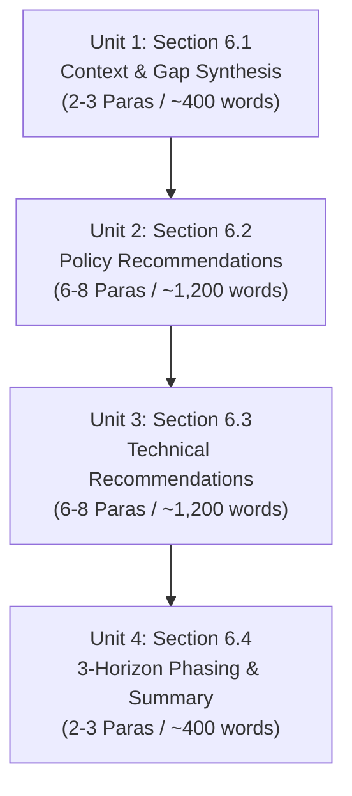

# Drafting Plan: CRDB Full Report Chapter 6 (Draft Version)

**Document Purpose**: Detailed, unit-by-unit drafting specification for generating the text of Chapter 6. This is the **Plan to Draft**, providing the exact argumentative structure, paragraph blueprints, vocabulary constraints, and evidence bindings.

**Title**: บทที่ 6 (ร่าง) ข้อมูลเสนอแนะเชิงนโยบายและเชิงเทคนิคในการพัฒนารายการชุดข้อมูลพื้นฐาน รายการผลิตภัณฑ์ข้อมูลและสารสนเทศและการบริหารจัดการข้อมูลในระยะยาว  
**Contractual Scope**: TOR Clause 5.3.9 (Installment 3: Draft Final Report)  
**Author Stance**: คณะที่ปรึกษา (Active subject; objective institutional voice)  
**Tone & Vocabulary**: Formal institutional Thai, analytical, non-poetic. Avoid colloquial filler words ("ในยุคปัจจุบัน", "ต้องตระหนัก", "สิ่งสำคัญคือ") and avoid opening paragraphs with modal directives ("ควร..."). Toned-down administrative capability phrasing (per Boss's decision).

---

## Unit Breakdown & Execution Sequence

---

## Unit 1: Section 6.1 บริบทและความเชื่อมโยงจากผลการวิเคราะห์ช่องว่างสู่กรอบข้อเสนอแนะฉบับร่าง

- **Target Size**: 2–3 paragraphs (~400 words).
- **Core Objective**: Establish the bridge between Section 5.3.8 (Gap Analysis) and the draft recommendations under 5.3.9.

### Paragraph Blueprint:
1. **Paragraph 1: The Core Synthesis from Gap Analysis**:
   - *Claim*: The primary adaptation data bottleneck in Thailand is not merely data scarcity, but the lack of curation, official certification, and decision-ready service packaging.
   - *Grounds*: Cite findings from Section 5.3.8—80% of data requests are manual/ad-hoc; over 51% of catalog datasets are restricted; users lack confidence in using uncertified data for official planning.
   - *Warrant*: Expanding raw data collection without fixing governance and delivery channels will only recreate the same data bottlenecks.
2. **Paragraph 2: The Institutional Transition Mandate**:
   - *Claim*: DCCE must evolve beyond an IT file repository into the architect and certifier of national adaptation information services.
   - *Grounds*: 5 cross-cutting user demands: official baseline values, sub-provincial resolution, science-to-decision translation, systematic data access, and uncertainty communication standards.
   - *So-What*: Sets up the dual-axis structure (Policy & Technical) across the 3 target components of the TOR.

- **Evidence Anchors**: [`2026-06-25_draft_section-5.3.8.md`](file:///C:/Users/sitth/OracleWorkspace/Arun_Creagy/ψ/incubate/DCCE/CRDB/output/draft_final_report/5.3/2026-06-25_draft_section-5.3.8.md), [`analysis-piece-for-5.3.9.md`](file:///C:/Users/sitth/OracleWorkspace/Arun_Creagy/ψ/incubate/DCCE/CRDB/output/draft_final_report/5.3/analysis-piece-for-5.3.9.md).

---

## Unit 2: Section 6.2 ข้อมูลเสนอแนะเชิงนโยบาย (Policy Recommendations)

- **Target Size**: 6–8 paragraphs (~1,200 words).
- **Structure**: 3 Subsections mapped to the 3 TOR components.

### 6.2.1 ด้านการพัฒนารายการชุดข้อมูลพื้นฐาน (Baseline Data Inventory Policy)
1. **Paragraph 1: Institutional Partnerships & Data Sharing Policy**:
   - Transition from one-off, ad-hoc data requests to structured institutional technical partnerships across 3 modalities: data sharing, methodology co-creation, and service co-design.
   - Priority partner agencies: TMD, GISTDA, water management authorities, and statistical agencies.
2. **Paragraph 2: Data Access & Open Data Classification Policy**:
   - Clear classification rules to systematically address the 51% access restriction. Establishing public and academic open-access tiers with transparent licensing terms.

### 6.2.2 ด้านการพัฒนารายการผลิตภัณฑ์ข้อมูลและสารสนเทศ (Information Product Inventory Policy)
3. **Paragraph 3: Managing Systems as an Information Service Portfolio**:
   - Moving from one-off software procurement to managing a continuing service portfolio responsive to multi-sectoral users.
   - Introducing 4 initial core service clusters:
     1. Certified reference datasets & data certification services.
     2. Spatial climate risk analysis services.
     3. Evidence support services for budgeting and finance.
     4. Uncertainty management and interpretation standards.
4. **Paragraph 4: Strategic Role Framing of DCCE**:
   - DCCE avoids duplicating the primary scientific and observational data generation of line agencies.
   - Focuses institutional authority on setting standards, certifying authoritative reference data, and acting as the bridge translating climate science into policy/financial decisions.

### 6.2.3 ด้านการบริหารจัดการข้อมูลในระยะยาว (Long-Term Data Management Policy)
5. **Paragraph 5: Internal Data Governance Structure (Pillar 1)**:
   - Establishing the 6 core operational elements: Data Owner, Data Steward, Technical Custodian, Minimum Metadata Standard, Data Dictionary, and Certification Workflow.
   - Appointing an internal Data Governance Working Committee within the Adaptation Division.
6. **Paragraph 6: Institutional Protection for Administrative Decision-Making**:
   - Providing an established institutional review and certification process that protects departmental officers and executives when applying probabilistic climate projections in official planning and budget allocations.
7. **Paragraph 7: Multi-Disciplinary Capacity & Infrastructure Investment (Pillar 6)**:
   - Fostering interdisciplinary capability by networking with sectoral specialists (disaster engineers, environmental economists, hydrologists) alongside climate data scientists.
   - Investing in cloud infrastructure for stable API queries and pursuing complementary long-term international climate funds (GCF, GEF).

- **Evidence Anchors**: [`2026-06-25_draft_section-5.3.9.md`](file:///C:/Users/sitth/OracleWorkspace/Arun_Creagy/ψ/incubate/DCCE/CRDB/output/draft_final_report/5.3/2026-06-25_draft_section-5.3.9.md) §§1, 2, 4, 5, 6; [`plans/chapter6/evidence_map.md`](file:///C:/Users/sitth/OracleWorkspace/Arun_Creagy/plans/chapter6/evidence_map.md).

---

## Unit 3: Section 6.3 ข้อมูลเสนอแนะเชิงเทคนิค (Technical Recommendations)

- **Target Size**: 6–8 paragraphs (~1,200 words).
- **Structure**: 3 Subsections mapped to the 3 TOR components.

### 6.3.1 ด้านการพัฒนารายการชุดข้อมูลพื้นฐาน (Baseline Data Inventory Technical)
1. **Paragraph 1: Metadata Standard (12 Core Attributes)**:
   - Mandatory minimum metadata fields: dataset name, owner agency, coverage period, spatial resolution, update cycle, certification status, and constraints (aligned with DGA and ISO 19115).
2. **Paragraph 2: Conceptual Data Model (CDM) and Data Dictionary**:
   - Establishing the 8-domain Conceptual Data Model as the interoperability backbone linking hazards, exposure, vulnerability, impacts, and adaptation.
   - Unified Data Dictionary for cross-cutting variables.

### 6.3.2 ด้านการพัฒนารายการผลิตภัณฑ์ข้อมูลและสารสนเทศ (Information Product Inventory Technical)
3. **Paragraph 3: National Risk Methodology Catalog (ระบบสารบัญระเบียบวิธีวิเคราะห์ความเสี่ยง)**:
   - Creating a centralized catalog of risk assessment methodologies (index-based vs. probabilistic models) with selection guidelines to eliminate methodological divergence in local planning.
4. **Paragraph 4: Science-to-Decision Translation Standards**:
   - Formulating standardized calculation rules, proxy metrics, and application manuals for translating climate variables into engineering design parameters and economic loss estimates.
5. **Paragraph 5: Uncertainty Communication Standards**:
   - Standardizing the communication of projection uncertainty: distinguishing probabilistic vs. scenario-based information, presenting confidence intervals, and defining model boundaries.

### 6.3.3 ด้านการบริหารจัดการข้อมูลในระยะยาว (Long-Term Data Management Technical)
6. **Paragraph 6: Interoperability Standards & Web Services**:
   - Technical standards for automated APIs and Web Services: versioning, access control protocols, update triggers, and endpoint documentation.
7. **Paragraph 7: Automated CMS Quality Validation Rules**:
   - Converting metadata standards and CDM rules into automated CMS validation checks upon data ingestion, ensuring quality control is systemic rather than manual.

- **Evidence Anchors**: [`2026-06-25_draft_section-5.3.9.md`](file:///C:/Users/sitth/OracleWorkspace/Arun_Creagy/ψ/incubate/DCCE/CRDB/output/draft_final_report/5.3/2026-06-25_draft_section-5.3.9.md) §3; [`Pillar_03_DataInventory_DQ_Technical_Specification.md`](file:///C:/Users/sitth/OracleWorkspace/Arun_Creagy/ψ/incubate/DCCE/CRDB/output/02_Data_Inventory/Pillar_03_DataInventory_DQ_Technical_Specification.md).

---

## Unit 4: Section 6.4 กรอบลำดับการดำเนินงานเชิงวิเคราะห์ 3 ขอบฟ้า (3 Horizons Phasing)

- **Target Size**: 2–3 paragraphs (~400 words).
- **Core Objective**: Present the analytical 3-horizon phasing derived from the initial study.

### Paragraph Blueprint:
1. **Paragraph 1: Horizon 1 (Foundational Credibility & Governance)**:
   - Focus: Establishing internal data governance, minimum metadata standard, data dictionary, and reference dataset registers for recurring use cases.
2. **Paragraph 2: Horizon 2 (Connectivity & Service Enablement)**:
   - Focus: Developing automated data exchange (APIs), data packages, usage guidelines, and pilot prototypes for spatial risk and budgeting services.
3. **Paragraph 3: Horizon 3 (Systemic Integration & Scale)**:
   - Focus: Scaling full interoperability, uncertainty communication standards, and multi-agency co-development across all 8 adaptation service sectors.

- **Evidence Anchors**: [`2026-06-25_draft_section-5.3.9.md`](file:///C:/Users/sitth/OracleWorkspace/Arun_Creagy/ψ/incubate/DCCE/CRDB/output/draft_final_report/5.3/2026-06-25_draft_section-5.3.9.md) §7; [`analysis-piece-for-5.3.9.md`](file:///C:/Users/sitth/OracleWorkspace/Arun_Creagy/ψ/incubate/DCCE/CRDB/output/draft_final_report/5.3/analysis-piece-for-5.3.9.md).
