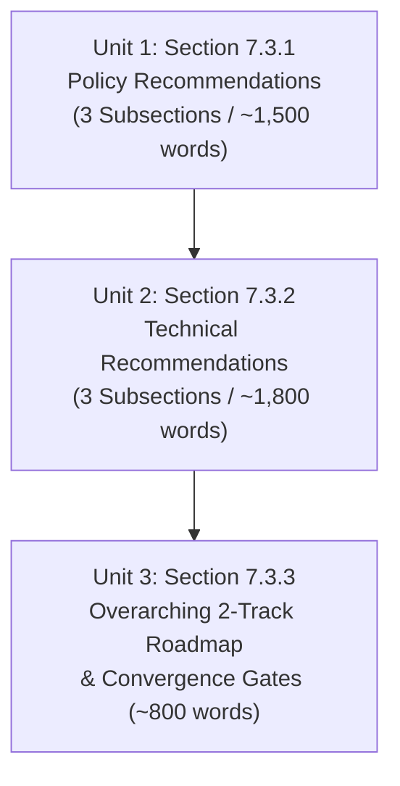

# Drafting Plan: CRDB Full Report Section 7.3 (Final Recommendations)

**Document Purpose**: Detailed, unit-by-unit drafting specification for generating the text of Section 7.3 in Chapter 7. This is the **Plan to Draft**, providing the exact argumentative structure (Toulmin: Claim, Grounds, Warrant, So-What), paragraph blueprints, vocabulary constraints, evidence bindings, and evaluation gates matching `plans/crdb_recommendations_evaluator.json`.

**Title**: ส่วนที่ 7.3 ข้อมูลเสนอแนะเชิงนโยบายและเชิงเทคนิคในการพัฒนารายการชุดข้อมูลพื้นฐาน รายการผลิตภัณฑ์ข้อมูลและสารสนเทศและการบริหารจัดการข้อมูลในระยะยาว (ฉบับสมบูรณ์)  
**Contractual Scope**: TOR Installment 4 Deliverable 4 (Final Report)  
**Author Stance**: คณะที่ปรึกษา (Active subject; authoritative institutional advisory voice)  
**Tone & Vocabulary**: Formal institutional Thai, technically rigorous, highly actionable, decision-ready. Avoid colloquial filler words ("ในยุคปัจจุบัน", "ต้องตระหนัก", "สิ่งสำคัญคือ") and avoid opening paragraphs with modal directives ("ควร..."). Strictly follow the TOR title and structural framing.

---

## Unit Breakdown & Execution Sequence

---

## Unit 1: Section 7.3.1 ข้อมูลเสนอแนะเชิงนโยบาย (Policy Recommendations)

- **Target Size**: 3 Subsections (~1,500 words).
- **Core Stance**: Actionable executive policy mandates for DCCE leadership, backed by empirical data and institutional authority.

### 7.3.1.1 ด้านการพัฒนารายการชุดข้อมูลพื้นฐาน (Baseline Data Inventory Policy)
- **Primary Dissected Recommendation**: `REC-BASE-POL-01` (Proactive Bilateral Data Exchange Agreement & Access Classification Policy).
- **Paragraph 1: Demand-Driven Intake & 5-Agency Bilateral Agreements**:
  - *Claim*: กรมการเปลี่ยนแปลงสภาพภูมิอากาศและสิ่งแวดล้อม (กรม สส.) ต้องจัดทำข้อตกลงแลกเปลี่ยนข้อมูล (Data Exchange Agreements / SLAs) ทวิภาคีร่วมกับ 5 หน่วยงานหลัก โดยยึดความต้องการเชิงยุทธศาสตร์ของ กรม สส. เป็นตัวตั้ง (Demand-driven) ไม่ใช่ปริมาณข้อมูลที่หน่วยงานภายนอกถือครอง
  - *Grounds*: หน่วยงานหลัก 5 แห่ง (กรมอุตุนิยมวิทยา, สำนักงานพัฒนาเทคโนโลยีอวกาศและภูมิสารสนเทศ (องค์การมหาชน) - GISTDA, กรมป้องกันและบรรเทาสาธารณภัย - ปภ., สำนักงานสถิติแห่งชาติ - สสช., และสำนักงานสภาพัฒนาการเศรษฐกิจและสังคมแห่งชาติ - สศช.) เป็นผู้ถือครองชุดข้อมูล 97 ชุด จากทั้งหมด 260 ชุดในบัญชีข้อมูลระดับประเทศ (คิดเป็นร้อยละ 37.3) และผลการสำรวจพบว่าข้อมูลกว่าร้อยละ 51 ยังถูกจำกัดการเข้าถึง
  - *Warrant*: การกำหนดความต้องการเชิงยุทธศาสตร์ล่วงหน้าช่วยป้องกันมิให้แพลตฟอร์มกลายเป็นเพียงคลังรวมไฟล์ข้อมูลดิบที่ขาดทิศทางการใช้งาน และการเจรจาทวิภาคีเป็นรายหน่วยงานช่วยขจัดอุปสรรคเชิงระเบียบและข้อจำกัดตามกฎหมายคุ้มครองข้อมูลส่วนบุคคล (PDPA) อย่างตรงจุด
  - *So-What*: เปลี่ยนสถานะของ กรม สส. จากหน่วยงานผู้ร้องขอข้อมูลรายครั้ง (ad-hoc manual requests) เป็นผู้กำหนดสถาปัตยกรรมการไหลของข้อมูลการปรับตัวระดับชาติ
- **Paragraph 2: Principle of Parallel Execution (หลักการดำเนินงานคู่ขนาน)**:
  - *Claim*: การเจรจาจัดทำข้อตกลงแลกเปลี่ยนข้อมูลทวิภาคีต้องดำเนินงานควบคู่ไปกับการจัดซื้อจัดจ้างและพัฒนาระบบเทคโนโลยีสารสนเทศ โดยไม่ตั้งเงื่อนไขให้การเจรจาเสร็จสิ้นก่อนเริ่มพัฒนาระบบ
  - *Grounds*: การเจรจาเชิงสถาบันระหว่างหน่วยงานภาครัฐมักใช้ระยะเวลายาวนาน หากนำมาเป็นเงื่อนไขบังคับก่อน (Gating dependency) จะส่งผลให้การส่งมอบระบบตามสัญญาจ้างต้องหยุดชะงัก
  - *Warrant & Action*: กำหนดให้สัญญาก่อสร้างระบบมุ่งเน้นการวางท่อเชื่อมต่อข้อมูล (Data Ingestion Pipeline) และส่วนต่อประสาน (API Interface) ที่รองรับมาตรฐานกลางไว้ล่วงหน้า เพื่อให้สามารถเชื่อมต่อข้อมูลได้ทันทีเมื่อข้อตกลงทวิภาคีแล้วเสร็จ

### 7.3.1.2 ด้านการพัฒนารายการผลิตภัณฑ์ข้อมูลและสารสนเทศ (Information Product Inventory Policy)
- **Primary Dissected Recommendation**: `REC-PROD-POL-01` (Product-Led Strategy & 5 Priority Services Portfolio).
- **Paragraph 3: Product-Led Strategy & DCCE Product Ownership**:
  - *Claim*: กรม สส. ต้องกำหนดขอบเขตงานจ้างพัฒนาระบบด้วยยุทธศาสตร์ “ผลิตภัณฑ์นำ” (Product-Led Strategy) โดย กรม สส. ทำหน้าที่เป็นเจ้าของผลิตภัณฑ์ (Product Owner) ที่กำหนดฟังก์ชันเชิงวิชาการอย่างเบ็ดเสร็จ แทนการปล่อยให้ผู้รับจ้างตีความความต้องการเอง
  - *Grounds*: บทเรียนจากการจัดซื้อจัดจ้างระบบภาครัฐชี้ว่า ระบบที่มุ่งเน้นความพร้อมทางเทคนิคของแพลตฟอร์มโดยขาดการระบุบริการขั้นสุดท้าย มักส่งผลให้ได้ระบบที่ไม่ตอบโจทย์การใช้งานจริงของผู้กำหนดนโยบาย
  - *Warrant*: การเจาะจงบริการที่มีความพร้อมสูงและตรงกับความต้องการของกลุ่มผู้ใช้เป้าหมาย จะช่วยสร้างผลสัมฤทธิ์เชิงประจักษ์ (Early Wins) ภายในรอบสัญญาจ้าง
- **Paragraph 4: Prioritization of the 5 Core Services & Data Catalog**:
  - *Claim*: กำหนดขอบเขตสัญญาจ้างช่วงพัฒนา (Downstream Build Contract) มุ่งเน้นการส่งมอบบริการหลัก 5 รายการ แบ่งเป็น 2 กลุ่มงานเชิงยุทธศาสตร์ พร้อมกำหนดให้ระบบบัญชีข้อมูล (Data Catalog) เป็นบริการส่งมอบแยกต่างหากอย่างเป็นเอกเทศ
  - *Grounds & Structure*:
    1. *กลุ่มบริการวิเคราะห์ความเสี่ยงเดิม 3 บริการ*: ฐานข้อมูลความเสี่ยงเชิงพื้นที่ (Spatial Risk Database), แผนที่ความเสี่ยงเชิงพื้นที่ (Hazard & Exposure Maps), และดัชนีความเสี่ยงสภาพภูมิอากาศ (Climate Risk Index) ซึ่งมีระเบียบวิธีและผลการวิเคราะห์ระดับประเทศรองรับแล้ว
    2. *กลุ่มบริการที่มีความต้องการเชิงนโยบายเร่งด่วน 2 บริการ*: บริการข้อมูลเพื่อการรายงานความโปร่งใสรายสองปีด้านการปรับตัว (Adaptation Biennial Transparency Report - A-BTR) ตามพันธกรณีความตกลงปารีส และบริการสถิติความเสียหายและการสูญเสียจากสภาพภูมิอากาศ (Disaster Loss and Damage Statistics)
  - *Warrant (Loss & Damage 2-Step MVP)*: บริการสถิติความสูญเสียฯ ต้องดำเนินงานแบบ 2 ระยะตามระดับความพร้อมของข้อมูล: ระยะที่ 1 เชื่อมโยงข้อมูลความเสียหายทางกายภาพจาก ปภ. ซึ่งพร้อมใช้งานทันที; ระยะที่ 2 พัฒนาระเบียบวิธีประเมินมูลค่าความสูญเสียทางเศรษฐกิจร่วมกับ สศช. ในระยะถัดไป

### 7.3.1.3 ด้านการบริหารจัดการข้อมูลในระยะยาว (Long-Term Data Management Policy)
- **Primary Dissected Recommendations**: `REC-MGMT-POL-01` (4-Tier Internal Data Governance Structure), `REC-MGMT-POL-02` (In-House Data Capability Building), and `REC-MGMT-POL-03` (Agile Contract Governance Framework).
- **Paragraph 5: Internal 4-Tier Data Governance Structure**:
  - *Claim*: กรม สส. ต้องจัดตั้งและขับเคลื่อนโครงสร้างธรรมาภิบาลข้อมูลภายใน 4 ระดับ เพื่อสร้างเจ้าภาพและความรับผิดชอบที่ระบุตัวตนได้ชัดเจน (Accountability) ในการบริหารจัดการชุดข้อมูล 260 ชุด
  - *Grounds*: คณะที่ปรึกษาจัดลำดับให้ข้อเสนอนี้มีความสำคัญเป็น “อันดับที่ 1” เนื่องจากเป็นภารกิจที่อยู่ภายใต้อำนาจการตัดสินใจของ กรม สส. ร้อยละ 100 โดยไม่ต้องรอการอนุมัติงบประมาณภายนอกหรือความยินยอมจากหน่วยงานอื่น
  - *Specification (The 4 Tiers)*:
    1. *คณะกรรมการธรรมาภิบาลข้อมูลระดับกองปรับตัวฯ* (ผอ.กอง เป็นประธาน) กำกับนโยบาย
    2. *ผู้รับผิดชอบข้อมูล (Data Owner)* ระดับ ผอ.กลุ่ม (1 คนต่อ 1 กลุ่มงาน) ตัดสินใจชั้นความลับและการเผยแพร่
    3. *ผู้บริบาลข้อมูล (Data Steward)* ระดับปฏิบัติการ (1 คนต่อ 1 กลุ่มงาน) ตรวจสอบความถูกต้องและกำกับวงจรข้อมูล
    4. *ผู้ดูแลข้อมูลทางเทคนิค (Data Custodian)* รับผิดชอบความมั่นคงปลอดภัยและรูปแบบข้อมูลดิจิทัล
- **Paragraph 6: In-House Data Talent & Capacity Building**:
  - *Claim*: กรม สส. ต้องสร้างและบรรจุบุคลากรสายวิชาชีพข้อมูล (Data Talent) ภายในองค์กรอย่างเป็นระบบ โดยแยกภารกิจด้านการจัดการเนื้อหาข้อมูล (Data Management) ออกจากภารกิจบำรุงรักษาระบบโครงสร้างพื้นฐานไอทีแบบเดิม
  - *Grounds*: โครงการที่พึ่งพาเพียงบุคลากรไอทีทั่วไปมักไม่สามารถบริหารจัดการท่อส่งข้อมูล (Data Pipelines), ปรับเทียบแบบจำลองความเสี่ยง (Model Calibration), หรือตรวจสอบความสมบูรณ์เชิงวิทยาศาสตร์ของข้อมูลอุตุนิยมวิทยาและอุทกวิทยาได้
  - *Warrant & Boss's Invariant*: *"สัญญาก่อสร้างระบบทำหน้าที่เพียงสร้างแพลตฟอร์ม แต่ไม่สามารถทำให้ระบบมีชีวิตและขับเคลื่อนได้อย่างยั่งยืน (Contract-based delivery can build a platform; it cannot keep one alive)"*
  - *Action*: กำหนด 3 บทบาทหลักที่ กรม สส. ต้องมี: วิศวกรข้อมูล (Data Engineer), นักวิเคราะห์ข้อมูลสภาพภูมิอากาศ (Climate Data Analyst), และผู้จัดการข้อมูล (Data Manager)
- **Paragraph 7: Agile Contract Governance & 2-Cycle Build Mandate**:
  - *Claim*: การบริหารสัญญาจ้างพัฒนาระบบในอนาคต ต้องกำหนดกระบวนการพัฒนาซอฟต์แวร์แบบคล่องตัว (Agile Software Development Lifecycle) ที่แบ่งรอบการส่งมอบออกเป็นอย่างน้อย 2 รอบ (Build Cycles)
  - *Grounds*: การพัฒนาแบบ Waterfall ดั้งเดิมที่ส่งมอบระบบทั้งหมดในงวดสุดท้าย มักพบข้อผิดพลาดด้านการใช้งานและไม่ตรงกับความต้องการจริงเมื่อส่งมอบงาน
  - *Warrant & Specification*: ต้องกำหนดหมุดหมายการทดสอบระบบเวอร์ชันเบต้า (Working Beta Release) ในช่วงกึ่งกลางของสัญญา เพื่อให้เจ้าหน้าที่ กรม สส. และผู้ใช้งานจริงได้ทดลองปฏิบัติงาน และนำผลสะท้อนกลับ (User Feedback) มาปรับปรุงสถาปัตยกรรมระบบในรอบการสร้างที่สอง (Second Build Cycle) ก่อนการส่งมอบขั้นสุดท้าย

---

## Unit 2: Section 7.3.2 ข้อมูลเสนอแนะเชิงเทคนิค (Technical Recommendations)

- **Target Size**: 3 Subsections (~1,800 words).
- **Core Stance**: Explicit technical specifications, blueprints, schema constraints, and engineering deliverables to be embedded directly into downstream procurement TORs.

### 7.3.2.1 ด้านการพัฒนารายการชุดข้อมูลพื้นฐาน (Baseline Data Inventory Technical)
- **Primary Dissected Recommendation**: `REC-BASE-TECH-01` (Conceptual Data Model & Mandatory Metadata Standard Enforcement).
- **Paragraph 1: Conceptual Data Model (CDM) 8 Domains**:
  - *Claim*: กำหนดให้แบบจำลองข้อมูลเชิงแนวคิด (Conceptual Data Model - CDM) ครอบคลุม 8 มิติ เป็นพิมพ์เขียวเชิงเทคนิคบังคับสำหรับการจัดหมวดหมู่และเชื่อมโยงชุดข้อมูลพื้นฐานทั้งหมด
  - *Grounds & Architecture*: CDM ประกอบด้วย 8 มิติข้อมูล: Hazard, Exposure, Vulnerability, Climate Impact, Adaptation Measure, Financial & Budget, Greenhouse Gas & Climate Science, และ Spatial Context เพื่อขจัดปัญหาความไม่สอดคล้องเชิงความหมาย (Semantic Interoperability)
- **Paragraph 2: Mandatory 12-Attribute Metadata Standard & Asset Survey**:
  - *Claim*: กำหนดมาตรฐานเมทาดาตาบังคับ 12 คุณลักษณะสำคัญตามมาตรฐานสากล (ISO 19115 และ สพร.) สำหรับชุดข้อมูลทุกชุด พร้อมทั้งกำหนดให้ดำเนินการสำรวจและขึ้นทะเบียนทรัพย์สินดิจิทัลภายใน กรม สส. ให้แล้วเสร็จภายใน 6 เดือนแรก
  - *Grounds & Attributes*: คุณลักษณะบังคับ 12 รายการครอบคลุม: รหัสชุดข้อมูล, ชื่อชุดข้อมูล, หน่วยงานเจ้าของข้อมูล, ขอบเขตพื้นที่, ความละเอียดเชิงพื้นที่และเวลา, รอบการปรับปรุง, สถานะการรับรอง, รูปแบบไฟล์, เงื่อนไขการเข้าถึง, ความเชื่อมโยงกับมิติ CDM, ระดับคุณภาพ, และช่องทางเชื่อมต่อ (API)

### 7.3.2.2 ด้านการพัฒนารายการผลิตภัณฑ์ข้อมูลและสารสนเทศ (Information Product Inventory Technical)
- **Primary Dissected Recommendations**: `REC-PROD-TECH-01` (System SDLC 6-Phase Blueprint & Appendix ฌ Handover) and `REC-PROD-TECH-02` (Role Separation & Iterative Design Cycle Principle).
- **Paragraph 3: System SDLC Blueprint & Readiness Transition**:
  - *Claim*: วางกรอบการพัฒนาระบบเทคโนโลยีสารสนเทศตามวงจรการพัฒนาระบบ 6 ระยะ (System Development Life Cycle - SDLC) โดยรับรองว่าผลการดำเนินงานในสัญญาปัจจุบันได้ส่งมอบความพร้อมของระยะที่ 1 ไปแล้วร้อยละ 70 และระยะที่ 2 ไปแล้วร้อยละ 80
  - *Grounds*: การส่งมอบการออกแบบเชิงสถาปัตยกรรม ความต้องการระบบ และแบบจำลองข้อมูลล่วงหน้า ทำให้สัญญาจ้างถัดไปสามารถเริ่มต้นที่ระยะที่ 3 (การออกแบบและพัฒนาระบบ - System Design & Development) ได้ทันที ลดเวลาการศึกษาซ้ำซ้อน
- **Paragraph 4: Handover of the 8 Technical Support Elements (Appendix ฌ)**:
  - *Claim*: กำหนดให้ผู้รับจ้างในสัญญาถัดไปต้องใช้ข้อมูลสนับสนุนทางเทคนิค 8 รายการที่ส่งมอบในภาคผนวก ฌ เป็นข้อกำหนดพื้นฐานบังคับ
  - *Grounds & Elements*:
    1. แผนผังเว็บไซต์ฉบับสมบูรณ์ (Website Sitemap) 38 โหนดโครงสร้าง
    2. ข้อกำหนดเนื้อหาเว็บไซต์ (Content Requirements) 75 รายการ
    3. รายละเอียดการส่งมอบงานระบบ (Deliverables Breakdown) 14 รายการ
    4. รายการทรัพย์สินดิจิทัลและชุดข้อมูลพื้นฐานของ กรม สส.
    5. สตอรีบอร์ดเนื้อหารายหน้าและแนวทางการสังเคราะห์ (Content Storyboards)
    6. คำอธิบายเชิงธุรกิจของบริการข้อมูล (Information Service Business Narratives)
    7. แบบจำลองข้อมูลเชิงแนวคิด (CDM) ครอบคลุม 8 มิติ
    8. พจนานุกรมศัพท์เฉพาะ (Glossary) 74 คำศัพท์มาตรฐาน
- **Paragraph 5: Role Separation & Iterative Design Cycle Principle**:
  - *Claim*: ในการบริหารทีมพัฒนา ต้องแยกบทบาทอย่างเด็ดขาดระหว่าง “ผู้สังเคราะห์เนื้อหาเชิงวิชาการ” (Content Writers) และ “ผู้พัฒนาระบบซอฟต์แวร์” (System Developers) พร้อมยึดหลักวงจรการออกแบบแบบวนซ้ำ (Iterative Design Cycle)
  - *Grounds*: การมอบหมายให้นักพัฒนาระบบเขียนเนื้อหาทางวิชาการสภาพภูมิอากาศ หรือให้นักวิชาการกำหนดโค้ดโปรแกรมมักทำให้เนื้อหาขาดความน่าเชื่อถือทางวิทยาศาสตร์หรือระบบขาดความมั่นคงปลอดภัย
  - *Warrant*: การแยกบทบาททำให้ผู้เชี่ยวชาญแต่ละด้านทำงานเต็มประสิทธิภาพ โดยยึดหลัก "การตรึงตรรกะทางธุรกิจเชิงวิชาการให้คงที่ แต่เปิดให้ปรับเปลี่ยนสถาปัตยกรรมทางเทคนิคได้อย่างยืดหยุ่นตามความเหมาะสม (Freeze business logic, retain technical flexibility)"

### 7.3.2.3 ด้านการบริหารจัดการข้อมูลในระยะยาว (Long-Term Data Management Technical)
- **Primary Dissected Recommendation**: `REC-MGMT-TECH-01` (Automated CMS Validation Rules & Data Pipeline Protocols).
- **Paragraph 6: Automated CMS Validation Rules**:
  - *Claim*: กรม สส. ต้องกำหนดให้ระบบบริหารจัดการเนื้อหา (CMS) ของแพลตฟอร์มมีกลไกตรวจสอบความถูกต้องของข้อมูล (Automated Validation Rules) ตามมาตรฐานเมทาดาตา 12 คุณลักษณะและข้อกำหนด CDM แบบอัตโนมัติก่อนนำเข้าสู่ฐานข้อมูล
  - *Grounds*: การพึ่งพาการตรวจสอบด้วยสายตามนุษย์เพียงอย่างเดียวสำหรับชุดข้อมูล 260 ชุด ย่อมเกิดข้อผิดพลาดและความไม่สม่ำเสมอของโครงสร้างข้อมูล
  - *Warrant & Specification*: หากชุดข้อมูลที่นำเข้าไม่ผ่านเกณฑ์บังคับ เช่น ขาดการระบุความละเอียดเชิงพื้นที่ ขาดการอ้างอิงแหล่งที่มา หรือใช้คำศัพท์ที่ไม่ตรงกับพจนานุกรม 74 คำศัพท์ ระบบจะปฏิเสธการเผยแพร่โดยอัตโนมัติ (Automated Gate Enforcement)
- **Paragraph 7: Data Pipeline Protocols & Recurring Audit Workflows**:
  - *Claim*: วางโพรโทคอลทางเทคนิคสำหรับท่อส่งข้อมูลอัตโนมัติ (ETL/ELT Data Pipelines) ร่วมกับเวิร์กโฟลว์การตรวจสอบคุณภาพข้อมูลเป็นประจำของผู้บริบาลข้อมูล (Data Stewards)
  - *Grounds*: ข้อมูลสภาพภูมิอากาศและภัยพิบัติมีการปรับปรุงตามรอบเวลาที่แตกต่างกัน (รายวัน รายเดือน รายปี) ท่อส่งข้อมูลที่วางไว้ล่วงหน้าช่วยให้การดึงข้อมูลจาก TMD, GISTDA, ปภ. มีเสถียรภาพและลดภาระงานของบุคลากร

---

## Unit 3: Section 7.3.3 แผนที่นำทางสำหรับการพัฒนาระบบและธรรมาภิบาลข้อมูล และจุดบรรจบของสัญญา (Overarching Implementation Roadmap & Convergence Gates)

- **Target Size**: 3–4 paragraphs (~800 words).
- **Core Stance**: Master strategic roadmap unifying procurement and institutional governance, establishing explicit convergence gates to prevent decoupling.

### Paragraph Blueprint:
1. **Paragraph 1: The 2-Track Parallel Architecture**:
   - *Claim*: กำหนดแผนที่นำทางการดำเนินงานออกเป็น 2 กลุ่มงานคู่ขนาน (2-Track Implementation Roadmap) ที่เริ่มต้นพร้อมกันในทันที เพื่อให้การพัฒนาระบบเทคโนโลยีสารสนเทศกับการขับเคลื่อนธรรมาภิบาลข้อมูลภายในองค์กรบรรจบกันอย่างลงตัว
   - *Grounds*: Track 1 คือ การจัดซื้อจัดจ้างสัญญาจ้างพัฒนาระบบและสังเคราะห์เนื้อหา (Software & Content Build Contract); Track 2 คือ การขับเคลื่อนธรรมาภิบาลข้อมูลภายในของ กรม สส. (DCCE Internal Governance Execution) ครอบคลุม 8 ภารกิจ
   - *Warrant*: หากเดินหน้าเฉพาะ Track 1 โดยละเลย Track 2 แพลตฟอร์มที่สร้างเสร็จจะไม่มีเจ้าหน้าที่รับผิดชอบข้อมูลคอยดูแล; หากเดินหน้าเฉพาะ Track 2 โดยไม่มี Track 1 การวางระเบียบจะขาดเครื่องมือดิจิทัลรองรับ
2. **Paragraph 2: Phasing of the 8 Internal Governance Tasks**:
   - *Structure & Specification*:
     - **ระยะสั้น (ภายใน 6 เดือนแรก - 4 ภารกิจเร่งด่วน)**:
       1. จัดตั้งคณะกรรมการธรรมาภิบาลข้อมูลระดับกองปรับตัวฯ (คำสั่งแต่งตั้งเป็นทางการ)
       2. แต่งตั้งผู้รับผิดชอบข้อมูล (Data Owner) และผู้บริบาลข้อมูล (Data Steward) ประจำกลุ่มงาน
       3. ประกาศใช้มาตรฐานเมทาดาตา 12 คุณลักษณะ แบบจำลอง CDM และพจนานุกรมศัพท์ 74 คำ เป็นระเบียบปฏิบัติภายใน
       4. ดำเนินการสำรวจและขึ้นทะเบียนทรัพย์สินดิจิทัลและชุดข้อมูลพื้นฐานของทุกกลุ่มงาน
     - **ระยะปานกลาง (1–3 ปี - 4 ภารกิจขยายผล)**:
       5. ใช้งานระบบบัญชีข้อมูล (Data Catalog) ภายในกองปรับตัวฯ อย่างเต็มรูปแบบ
       6. บรรจุข้อกำหนดมาตรฐานธรรมาภิบาลข้อมูลลงในขอบเขตงานจ้าง (TOR) ของทุกโครงการในอนาคต
       7. ดำเนินการจัดทำข้อตกลงแลกเปลี่ยนข้อมูลทวิภาคี (SLAs) กับ 5 หน่วยงานหลัก และร่วมพัฒนาบริการข้อมูลที่มีความต้องการสูง
       8. ปรับเทียบและขยายผลระเบียบวิธีวิเคราะห์ความเสี่ยงสภาพภูมิอากาศเชิงลึก
3. **Paragraph 3: Contract-Governance Convergence Gates (จุดบรรจบสำคัญของสัญญา)**:
   - *Claim*: กำหนดจุดบรรจบเชิงสัญญาระหว่าง Track 1 และ Track 2 (Convergence Gates) เพื่อป้องกันมิให้ผู้รับจ้างสร้างระบบบนฐานข้อมูลที่ยังไม่ผ่านการรับรอง
   - *Grounds*: ความล้มเหลวของโครงการไอทีภาครัฐมักเกิดจากผู้รับจ้างสร้างระบบเสร็จตามสัญญา แต่องค์กรยังไม่ได้จัดทำระเบียบหรือรับรองมาตรฐานข้อมูล ทำให้ไม่สามารถนำข้อมูลจริงขึ้นระบบได้
   - *Invariant Gate*: กำหนดให้ภารกิจที่ 3 (การรับรองมาตรฐานข้อมูลภายใน) ของ Track 2 ต้องผ่านการอนุมัติอย่างเป็นทางการ *ก่อน* ที่ผู้รับจ้างใน Track 1 จะเริ่มพัฒนาโมดูลการตรวจสอบข้อมูลอัตโนมัติในระบบ CMS ในระยะที่ 3 ของ SDLC

---

## Evaluation Gate Binding Matrix (Against `plans/crdb_recommendations_evaluator.json`)

| Dissected Recommendation ID | Evaluator Keywords (Must Contain) | Preserved Invariants | Anti-Patterns to Reject |
|---|---|---|---|
| `REC-BASE-POL-01` | ข้อตกลงแลกเปลี่ยนข้อมูล, 5 หน่วยงาน, อม., GISTDA, ปภ., สสช., สศช., 97 ชุดข้อมูล, ร้อยละ 37, ยึดความต้องการของ กรม สส. เป็นตัวตั้ง | ดำเนินการคู่ขนาน ไม่รอเจรจาเสร็จก่อนเริ่มสร้างระบบ | การขอข้อมูลเป็นรายครั้ง (ad-hoc), การตั้งเงื่อนไขให้ภายนอกพร้อมก่อน |
| `REC-PROD-POL-01` | ยุทธศาสตร์ผลิตภัณฑ์นำ, เจ้าของผลิตภัณฑ์ (Product Owner), บริการ 5 รายการ, A-BTR, สถิติความเสียหายและการสูญเสีย, 2 ระยะ (MVP), บัญชีข้อมูลแยกอิสระ | กรม สส. เป็น Product Owner เอง, Loss & Damage แบ่ง 2 ระยะ | การปล่อยให้ผู้รับจ้างคิดฟังก์ชันเอง, การยุบบัญชีข้อมูลรวมกับระบบอื่น |
| `REC-MGMT-POL-01` | ธรรมาภิบาลข้อมูล 4 ระดับ, คณะกรรมการระดับกอง, ผู้รับผิดชอบข้อมูล (Data Owner), ผู้บริบาลข้อมูล (Data Steward), ผู้ดูแลข้อมูลทางเทคนิค (Data Custodian), อันดับที่ 1 | เป็นภารกิจที่ กรม สส. ทำได้เอง 100% ทันที | การรอจัดตั้งคณะกรรมการระดับกระทรวง, การขาดผู้รับผิดชอบระดับบุคคล |
| `REC-MGMT-POL-02` | กำลังคนด้านข้อมูล (Data Talent), วิศวกรข้อมูล, นักวิเคราะห์ข้อมูล, ผู้จัดการข้อมูล, แยกจากงานไอทีทั่วไป, สร้างแพลตฟอร์มแต่ไม่สามารถทำให้มีชีวิต | แยกบทบาท Data Management ออกจาก Infrastructure IT ชัดเจน | การมองว่าบุคลากรไอทีทั่วไปทดแทนนักวิเคราะห์ข้อมูลสภาพภูมิอากาศได้ |
| `REC-MGMT-POL-03` | Agile Software Development, อย่างน้อย 2 รอบ (Build Cycles), รุ่นทดสอบเบต้า (Working Beta), ผลสะท้อนกลับของผู้ใช้ (User Feedback) | กำหนด Working Beta กลางสัญญาเพื่อปรับปรุงในรอบที่สอง | การพัฒนาแบบ Waterfall ส่งมอบงวดเดียว, การไม่ให้ผู้ใช้จริงทดสอบ |
| `REC-BASE-TECH-01` | CDM 8 มิติ, เมทาดาตาบังคับ 12 คุณลักษณะ, สำรวจทรัพย์สินดิจิทัล, ภายใน 6 เดือน | มาตรฐานครอบคลุมทั้ง 8 มิติและ 12 คุณลักษณะบังคับ | การลดทอนแอตทริบิวต์เมทาดาตา, การละเลยการสำรวจข้อมูลภายใน |
| `REC-PROD-TECH-01` | SDLC 6 ระยะ, ร้อยละ 70 ของระยะที่ 1, ร้อยละ 80 ของระยะที่ 2, ข้อมูลสนับสนุน 8 รายการ, ภาคผนวก ฌ, เริ่มระยะที่ 3 | ส่งมอบความพร้อมล่วงหน้า ข้ามไปเริ่มระยะที่ 3 ได้ทันที | การเริ่มนับหนึ่งใหม่ในระยะที่ 1, การตัดทอนข้อมูลสนับสนุน 8 รายการ |
| `REC-PROD-TECH-02` | ผู้สังเคราะห์เนื้อหา (Content Writers), ผู้พัฒนาระบบ (System Developers), ตรึงตรรกะธุรกิจ เปิดความยืดหยุ่นทางเทคนิค | แยกบทบาทงานเขียนทางวิชาการออกจากงานโค้ดระบบชัดเจน | ให้โปรแกรมเมอร์เขียนเนื้อหาทางวิทยาศาสตร์, การเปลี่ยนตรรกะธุรกิจบ่อย |
| `REC-MGMT-TECH-01` | กฎตรวจสอบความถูกต้องอัตโนมัติ (Automated CMS Validation), 12 คุณลักษณะ, CDM, ท่อส่งข้อมูลอัตโนมัติ, เวิร์กโฟลว์ผู้บริบาลข้อมูล | ตรวจสอบอัตโนมัติผ่านระบบ CMS ก่อนเผยแพร่ | การพึ่งพาการตรวจด้วยตามนุษย์เพียงอย่างเดียวสำหรับ 260 ชุดข้อมูล |
| `REC-MGMT-ROADMAP-01` | แผนที่นำทาง 2 กลุ่มงานคู่ขนาน, Track 1 สัญญาจ้างพัฒนาระบบ, Track 2 ธรรมาภิบาลภายใน 8 ภารกิจ, จุดบรรจบของสัญญา (Convergence Gates) | เริ่ม 2 Track พร้อมกัน, รับรองมาตรฐานก่อนสร้างระบบตรวจสอบ CMS | การทำแบบลำดับเส้นตรง (Sequential), การไม่กำหนดจุดบรรจบระหว่างสัญญา |

---

## Transition & Evidence Verification Checklist
- [x] Strictly uses TOR contractual title and 2 primary axes $\times$ 3 target components.
- [x] Dissects Recommendation 3 cleanly across Information Products (Product-Led & 5 Services) and Long-Term Data Management (Agile Dev Lifecycle).
- [x] Reflects Boss's September 3 ruling on in-house data talent.
- [x] Positions Section 7.3.3 as the overarching concluding roadmap and contract convergence mechanism.
- [x] Maps all 8 ledger anchors (`CH-029`, `CH-038`, `CH-044`, `D-074`, etc.).
- [x] Fully ready for verbalization via `/writing-th` upon human approval.
