# The Logic of Transition: From Chapter 6 (Draft) to Chapter 7.3 (Final Recommendations)

**Document Purpose**: Explains the rationale, structural evolution, and strategic filters applied when transitioning from the analytical Draft Recommendations in Chapter 6 (under TOR Scope 5.3.9) to the final, hardened Operational Procurement Blueprint in Chapter 7 (Section 7.3).

---

## 1. Executive Context & The Core Shift

```mermaid
flowchart LR
    subgraph Ch6["Chapter 6: Analytical Capability Framework (June 2026)"]
        direction TB
        C1["Focus: What DCCE needs to BECOME"]
        C2["Audience: DCCE Strategic Leadership"]
        C3["Nature: Broad Thematic Capability Pillars"]
        C4["Timeframe: Exploratory 3-Horizon Progression"]
    end

    subgraph Shift["The Transition Catalyst (July - Aug 2026)"]
        direction TB
        S1["TOR70 Procurement Alignment (25M THB Contract)"]
        S2["Developer-Ready Design (DRD v2) Feasibility"]
        S3["Boss's Ruling on In-House Data Talent vs. IT"]
    end

    subgraph Ch7["Chapter 7.3: Operational Procurement Blueprint (Sep 2026)"]
        direction TB
        F1["Focus: What DCCE must SPECIFY in the next contract"]
        F2["Audience: DCCE Leadership, Procurement, & Vendors"]
        F3["Nature: Hardened Decision-Authority Recommendations"]
        F4["Timeframe: Actionable 2-Track Parallel Roadmap"]
    end

    Ch6 --> Shift --> Ch7
```

- **Chapter 6 (Draft Version)** reflects the project state as of **June 2026 (`CH-029`)**, immediately following the 10 Canonical Use Cases, stakeholder focus groups, and gap analysis. Its purpose is exploratory and diagnostic—defining the institutional capabilities DCCE must build to transition from an IT data warehouse to a national adaptation authority.
- **Chapter 7.3 (Final Version)** reflects the hardened project state as of **August–September 2026 (`WP8`, `CH-044`, `EX 4.3–4.5`)**, driven by the realization that DCCE was preparing an immediate 25M THB systems procurement contract (TOR70). The recommendations had to be stripped of consulting abstractions and converted into zero-discovery procurement specifications, contract clauses, and internal organizational appointments.

---

## 2. Component-by-Component Transition Matrix

| Chapter 6 Draft Component (June 2026) | Chapter 7.3 Final Form (September 2026) | Transition Type | Strategic Rationale for Change |
|---|---|---|---|
| **Pillar 1: Data Governance (6 Elements)** | **4-Tier Internal Governance Structure** (Committee, Owner, Steward, Custodian) | **Enhanced & Institutionalized** | The 6 elements were operational concepts. They were formalized into 4 named administrative tiers tied to DCCE's actual group hierarchy and assigned to review the 260 catalog datasets. Positioned as Recommendation #1 because DCCE holds 100% internal decision authority. |
| **Pillar 2: Service Portfolio (4 Broad Categories)** | **5 Specific Priority Services + Data Catalog** | **Replaced & Hardened** | Broad theoretical categories (Reference data, Spatial risk, Finance, Uncertainty) cannot be written into a vendor RFP. They were replaced by 5 bounded, user-vetted services (3 existing + 2 new: A-BTR and Disaster Loss & Damage MVP with NESDC). |
| **Pillar 3: Layer 1 & 2 Standards (Metadata & CDM)** | **Handover Specs in Appendix ฌ & CMS Validation Rules** | **Hardened into Deliverables** | Metadata (12 fields), CDM (8 domains), and Glossary (74 terms) were physically built during the project and packaged as zero-discovery handoff assets for immediate inclusion in the next build contract. |
| **Pillar 3: Layers 3, 4, 5 (Methodology Catalog, Translation, Uncertainty)** | **Deferred to Medium-Term Governance Tasks (Tasks 7 & 8)** | **Demoted & Re-sequenced** | *Why deferred from the contract?* These require cross-ministerial scientific consensus. Forcing a software development vendor to solve national uncertainty standards or write a universal risk methodology catalog would cause contract failure. They belong to DCCE's internal standing mandate (1–3 years), not the build contract. |
| **Pillar 4: Technical Partnerships (3 Modalities)** | **Bilateral SLAs with 5 Priority Agencies + NESDC Method Partnership** | **Targeted & Empirical** | Generic partnership talk was replaced by hard catalog evidence: 5 agencies hold 97 datasets (37% of 260). Modality 2 (method co-creation) was focused on NESDC for disaster loss valuation. Modality 3 (co-design) was built into the Agile beta test. |
| **Pillar 5: Competitive Positioning (Certifier, Translator, Integrator, Shield)** | **Absorbed into Procurement Rules; Metaphors Dropped** | **Dropped as Rhetoric; Converted to Function** | *Why dropped?* In June 2026, metaphors like "Institutional Shield" were needed to persuade leadership not to build a generic data warehouse. By September, that strategic battle was won. Procurement officers need concrete TOR specifications, not strategic branding slogans. "Certifier" became the 4-tier governance review; "Translator" became the 5 services. |
| **Pillar 6: Resources, Cloud IT & Climate Finance (GCF/GEF)** | **In-House Data Capability Building (Data Engineers, Analysts, Managers)** | **Radically Restructured (Boss Mandate)** | *Why dropped/replaced?* DCCE already has an IT unit for servers/networks, and chasing GCF grants is a multi-year speculative effort that doesn't solve immediate platform death. Boss identified the true fatal risk: DCCE had *nobody who understands data content, pipelines, models, or curation*. Without in-house data engineers/analysts, the platform rots the day the vendor leaves. |
| **Recommendation 3: Product Strategy + Agile Dev** | **Dissected into Information Products (§7.3.1.2) vs. Long-Term Mgmt (§7.3.1.3)** | **Dissected & Reallocated** | *Why split?* Bundling what gets built (5 services) with how the contract is managed (Agile 2 cycles + beta test) muddied the TOR frame. Scoping the 5 services belongs in Information Products; managing the build cycle belongs in Long-Term Data Management. |
| **Implementation Phasing (3 Horizons)** | **Actionable 2-Track Parallel Roadmap (8 Tasks + Convergence Gates)** | **Operationalized** | The 3 chronological horizons were conceptual. They were transformed into a synchronized 2-track operational plan: Track 1 (Vendor RFP build) + Track 2 (8 DCCE internal governance tasks: 4 short-term $\le 6$ mo, 4 medium-term 1–3 yr), with explicit convergence gates. |

---

## 3. Deep-Dive: Rationales for Dropped or Restructured Elements

### 1. Why was the "Competitive Positioning" vocabulary dropped?
In Chapter 6, the draft text devotes considerable space to defining DCCE as *National Certifier*, *Translator*, *Integrator*, and *Institutional Shield Provider*.
- **Initial Utility (June 2026)**: Highly valuable during stakeholder consultations and leadership briefings to defend DCCE's institutional mandate against accusations of duplicating the meteorological department or GISTDA.
- **Why Dropped in Chapter 7.3**: Once the project reached final reporting, repeating these abstract identities added no operational value. A procurement document or final recommendation cannot instruct a ministry to "be an Institutional Shield." Instead, the final version operationalizes the shield into:
  1. The 4-Tier Data Governance Structure (providing administrative backing for citable datasets).
  2. The adoption of the Conceptual Data Model (CDM) and Metadata standard as official departmental policy.

### 2. Why were Cloud IT Infrastructure and International Climate Finance (GCF/GEF) dropped in favor of In-House Data Talent?
In Chapter 6 (Pillar 6), the draft recommended investing in cloud infrastructure and pursuing GCF/GEF funding.
- **The Boss-Directed Pivot (2026-09-03)**: During the final sprint review, Boss noted that this recommendation was conventional boilerplate that failed to address DCCE's actual institutional pathology.
- **The Structural Insight**:
  - DCCE already has an IT department that handles server racks, hosting, and network availability. Adding more cloud budget wouldn't solve data quality issues.
  - Applying for GCF/GEF grants takes 2–4 years and is speculative; it cannot anchor a platform launch scheduled for next year.
  - **The Fatal Vulnerability**: The platform catalog holds 260 datasets requiring recurring quality certification. If DCCE has zero staff who can write SQL, build ingestion pipelines, or evaluate data models, every single modification must be re-procured through an external contractor.
  - Therefore, the recommendation was ruthlessly sharpened: **Build in-house Data Engineers, Data Analysts, and Data Managers, strictly distinguished from traditional IT infrastructure staff**.

### 3. Why were Layers 3–5 Technical Standards (Uncertainty & Risk Methodology Catalog) deferred to Medium-Term Governance?
In Chapter 6, five technical standards were presented on an equal plane.
- **Procurement Realism**: When scoping the upcoming TOR70 contract, the team recognized that asking a software development contractor to invent national standards for climate uncertainty communication or compile a universal catalog of risk assessment models would lead to contract disputes and delivery failure.
- **The Resolution**:
  - Layers 1 & 2 (Metadata and CDM) were finished by this project and are ready to be coded into CMS validation rules.
  - Layers 3–5 were reclassified as **standing departmental governance research** (Tasks 7 & 8 of the medium-term roadmap) to be co-developed with academic and institutional partners over 1–3 years.

### 4. Why was Recommendation 3 Dissected?
In the first submission text, Recommendation 3 attempted to combine the product prioritization of 5 services with the adoption of Agile contracting.
- **The Rationale for Severance**:
  - Prioritizing what software to build (Spatial Risk, Hazard Maps, CRI, A-BTR, Loss & Damage MVP) is an **Information Product Inventory** decision.
  - Enforcing a 2-cycle development sprint with a mid-contract beta test is a **Contractual Governance & Project Management** decision.
  - Severing them allows Chapter 7.3 to map cleanly into the TOR's separate categories for *Information Products* and *Long-Term Data Management* without semantic distortion.
