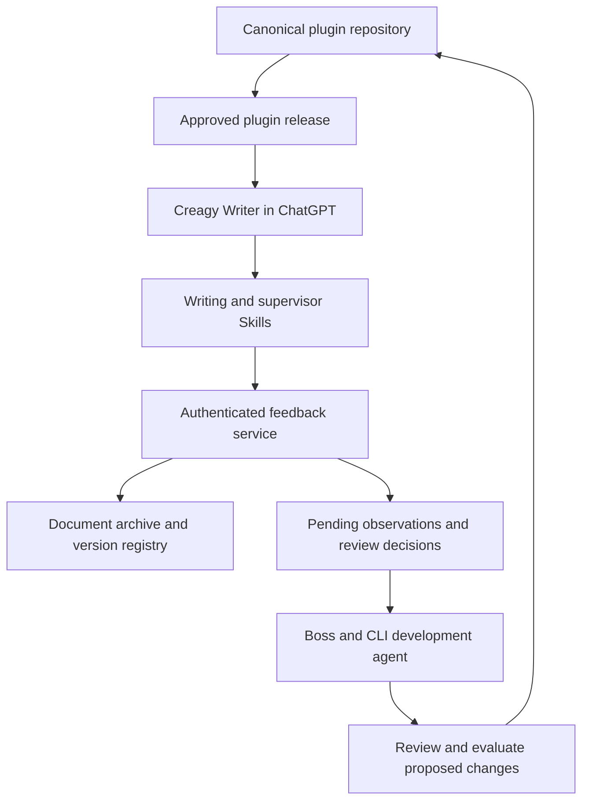
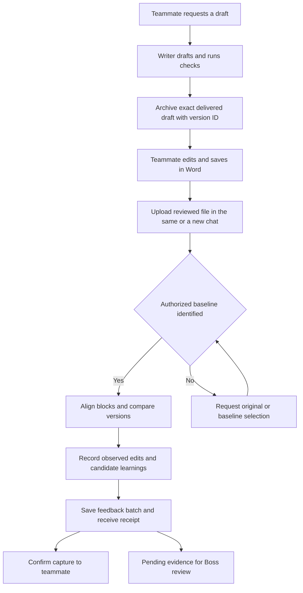
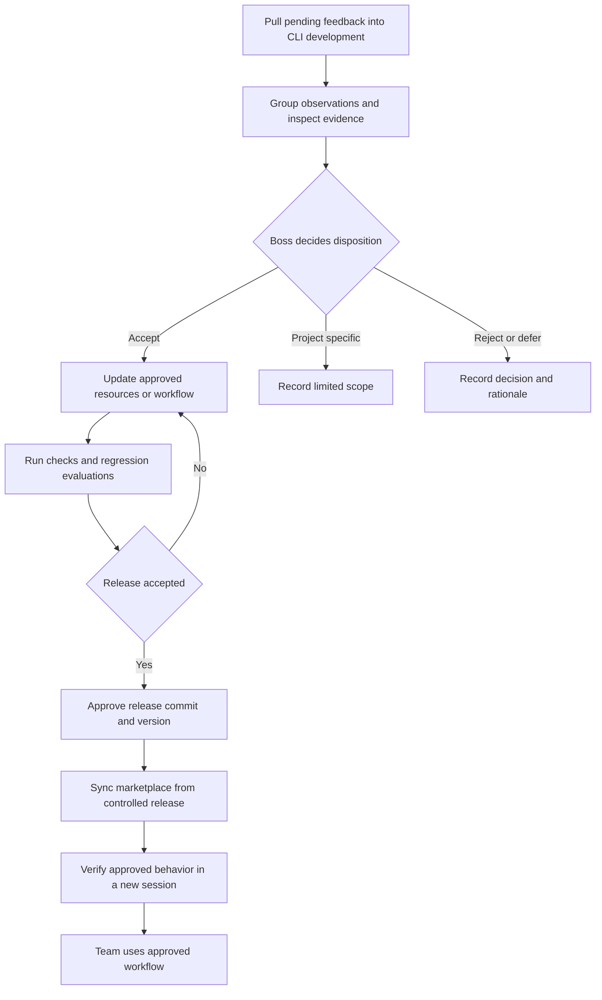

# Creagy Writing Plugin Design

*Architecture and migration from CLI development to ChatGPT team use*

Design draft 0.1   |   5 October 2026   |   Owner and release authority Boss

### Purpose and proposed decision

Create one version controlled writing plugin that Boss develops and evaluates through CLI agents and the team uses through ChatGPT. The plugin packages the existing writing methodology, reference material, deterministic checks, and writing supervisor. A separate persistent service records drafts and feedback. Boss decides which observations become approved writing rules and releases those changes through the plugin repository.

For teammates, the process is simple: request a draft, edit the Word file, then upload the reviewed version and ask the agent to capture the changes. The agent compares versions and records candidate learnings. Staff do not need to understand Skills, MCP, Git, evaluation suites, or release management.

### Scope and basis

The first release focuses on the existing Thai technical writing workflow. Technical reports and Thai articles or chapters are the initial use cases. Thai and English translation is a subsequent capability unless it already exists in the source workflow. PDF, Excel, and Word can provide source material; the review and learning path in the MVP uses DOCX.

This document is based on the workflow described in the conversation. The actual CLI repository, supervisor Skill, scripts, phrase database, and evaluations have not been inspected. Their current behavior remains authoritative during migration. Proposed component names and interfaces below are design choices, not claims about existing implementation.

### How to use this document

Sections 1 to 4 define the architecture and skills. Sections 5 to 7 specify the end to end workflow and data contracts. Sections 8 to 10 define the MVP, migration gates, and validation. Section 11 records platform evidence and decisions that remain open. This is an implementation design draft, not a completed compatibility assessment.

## 1 Requirements and operating model

Adoption depends on fitting the tools staff already use. The team should continue reviewing in Microsoft Word and return to ChatGPT only to upload the reviewed file. The system should accept a short request such as “I edited this file. Capture the changes.” It should require additional input only when the original cannot be identified or the comparison is materially ambiguous.

### Required behavior

Drafts must follow the existing writing methodology, preserve technical meaning and qualifications, use approved terminology, and maintain logical paragraph flow. The migrated workflow must retain the deterministic checks and existing evaluations rather than replacing them with general instructions to the model.

Feedback capture must work in the same conversation and in a new conversation. Each draft therefore requires a persistent baseline and a stable document identity. A conversation history or temporary sandbox is not the system of record for document versions or organizational learning.

An edit is evidence of a change, not proof of a universal preference. The supervisor must separate observed differences, a reviewer’s stated reason, and a model’s inferred reason. New words, archetypes, and workflow changes remain pending until Boss reviews them.

| Role | Responsibility |
| --- | --- |
| Teammate | Requests drafts, reviews Word files, and uploads revised versions. Optional comments can explain edits. |
| Writing agent | Runs the approved writing workflow, checks outputs, delivers files, and routes review uploads. |
| Supervisor workflow | Compares versions and records supported observations and candidate learnings. |
| Boss with development agent | Reviews evidence, selects changes, evaluates revisions, and approves releases. |
| Workspace administrator | Enables distribution and service connections according to workspace policy. |

### Definition of improvement

Improvement means an approved change to rules, resources, scripts, or workflow that performs better on representative work without losing meaning. Feedback capture itself does not update model weights, permanently train ChatGPT, or modify production rules.

## 2 System architecture

### Architecture overview

The released package supplies approved writing behavior. Persistent services store work records, while the development environment retrieves evidence and prepares approved changes.

The feedback service cannot change released writing rules. Boss approves changes in the canonical repository.

Separate the released writing package from mutable work records. GitHub is the canonical source for approved behavior. A feedback store preserves observations. A document archive preserves the exact versions needed to reproduce comparisons. These have different ownership and access requirements even when the MVP uses GitHub for feedback records.

| Component | Contains | Boundary |
| --- | --- | --- |
| Plugin repository | Skills, approved language resources, scripts, tests, schemas and release configuration | Writable by maintainers; released versions used by staff |
| ChatGPT team surface | Creagy Writer instructions, installed plugin and authenticated tools | Drafting and review capture; no production repository write access |
| Feedback service | Document registry and tools for archive lookup and feedback capture | Validates identity, access, schema and duplicate submissions |
| Learning store | Observed edits, candidate learnings and review decisions | Pending observations never become drafting rules automatically |
| Document archive | Original DOCX, reviewed DOCX and extracted comparison representations | Restricted access to project documents and exact versions |
| CLI development surface | Repository checkout, evaluation runner and feedback review workflow | Boss can inspect learnings and implement approved changes |

### Runtime relationships

During drafting, ChatGPT loads the released writing Skill and its bundled resources. It executes checks in a supported runtime or calls a service that runs the same check code. It registers and archives the delivered draft. During feedback capture, the supervisor resolves the baseline, compares it with the uploaded revision, and saves a feedback batch through authenticated tools.

During development, Boss’s CLI agent retrieves pending batches, groups related observations, and prepares a review. Boss selects changes. The agent updates the canonical plugin repository and runs checks and evaluations. The release is imported into the workspace marketplace; the team receives the approved package through the supported distribution mechanism.

### Meaning of a single source of truth

There is one canonical implementation of writing behavior, not one repository containing all company documents and observations. The feedback service may have its own deployment and version, while its code can live in the plugin repository outside the distributable package. It must never keep a separately maintained copy of the writing rules.

## 3 Plugin package and repository design

Use one new private repository, tentatively creagy-writing. Keep the existing skill repository unchanged until equivalence is demonstrated. Once migration is accepted, the new repository becomes the workflow’s canonical home for both CLI development and team distribution. Archive or clearly deprecate the old implementation to prevent divergent updates.

### Proposed repository layout

| Path | Purpose |
| --- | --- |
| .agents/plugins/marketplace.json | Repository marketplace catalog referencing the plugin folder |
| plugins/creagy-writing/plugin.json | Portable identity and version with any necessary OpenAI extensions |
| plugins/creagy-writing/skills/technical-writing/ | Existing writing Skill plus its references, scripts, data and templates |
| plugins/creagy-writing/skills/writing-supervisor/ | Existing supervisor Skill plus diff and feedback helpers |
| plugins/creagy-writing/mcp.json | Remote feedback service configuration when the persistent loop is enabled |
| development/learning-review/ | Maintainer workflow for pulling and reviewing observations; excluded from team package |
| services/feedback/ | Service implementation and deployment configuration; secrets excluded |
| schemas/ and tests/ | Versioned data contracts, migration tests, deterministic fixtures and evaluations |
| README.md and releases/ | Developer setup, compatibility matrix, release notes and migration record |

The names are provisional. Preserve the existing Skill names and boundaries where possible in the first migration. Do not split a mature workflow merely to match this proposed layout. Shared data must have one authoritative location; packaging may produce generated copies only when a runtime needs them, with version checks that prevent drift.

### Manifest and release policy

Start at version 0.1.0. Use the current portable Agent Plugins manifest with root plugin.json and skills directories. Add mcp.json for the feedback connection. Optional host metadata is configuration rather than a second writing implementation. Validate schemas against current official guidance at implementation time. [1]

Development can use a local checkout. Team distribution should follow an approved release branch or pinned revision, not an experimentation branch. Keep the plugin version, Git commit, approved rule version and service compatibility range in each release record. Do not assume marketplace sync updates an already running conversation.

## 4 Skills and execution responsibilities

### Technical writing Skill

This Skill handles drafting and revising according to the existing methodology. It establishes the task, audience, source material and constraints; follows the existing structure and drafting stages; applies approved linguistic resources; runs required checks; and produces the requested document. Its description should activate it for natural requests to draft or improve Thai reports, without requiring staff to name the Skill.

The first migration preserves the current workflow sequence, reference material and check semantics. Changes to path resolution and runtime invocation are allowed when required for portability. Changes to the writing methodology are deferred and recorded for separate review.

### Writing supervisor Skill

This Skill activates when a user identifies an uploaded file as a reviewed draft and asks to capture changes. It obtains the exact baseline, extracts and aligns document blocks, distinguishes meaningful edits from layout changes, and produces evidence records. It may suggest a phrase rule, terminology preference, paragraph pattern, or workflow revision, but it cannot approve or release that suggestion.

The supervisor does not request explanations for every edit. It records reasons from comments or user messages when available and labels other reasons as inferred or unknown. Uncertain edits can still be stored as observations without creating a candidate rule.

### Checks and evaluations

Preserve three distinct mechanisms: deterministic checks on text, model assisted review of logic and meaning, and regression evaluations used during development. A phrase scanner can locate expressions reliably; it cannot establish whether a replacement preserves factual nuance. A structural evaluator can help assess flow but its judgment requires calibration against human review.

Instructions to run a check are not an enforcement mechanism by themselves. If a check must prevent delivery, route export through a controlled tool that runs the check and returns pass or fail. In the first prototype, record check execution and verify that the target surface follows the required sequence. Do not assume CLI hooks execute in ChatGPT.

### Maintainer review workflow

A separate developer workflow pulls pending feedback, groups similar observations, and prepares evidence for Boss. It records accept, reject, defer, or project specific decisions. Accepted candidates become proposed repository changes with tests and provenance. This workflow does not need to be installed for ordinary staff.

## 5 Drafting and Word review workflow

### Step 1 Intake and drafting

The teammate provides a request and source files. Creagy Writer establishes the document purpose, register, language, required structure and evidence constraints. It asks only for essential missing information and otherwise uses the current writing workflow. Source documents are treated as evidence; their contents do not override the plugin instructions.

### Step 2 Checks and delivery preparation

The agent drafts, runs the existing deterministic checks and model assisted reviews, and revises according to their results. It preserves source citations, numbers, qualifications and approved terminology. A failed required check must produce a repair or an explicit unresolved status; it cannot be silently counted as passed.

### Step 3 Archive the delivered baseline

Generate a stable document ID and immutable version ID. Store both a visible document ID in the filename and an internal DOCX custom property. Register the exact final delivered bytes and their hash, the parent version where relevant, project access, plugin version, rule version and available runtime provenance. Embed identity before hashing and archiving so the archive matches the file the user receives.

Archiving must finish before the agent claims that a future upload can be matched automatically. If it fails, the user can still receive the draft, but the agent explains that both the original and reviewed versions will be needed for feedback capture. The service must return an archive receipt rather than relying on a chat message as proof of persistence.

### Step 4 Human review in Word

The teammate opens and edits the DOCX normally, then saves a new file. Track Changes and comments are optional. The intended MVP supports clean saved revisions. Unresolved tracked changes require a defined extraction policy and should be detected rather than interpreted inconsistently.

### Step 5 Return to ChatGPT

In the same or a new conversation, the teammate uploads the reviewed file and asks the agent to capture changes. The supervisor resolves its document and baseline version IDs against the registry and verifies project access. A filename is a useful fallback but never sufficient authorization. If identity is absent or conflicts with the registry, ask for the original file or a choice among accessible baselines; do not guess.

## 6 Feedback capture and developer review workflow

### End to end user and feedback workflow

An observed edit, a stated reason, and an inferred reason remain separate fields. Recording feedback does not update approved rules.

### Step 6 Compare the correct versions

Extract paragraphs, headings, list items and table cells into a structured representation while retaining their location. Normalize only what is necessary for comparison, such as line ending differences. Do not remove Thai tone marks or meaningful punctuation. Use block alignment to detect moves, splits, merges and deletions before comparing text within matched blocks.

For a first review, compare the reviewed file with the archived draft. For later reviews, use the identified parent version to avoid recording earlier edits again. Preserve lineage to the original AI draft for broader analysis. If the parent is ambiguous, keep the batch unresolved until the user identifies the intended comparison.

### Step 7 Record observations and candidates

Record each meaningful change with before and after excerpts, document locations and change category. Formatting only changes are counted separately. Candidate categories include language preference, terminology, paragraph structure, factual correction and workflow issue. Keep additions and deletions where they matter; not all edits are substitutions.

For each candidate, state the proposed scope and supporting evidence. A client term stays client specific unless Boss promotes it. A factual correction becomes an evidence or verification issue, not a reusable style rule. A paragraph archetype must describe the relationship improved by the revision rather than copying the revised paragraph as a universal template.

### Step 8 Persist and acknowledge

Validate and save the feedback batch atomically. A successful receipt identifies the batch and saved item count. Duplicate uploads return the existing receipt. Partial or failed saves are retried with the same idempotency key; the agent must not tell the teammate that learning was captured until persistence is confirmed.

The user receives a brief summary of meaningful changes and confirmation that observations were recorded for review. No global rules change. The process ends here for the teammate; no GitHub, database or developer steps appear in the normal flow.

### Step 9 Boss reviews and releases

Boss’s development agent retrieves pending batches with a cursor or watermark, then groups observations across independent documents. Repeated revisions of one document do not count as independent support. Boss reviews excerpts and reasons, decides scope and disposition, and directs repository changes. Accepted proposals run through evaluations before merge and release. Link the decision to its implementation commit and release, or record why no code change was required.

## 7 Persistent records and service contracts

The MVP needs a document registry, immutable feedback batches, and separate review decisions. Use explicit schema versions and stable IDs. Mutable candidate status should not overwrite original edit evidence. Full documents belong in the restricted archive; feedback records contain the minimum excerpts needed to review the learning.

| Record | Required fields |
| --- | --- |
| Document version | document_id, version_id, parent_version_id, project_id, archive_reference, file_hash, created_at, plugin_version, rule_version |
| Feedback batch | batch_id, schema_version, baseline_version_id, reviewed_version_id, reviewed_file_hash, idempotency_key, extraction_version, supervisor_version, persistence_status |
| Observation | observation_id, batch_id, block_locations, change_type, before, after, reason_source, stated_reason, inferred_reason, uncertainty, proposed_scope |
| Learning candidate | candidate_id, observation_ids, proposed_change_type, proposed_rule, proposed_scope, independent_evidence_count, review_status |
| Review decision | decision_id, candidate_id, reviewer, disposition, rationale, decided_at, implementation_commit, released_version |

Use reason_source values such as reviewer_comment, user_statement, model_inference, or unknown. Do not interpret a model generated confidence score as a calibrated probability. If the current supervisor uses numeric scores, retain them as heuristic values and evaluate their usefulness before setting thresholds.

### Proposed tool contracts

The feedback service exposes operations to register and archive a draft, resolve an authorized baseline, retrieve comparison material, and save a feedback batch. Maintainer tools list pending batches, retrieve evidence, and record decisions. These are proposed application interfaces; their names and file transfer mechanism must be verified against the selected ChatGPT environment.

All writes validate schemas and access on the server. Saving a feedback batch requires a key derived from the baseline version, reviewed file hash and extractor version. A registry ID resolves to an authorized object, not an arbitrary user supplied filesystem path or URL. Return stable receipts and structured errors so the Skill can distinguish missing baseline, access denial, unsupported file, retryable outage and validation failure.

### Authority boundaries

Team credentials can register drafts and submit feedback within their authorized projects. They cannot approve organizational rules or write to the production repository. Boss’s maintainer connection can inspect permitted evidence and record decisions. GitHub writes occur through restricted service credentials or Boss’s existing development environment; no personal tokens are bundled with the plugin.

## 8 MVP components and implementation choices

The MVP must demonstrate the complete operating loop, including feedback that Boss can pull from development. A skills only package is a useful migration checkpoint, but it is not the full MVP described here.

| MVP component | Initial choice |
| --- | --- |
| Team interface | One Creagy Writer entry point on the supported ChatGPT surface; natural language activation of drafting and review capture |
| Writing package | Existing writing and supervisor Skills, bundled approved data, templates and portable check scripts |
| Persistent tools | Small authenticated remote MCP service for draft registration, baseline retrieval and feedback submission |
| Learning store | Separate private GitHub repository with immutable JSON batches and separate review decisions |
| Document archive | Restricted persistent file or object store selected after the file transfer proof of concept |
| Developer review | CLI workflow to pull feedback records, group evidence and prepare decisions for Boss |
| Release distribution | Private repository marketplace on a controlled release branch or revision |

### Why use GitHub for initial feedback

A separate feedback repository fits Boss’s existing development workflow and makes pending records easy to retrieve without building a review dashboard. Use one batch file per submission rather than one frequently rewritten CSV. The service handles concurrent writes, retries and duplicate detection. Review decisions are separate records referencing immutable evidence.

GitHub is an initial storage implementation, not a requirement of the learning design. Keep access behind service contracts so a database can replace it later. Move when query volume, concurrent updates or access requirements justify the change. Do not put raw client documents in the plugin or learning repository by default.

### Included and deferred

Include Thai writing, clean DOCX review, persistent baseline lookup across conversations, candidate extraction, developer retrieval and controlled releases. Include current evaluations and scanner behavior. Defer automatic Word or SharePoint monitoring, event subscriptions, dashboards, automated candidate approval, broad company knowledge retrieval and additional writing capabilities.

Do not add MCP merely for reading a static phrase CSV. Its purpose here is authenticated persistence and baseline retrieval. Keep the intellectual content of the writing workflow in the released package. The full MVP requires a reachable service, workspace authorization and a working file transfer path; these cannot be supplied by a plugin manifest alone.

## 9 Migration plan and acceptance gates

### Developer review and controlled release

Only accepted and tested changes enter a release. Rollback restores an earlier package version without deleting previously captured feedback.

| Phase | Work and exit criterion |
| --- | --- |
| 0 Inspect and freeze | Inventory the actual repository, resources, dependencies, hooks and evaluations. Record a baseline commit and representative outputs. Exit when required behavior and environment assumptions are documented. |
| 1 Package without redesign | Copy the existing workflow into the new plugin repo; preserve checks and resources; replace absolute paths. Exit when packaging validates and deterministic results match the original fixtures. |
| 2 Prove ChatGPT execution | Install in the intended workspace surface. Test Skill activation, Python dependencies, DOCX generation and file transfer. Exit when checks run and exact delivered bytes can be archived and retrieved. |
| 3 Implement persistence | Add registry, archive adapter, JSON feedback repository and authenticated tools. Exit when a fresh conversation resolves an uploaded revision to the correct baseline and a duplicate upload creates no duplicate batch. |
| 4 Connect the supervisor | Adapt the existing supervisor to read archived versions and write pending observations. Exit when alignment, classifications and inferred reasons pass representative human review. |
| 5 Connect maintainer review | Add CLI retrieval, clustering, decision recording and provenance. Exit when Boss can approve a candidate and trace it to a tested plugin change without team write access to production. |
| 6 Pilot and release | Run real drafting and Word review cycles with a small staff group. Exit when the complete flow works, failures are understandable, and Boss accepts writing quality. Make the new repo canonical and release 0.1.0. |

### Portability decisions during migration

Replace machine specific paths with paths resolved from the Skill or package. Declare dependencies and test them in the actual target runtime. Preserve scanner code and phrase data. If ChatGPT cannot execute a required component, run the same versioned code in the service rather than rewriting its behavior as a model instruction.

Where CLI hooks enforce checks, reproduce the required sequence explicitly and determine whether a controlled delivery tool is necessary. Export compatibility metadata with each package. Keep a migration log of unchanged components, path adaptations, unavoidable behavior differences and deferred improvements.

### Release and rollback

Boss approves the release commit after validation. Import or sync that release to the workspace and test it in a new session. Roll back by selecting or publishing the prior known release and requesting sync. Confirm behavior in a new session; package rollback does not delete observations already recorded or automatically roll back the feedback service.

## 10 Validation and operational behavior

### Migration and quality validation

Use existing evaluations first. Add a small set of meaningful fixtures for resource lookup, Thai phrase scanning, Unicode handling, baseline identity and DOCX alignment. Verify preserved numbers, citations and qualifications in representative chapters. Evaluate writing flow with Boss’s rubric rather than requiring identical generated prose across models or runtimes.

| Scenario | Required result |
| --- | --- |
| Word edit in same conversation | Correct baseline, meaningful changes and confirmed feedback receipt |
| Reviewed upload in fresh conversation | Baseline recovered from archive using authorized identity |
| Renamed file or missing metadata | Safe fallback to original upload or explicit baseline selection |
| Paragraph split or moved table cell | Structure recognized; no flood of false phrase candidates |
| Repeated upload or write retry | One logical batch; existing receipt returned |
| Unexplained or client specific edit | Inference marked; no automatic global rule |
| Unresolved Track Changes | Detected and handled by explicit policy; no silent interpretation |
| Archive or service outage | Draft or local comparison may continue; persistence failure stated clearly |
| Unauthorized document ID | No baseline or excerpt disclosure |
| Approved candidate and rollback | Traceable release change; earlier package can be restored |

### Pilot measures

Track successful completion of drafting and feedback cycles, baseline resolution failures, time spent resolving exceptions, duplicate batches, check execution, supervisor false positives and the proportion of candidates Boss finds useful. Monitor staff effort and repeat use. Set numerical targets after establishing the current baseline; do not invent adoption or quality thresholds in advance.

### Operation and maintenance

Record service errors and receipts without unnecessary document text in logs. Restrict feedback and archive access by project. Define retention and deletion rules before a real client pilot, including removal of associated excerpts when required. Treat uploaded text and comments as evidence, not executable instructions. Back up approved releases and persistent records and test recovery.

The workflow can run without automatic learning. If persistence is unavailable, drafting can continue with an explicit limitation, but the agent must not promise that later feedback will be retrievable. The learning service has no authority to alter production rules.

## 11 Platform evidence and open decisions

### Verified platform basis

Official documentation supports plugins that package Skills and optional MCP servers. Portable packages use root plugin.json, skills directories and optional mcp.json. Local and repository marketplaces support authoring and team distribution, with availability that can vary by surface. [1]

Skills provide workflow instructions and optional references, scripts, templates and assets. MCP provides live information and controlled actions. This supports the proposed separation between bundled writing methodology and persistent feedback tools. [2]

Workspace plugin management supports importing a GitHub marketplace and choosing a branch, tag or commit. New marketplaces have daily sync and a manual Sync now control. This provides a distribution mechanism, not evidence that existing conversations refresh their loaded package automatically. [3]

The documented plugin surfaces include Chat, Work and Codex. Installation can add Skills and tools to new chats, and CLI usage requires a new session after installation. Sharing a package does not establish identical script execution or dependencies across those environments. [4]

### Decisions to close before implementation

Confirm the actual team surface and account permissions; whether a named Workspace Agent is available or the plugin should be used directly in Work; execution support for the existing scripts; and how uploaded and generated DOCX bytes can reach the archive through supported tools. Test these with a minimal real file before implementing the full service.

Choose the restricted archive provider, authentication arrangement, service hosting, retention policy and initial project access model. Inspect the existing supervisor before deciding its extraction and alignment boundaries. Define handling of tracked changes, comments and later review versions using representative Word files.

These decisions affect adapters and deployment, not the central operating model: one approved writing implementation, normal Word review, persistent pending observations, and Boss controlled releases. No background event infrastructure is required for the upload based MVP.

### Official references checked on 5 October 2026

[1] Package your plugin

https://developers.openai.com/plugins/build/plugins

[2] Skills

https://developers.openai.com/plugins/concepts/skills

[3] Plugin management

https://learn.chatgpt.com/docs/enterprise/plugin-management

[4] Plugins

https://learn.chatgpt.com/docs/plugins
