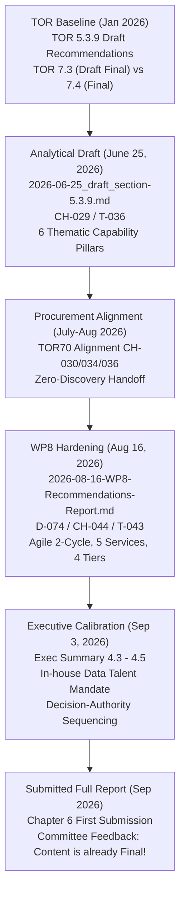

# Trace Log: CRDB Chapter 6 Recommendations Development History & Line-Drawing

**Query**: Evolution and Ancestry of CRDB Recommendations (TOR 5.3.9 vs Chapter 6 vs Chapter 7.3)  
**Date**: 2026-10-26 11:15 +07:00  
**Oracle**: Arun (It) | **Human**: Boss (He/Him)  
**Friction Score**: 0.90 (Source: 1.0 Oracle/Ledgers; Completeness: high +0.00; Clamped: 0.90)  
**Coverage**: `oracle`, `files`, `git`, `project-ledgers` (Evidence-Registry, Trigger-Log, Change-Log, Deliverable-Map, Submission-Log)  

---

## 1. Goal-Backward Evaluation
- **Question**: Where did each component of the recommendations in Chapter 6 originate, how did they evolve across project ledgers, and where should the line be drawn between Chapter 6 (Draft Version) and Chapter 7 (Final Version)?
- **Answer Confidence**: High (Fully answered and verified against primary git history, ledger entries `CH-001` through `CH-046`, `D-001` through `D-079`, and dated draft artifacts from June 2026, August 2026, and September 2026).

---

## 2. Forensic Timeline of Recommendations

---

## 3. Detailed Component Ancestry Across Project Ledgers

| Recommendation Component in Current Chapter 6 | Original Draft Stance (June 25, 2026 Draft) | Mid-Sprint Evolution (August 16, 2026 WP8) | Final Hardened Stance (September 2026) | Primary Ledger References |
|---|---|---|---|---|
| **6.1 Blueprint & SDLC Lifecycle** | General 3-stage lifecycle concept. | 7-stage lifecycle (`WP8` §1); UK GDS Agile model (`E-088`). | 6-Phase SDLC framework (70%/80% completion) + 8 Handover Elements in Appendix ฌ; Content Writer vs Developer roles. | `CH-013`, `CH-014`, `D-031`, `D-076`–`D-079`, `crdb-exec-summary-4.3`. |
| **6.2 Rec 1: Internal Governance Structure** | 6 operational governance elements; broad committee for "Institutional Shield". | 4-tier model (Committee, Data Owner, Data Steward, Data Custodian) tied to 260 datasets. | Prioritized as Recommendation #1 due to 100% internal decision authority. | `T-001`, `D-011`, `CH-029`, `CH-040`, `D-074`, `crdb-exec-summary-4.4`. |
| **6.2 Rec 2: In-House Data Talent** | General resources: Domain experts, cloud computing, and international climate finance (GCF/GEF). | Not separated; implied under departmental resources and capacity. | **Boss-directed structural pivot**: Dedicated Recommendation #2. Contrasts Data Engineers/Analysts/Managers with traditional IT infrastructure staff. | `CH-029` §6, `plan-slice.md` §4 (2026-09-03), `crdb-exec-summary-4.4`. |
| **6.2 Rec 3: Procurement Scope, 5 Services & Agile** | Service portfolio with 4 broad categories (Reference data, Spatial risk, Financial/budget, Uncertainty). | 9 service business cases (`D-071`); 5 priority services selected for next contract (`D-074`). | 5 Services (3 existing + 2 new: A-BTR, Loss/Damage MVP with NESDC) + Data Catalog + Agile 2-cycle build with mid-contract beta. | `CH-015`, `CH-016`, `CH-022`, `CH-042`, `CH-044`, `D-071`, `D-074`. |
| **6.2 Rec 4: Bilateral Data Agreements** | Broad technical partnerships (data sharing, method co-creation, service co-design). | Standing bilateral agreements with 6 key agencies. | 5 Priority Agencies holding 97 datasets (37% of 260) based on `data_catalog_v4.csv`; demand-driven intake principle. | `CH-029`, `CH-038`, `CH-044`, `D-060`, `D-074`. |
| **6.3 Implementation Roadmap** | 3 chronological phases (Credibility -> Connectivity -> Systemic scale). | First 6 months vs beyond (`WP8` §5). | Two-Track Parallel Plan: Track 1 (Vendor TOR specifications) + Track 2 (8 DCCE Internal Governance Tasks: 4 short-term ≤6 months, 4 medium-term 1–3 years). | `CH-029` §7, `D-074` §5, `crdb-exec-summary-4.5`. |

---

## 4. Line-Drawing Proposal

1. **Chapter 6: (Draft) Policy and Technical Recommendations (ฉบับ (ร่าง) ตาม TOR 5.3.9)**:
   - Restore the analytical, capability-building framing from the June 25, 2026 draft (`2026-06-25_draft_section-5.3.9.md`).
   - Structure around the **6 Thematic Analytical Pillars**:
     1. Internal Data Governance & Institutional Shield
     2. Service Portfolio Management (4 core service domains)
     3. 5-Layer Technical Standards (Metadata, API, Risk Methodology Catalog, Science-to-Decision, Uncertainty Communication)
     4. Technical Partnerships & Co-Development
     5. Competitive Positioning (National Certifier, Translator, Integrator, Institutional Shield Provider)
     6. Resources, Infrastructure, and Initial Capacity Development
   - Close with the analytical 3-phase developmental horizon.

2. **Chapter 7 (Section 7.3): Final Policy and Technical Recommendations (ฉบับสมบูรณ์)**:
   - Present the hardened, procurement-ready operational package developed in August–September 2026:
     - 6-Phase SDLC positioning & 8 Handover Elements
     - 4 Actionable Recommendations ordered strictly by DCCE's decision authority (Governance -> In-House Data Talent -> Agile RFP with 5 Priority Services & NESDC MVP -> 5 Bilateral Agency Agreements)
     - 2-Track Implementation Roadmap (Vendor TOR track + 8 Governance Tasks over 6 months / 1–3 years).
